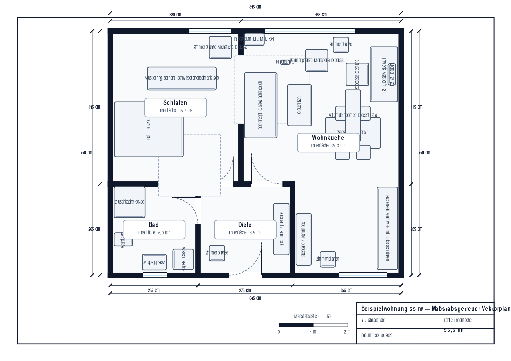

# 3D-Wohnungsvisualisierung & Raumplaner (cm-genau)

> Zentimetergenaue (`1 Three.js Unit = 1 cm`) 2D-/3D-Wohnungsvisualisierung und Möbelstellprobe mit **Three.js**, **React Three Fiber**, **TypeScript**, **Zustand** und einer integrierten **Karpathy LLM-Wiki-Wissensdatenbank**.

[](https://github.com/dksHyrion/wohnung-3d-planner/actions/workflows/ci.yml)
[](https://dkshyrion.github.io/wohnung-3d-planner/)
[](LICENSE)

👉 **[Interaktive Live-Demo im Browser starten](https://dkshyrion.github.io/wohnung-3d-planner/)**

> [!NOTE]
> **Für Desktop & große Bildschirme:** Diese App ist für die präzise 2D/3D-Raumplanung mit Maus und Tastatur an großen Bildschirmen konzipiert und **nicht für Mobilgeräte optimiert**. Auf dem Smartphone lässt sich die Anwendung nicht bedienen.

<p align="center">
  <a href="https://dkshyrion.github.io/wohnung-3d-planner/">
    
  </a>
  <br/>
  <em>Maßstabsgetreuer 1:50 Architektur-Plan mit DIN-Plankopf, 90°-Türschwenkbögen, Möblierung und Lichter Innenfläche (Beispielwohnung 55 m²)</em>
</p>

---

## 1. Schnellstart

### A. Lokaler Start (macOS / Linux / Windows)
```bash
# Repository klonen
git clone https://github.com/dksHyrion/wohnung-3d-planner.git
cd wohnung-3d-planner

# Abhängigkeiten installieren und Dev-Server starten
npm install
npm run dev
```
Im Browser öffnen: 👉 **`http://localhost:5173`**

### B. Remote-Start auf einem VPS (mit SSH-Portweiterleitung)

1. **Auf dem Server starten:**
   ```bash
   npm run dev -- --host 127.0.0.1 --port 5173
   ```

2. **Verbindung herstellen:**
   * **macOS & Linux (Terminal):**
     ```bash
     ssh -L 5173:127.0.0.1:5173 <user>@<vps-host>
     ```
   * **Windows (PowerShell):**
     ```powershell
     ssh -L 5173:127.0.0.1:5173 <user>@<vps-host>
     ```

3. Im lokalen Browser öffnen: 👉 **`http://localhost:5173`**

### C. Tests & Production-Build
```bash
npm test         # Vitest-Testsuite
npm run build    # Production-Build in dist/ (TypeScript + Vite)
```

---

## 2. Kern-Features & Highlights

* **🏢 Mehrgeschossigkeit, Decken & Parametrische Treppen (Sprints 12–14):**
  * Beliebige Etagen-Stapelung (`UG`, `EG`, `1. OG`, `DG` …) mit FOK-Höhenführung (`elevationCm`), lichter Geschosshöhe, Deckenstärke und optionaler Übernahme der Außenwände.
  * 2D-Geisterlinie (`showGhostBelow2D`) zum Durchpausen des darunterliegenden Geschosses und flexible 3D-Ansichtsmodi (*Alle gestapelt*, *Nur aktives*, *Aktiv + Geist darunter*).
  * Parametrische Treppen (`straight`, `l-shaped`, `u-shaped`) mit Live-**DIN-18065-Schrittmaßprüfung** (`2s + a`), Geländerpfosten, DIN-2D-Lauflinie und automatischen **Decken-Ausschnitten (`THREE.Shape.holes`)** durch obere Geschossdecken.

* **📐 Präziser 2D-Grundriss-Editor & Multi-Selektion:**
  * cm-genaues Arbeiten mit Fangrastern (1, 5, 10, 25 cm), 90°-Orthogonal-Winkelfang, numerischer Längen-Eingabe und Polyline-Zeichnen.
  * Dynamische Wand-/Eckpunkt-Topologie, seitengetrennte Wandbeläge (`posFinish` / `negFinish`: Putz, Akzentfarbe, Holzlamellen, Fliesen, Mikrozement, Marmor) und automatische Netto-Raumstempel (**Lichte Innenfläche** in m²).
  * 5 architektonische Wandöffnungen: Türen (mit 90°-Schwenkbogen), Fenster (inkl. 3D-Fensterrahmen & Griff), Schiebetüren, Durchgänge und Balkontüren.
  * Dachschrägen (`RoofSlope`) mit 1 m / 2 m Konturlinien und automatischer **Dachschrägen-Flächenanrechnung (100 % / 50 % / 0 %)** sowie Haustechnik-Elemente (Heizkörper, Steckdosen, Schalter, Daten-/Wasseranschlüsse, Schächte).
  * Multi-Selektion per `Shift+Klick` und 2D-Marquee-Auswahlrahmen plus interaktive **3D-Transform-Gizmos** (Rotations-Ring & vertikaler Höhen-Handle).

* **🛋️ Möbel-Inventar, Custom-`.glb`-Upload & A/B-Varianten:**
  * Über 30 detailgetreue parametrische 3D-Architekturmodelle (inkl. BoConcept Osaka mit klappbarer Schlafsofa-Pose, Inwerk Masterlift, Vitsœ 606, Küchen & Bad-Objekte).
  * Eigener **Custom-`.glb`-Möbelimport** mit automatischer m→cm-Skalierung und Offline-IndexedDB-Speicherung (`customModelStore`).
  * Surface Stacking (`attachedToId`), interaktiver Teppich-Editor (`AreaRug`) sowie **A/B-Stellproben-Varianten** mit 2D/3D-Ghost-Diff-Vergleich.

* **⚡ Kollisions- & Ergonomie-2.0-Engine (WebWorker, DIN 18040 & Neufert):**
  * Etagen-isolierte 3D-Kollisionsboxen (`THREE.OBB`), SAT, hohle Wandöffnungs-Subsegmente, Treppenschacht-Prüfung, Dachschrägen-Höhencheck und 30-cm-Heizkörper-Wärmestau.
  * **Ergonomie 2.0 im WebWorker** (non-blocking): 2D-EDT-Erreichbarkeit ab Eingang/Treppe (auch geschossübergreifend), C-Space-Möbel-Lieferweg, DIN 18040-2 150-cm-Wendekreis, Stuhl-Rückzugsraum, Klapp-Simulation sowie Blendungs-/Sichtachsen-Check.
  * Magnetisches Kante-an-Kante-Snapping und Smart Alignment Guides in 2D und 3D.

* **🎨 Cinematische Archviz-Beleuchtung & WASD-Begehung (100 % Offline):**
  * Stufenlose Tageszeit-Engine (6:00 bis 22:00 Uhr), autarkes Lightformer-IBL (keine externen CDN-Downloads), N8AO Ambient Occlusion, Selective Bloom, AgX-Tonemapping und `⚡ Performance`-Modus.
  * Interaktive **WASD-/Pfeiltasten-Ego-Begehung** auf einstellbarer Augenhöhe (170 cm / 115 cm) inkl. Türdurchgang und Wandgleiten.

* **📏 CAD-Import, Maßband & Multi-Format-Export (SVG, DXF, BOM, GLB, USDZ):**
  * **Strukturierter CAD-/Scan-Import:** ASCII-DXF (`LINE`/`LWPOLYLINE`/`POLYLINE`), Vektor-SVG (`M/L/H/V/Z`) und Apple RoomPlan `CapturedRoom`-JSON mit automatischer Topologie-Verschmelzung.
  * Grundriss-Unterleger (PNG, JPG, WebP, SVG) mit 2-Punkt-Referenzkalibrierung und IndexedDB-Speicherung sowie freies 2D-Maßband.
  * **Exporte:** Maßstabsgetreues **1:50 / 1:100 / 1:200 SVG** (inkl. Etagentitel & Treppen), **AutoCAD R12 DXF** (Layer `WALLS`, `OPENINGS`, `STAIRS`, `MEP`, `FURNITURE`, `DIMENSIONS`), **CSV/Markdown-Stück- & Flächenbilanz** pro Geschoss sowie **`.glb` & `.usdz` (AR)** im korrekten Meter-Maßstab (`1 cm -> 0.01 m`).

* **🛡️ Session-Sicherheit, URL-Sharing & Privatsphäre:**
  * 30-Schritt-Undo/Redo (`Ctrl+Z` / `Ctrl+Y`), LocalStorage-Autosave, komprimiertes **URL-Hash-Sharing** (`#plan=gz:...`) und portabler JSON-Import/-Export.
  * 100 % lokal und privat: Keine Serverübertragung, private Pläne im git-ignorierten Ordner `privat/`.

---

## 3. Tech-Stack

| Bereich | Eingesetzte Frameworks & Tools |
| :--- | :--- |
| **3D & Rendering** | **Three.js (r170)**, **React Three Fiber (`@react-three/fiber`)**, **`@react-three/drei`** |
| **Post-Processing** | **`@react-three/postprocessing`** (N8AO, Selective Bloom, AgX Tonemapping, SMAA) |
| **Geometrie & Mathe** | **`THREE.OBB`** + SAT + 2D-EDT + WebWorker (`ergonomicsWorker`) |
| **Frontend & UI** | **React 18**, **TypeScript 5**, **Zustand 5** (Domain-Slices), **Lucide React**, **DE/EN i18n** |
| **2D-Engine & Exporte** | Natives React + SVG, `GLTFExporter` / `USDZExporter`, AutoCAD R12 DXF, RFC-4180 CSV/BOM |
| **Build & Testing** | **Vite 5**, **Vitest 2** (80 Suites / 696 Tests), **Playwright** (E2E) |
| **Wissensbasis** | **Karpathy LLM-Wiki Pattern** (`SCHEMA.md`, `raw/`, `wiki/index.md`, `wiki/log.md`) |

---

## 4. Projektübersicht

```text
wohnung-3d-planner/
├── src/
│   ├── core/         # Geometrie, Mehrgeschossigkeit, Treppen/Decken, SAT/OBB-Kollision, Ergonomie-Worker, CAD-Import/-Export
│   ├── store/        # Zustand-Store (Slices: wall, furniture, rug, level, stair, variant, preset; view, history)
│   ├── i18n/         # Vollständig typisierte DE/EN-Übersetzungen (100 % Key-Parität)
│   └── components/   # 2D-SVG-Canvas, 3D-R3F-Szene, Treppen/Decken, Beleuchtung & Inspektoren
├── tests/            # 80 Vitest-Testdateien (Geometrie, Mehrgeschossigkeit, Treppen, Kollision, Ergonomie, Exporte)
├── e2e/              # Playwright End-to-End Browser-Tests
├── wiki/             # Vernetzte LLM-Wissensbasis (Konzepte, Architektur, Audit-Log)
├── raw/              # Referenz-Quellen und GitHub-Benchmark-Dokumentation
├── privat/           # Lokale private Pläne & Notizen (in .gitignore)
├── AGENTS.md         # Richtlinien & Architektur-Invarianten für KI-Coding-Agenten
└── CLAUDE.md         # Projekt-Kommandos & Architektur-Leitfaden
```

---

## 5. Lizenz

Veröffentlicht unter der [MIT License](LICENSE).
