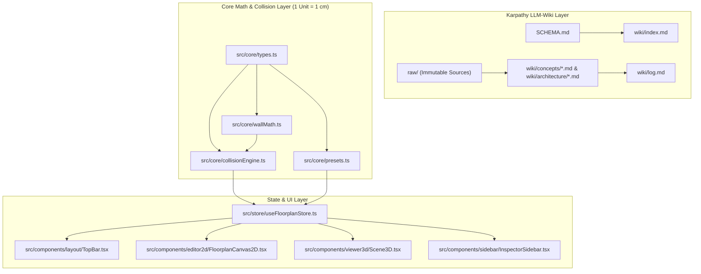

# 3D-Wohnungsvisualisierung & Karpathy LLM-Wiki Implementation Plan

> **For agentic workers:** REQUIRED SUB-SKILL: Use superpowers:subagent-driven-development to implement this plan task-by-task. Steps use checkbox (`- [ ]`) syntax for tracking.

**Goal:** Build a hybrid Karpathy LLM-Wiki knowledge base (`SCHEMA.md`, `raw/`, `wiki/`) and a centimeter-accurate 2D/3D apartment & furniture planner web application in `/home/agy/Wohnung` using Vite, React, TypeScript, Three.js (`THREE.OBB`), React Three Fiber, and Zustand.

**Architecture:** The repository combines an LLM-maintained Markdown knowledge base at the root (`SCHEMA.md`, immutable `raw/` sources, and interlinked `wiki/` pages with `index.md` and `log.md`) with a modular TypeScript web application (`src/`). All spatial coordinates and dimensions use the strict convention `1 Three.js unit = 1 cm` with a collision tolerance of `EPSILON_CM = 0.05`. Pure geometry and collision functions (`src/core/`) are decoupled from the UI and verified with Vitest unit tests before wiring into the Zustand state store (`src/store/`) and synchronized 2D SVG / 3D React Three Fiber viewports (`src/components/`).

**Architecture Diagram:**



**Tech Stack:** TypeScript 5, Vite 6, React 18, Three.js (`three`, `@types/three`, `three/addons/math/OBB.js`), `@react-three/fiber`, `@react-three/drei`, `zustand`, `lucide-react`, `vitest`.

**Spec:** [2026-10-20-3d-wohnungsvisualisierung-design.md](file:///home/agy/Wohnung/docs/superpowers/specs/2026-10-20-3d-wohnungsvisualisierung-design.md)

## Global Constraints

- Coordinate scale across all files: `1 unit = 1 cm` (`X` = left-to-right cm, `Z` = top-to-bottom floor depth cm, `Y` = vertical height from floor cm).
- Numerical collision tolerance: `EPSILON_CM = 0.05` (`0.5 mm`) so flush placement against walls and neighboring furniture does not trigger false collisions.
- Minimum valid wall length: `10 cm`; minimum valid furniture dimension: `1 cm`.
- Every file in `raw/` is immutable once created; every wiki modification must keep `wiki/index.md` and `wiki/log.md` in sync as defined in `SCHEMA.md`.

---

### Task 1: Project Scaffolding & Karpathy LLM-Wiki Knowledge Base

**Files:**
- Create: `package.json`
- Create: `tsconfig.json`
- Create: `vite.config.ts`
- Create: `SCHEMA.md`
- Create: `raw/2026-10-20-threejs-research-report.md`
- Create: `raw/furniture-specs/din-and-neufert-standards.md`
- Create: `wiki/index.md`
- Create: `wiki/log.md`
- Create: `wiki/concepts/coordinate-system-cm.md`
- Create: `wiki/concepts/wall-graph-topology.md`
- Create: `wiki/concepts/collision-detection.md`
- Create: `wiki/architecture/app-state-and-views.md`
- Test: `tests/wikiStructure.test.ts`

**Interfaces:**
- Consumes: Design specification [2026-10-20-3d-wohnungsvisualisierung-design.md](file:///home/agy/Wohnung/docs/superpowers/specs/2026-10-20-3d-wohnungsvisualisierung-design.md)
- Produces: Installed npm dependencies (`three`, `react`, `@react-three/fiber`, `@react-three/drei`, `zustand`, `vitest`) and verified Karpathy LLM-Wiki directory layout (`SCHEMA.md`, `raw/`, `wiki/index.md`, `wiki/log.md`, interlinked concept pages).

- [ ] **Step 1: Create `package.json`, `tsconfig.json`, `vite.config.ts`, and install dependencies**

Create [package.json](file:///home/agy/Wohnung/package.json):
```json
{
  "name": "wohnung-3d-planner",
  "private": true,
  "version": "0.1.0",
  "type": "module",
  "scripts": {
    "dev": "vite",
    "build": "tsc -b && vite build",
    "preview": "vite preview",
    "test": "vitest run"
  },
  "dependencies": {
    "@react-three/drei": "^9.114.0",
    "@react-three/fiber": "^8.17.10",
    "lucide-react": "^0.454.0",
    "react": "^18.3.1",
    "react-dom": "^18.3.1",
    "three": "^0.170.0",
    "zustand": "^5.0.1"
  },
  "devDependencies": {
    "@types/node": "^22.8.0",
    "@types/react": "^18.3.12",
    "@types/react-dom": "^18.3.1",
    "@types/three": "^0.170.0",
    "@vitejs/plugin-react": "^4.3.3",
    "typescript": "^5.6.3",
    "vite": "^5.4.10",
    "vitest": "^2.1.4"
  }
}
```

Create [tsconfig.json](file:///home/agy/Wohnung/tsconfig.json):
```json
{
  "compilerOptions": {
    "target": "ES2022",
    "useDefineForClassFields": true,
    "lib": ["ES2022", "DOM", "DOM.Iterable"],
    "module": "ESNext",
    "skipLibCheck": true,
    "moduleResolution": "bundler",
    "allowImportingTsExtensions": true,
    "isolatedModules": true,
    "moduleDetection": "force",
    "noEmit": true,
    "jsx": "react-jsx",
    "strict": true,
    "noUnusedLocals": false,
    "noUnusedParameters": false,
    "noFallthroughCasesInSwitch": true
  },
  "include": ["src", "tests"]
}
```

Create [vite.config.ts](file:///home/agy/Wohnung/vite.config.ts):
```typescript
import { defineConfig } from 'vite';
import react from '@vitejs/plugin-react';

export default defineConfig({
  plugins: [react()],
});
```

- [ ] **Step 2: Write the failing test `tests/wikiStructure.test.ts`**

Create [tests/wikiStructure.test.ts](file:///home/agy/Wohnung/tests/wikiStructure.test.ts):
```typescript
import { describe, it, expect } from 'vitest';
import fs from 'node:fs';
import path from 'node:path';

const ROOT = path.resolve(__dirname, '..');

describe('Karpathy LLM-Wiki Structure', () => {
  it('contains SCHEMA.md, raw/, wiki/index.md, and wiki/log.md', () => {
    expect(fs.existsSync(path.join(ROOT, 'SCHEMA.md'))).toBe(true);
    expect(fs.existsSync(path.join(ROOT, 'raw/2026-10-20-threejs-research-report.md'))).toBe(true);
    expect(fs.existsSync(path.join(ROOT, 'raw/furniture-specs/din-and-neufert-standards.md'))).toBe(true);
    expect(fs.existsSync(path.join(ROOT, 'wiki/index.md'))).toBe(true);
    expect(fs.existsSync(path.join(ROOT, 'wiki/log.md'))).toBe(true);
  });

  it('indexes all wiki concept and architecture pages in wiki/index.md with valid relative links', () => {
    const indexContent = fs.readFileSync(path.join(ROOT, 'wiki/index.md'), 'utf-8');
    const expectedPages = [
      'concepts/coordinate-system-cm.md',
      'concepts/wall-graph-topology.md',
      'concepts/collision-detection.md',
      'architecture/app-state-and-views.md',
    ];

    for (const relPath of expectedPages) {
      expect(indexContent).toContain(relPath);
      const fullPath = path.join(ROOT, 'wiki', relPath);
      expect(fs.existsSync(fullPath)).toBe(true);
    }
  });
});
```

- [ ] **Step 3: Install packages and run test to verify it fails**

Run: `npm install && npm test -- tests/wikiStructure.test.ts`
Expected: FAIL because `SCHEMA.md`, `raw/`, and `wiki/` files do not exist yet.

- [ ] **Step 4: Create `SCHEMA.md`, `raw/` sources, and `wiki/` pages**

Create [SCHEMA.md](file:///home/agy/Wohnung/SCHEMA.md):
```markdown
# LLM-Wiki Schema: 3D-Wohnungsvisualisierung (`Wohnung`)

Dieses Repository folgt Andrej Karpathys **LLM-Wiki-Pattern** ([Gist 442a6bf555914893e9891c11519de94f](https://gist.github.com/karpathy/442a6bf555914893e9891c11519de94f)) kombiniert mit einer ausführbaren Three.js/React-Three-Fiber-Anwendung (`src/`).

## 1. Architektur der Wissensbasis

- **`raw/` (Immutable Source Layer):** Unveränderliche Rohdokumente, Rechercheberichte, Messprotokolle der Wohnung und Möbel-Datenblätter. Der Agent liest aus `raw/`, verändert bestehende Dateien dort aber niemals.
- **`wiki/` (Compiled Knowledge Layer):** Vom Agenten verwaltete, untereinander verlinkte Markdown-Seiten.
  - **`wiki/index.md`:** Zentrales Inhaltsverzeichnis aller Wiki-Seiten mit je einer Kurzbeschreibung pro Eintrag.
  - **`wiki/log.md`:** Chronologisches Append-Only-Protokoll aller Ingest-, Query-, Lint- und Architektur-Updates.
  - **`wiki/concepts/`:** Fachliche und mathematische Konzepte (`1 Unit = 1 cm`, Wand-Graph, 1D-Skalarprodukt-Prüfung, 3D-OBB-Kollisionen).
  - **`wiki/architecture/`:** Technische Dokumentation der Web-App (`src/core`, `src/store`, `src/components`).

## 2. Agent-Workflows

1. **Ingest:** Wenn eine neue Datei in `raw/` abgelegt wird (z. B. echte Raummaße oder ein Möbelkatalog), liest der Agent die Quelle, aktualisiert oder erstellt die passenden Konzeptseiten in `wiki/`, ergänzt `wiki/index.md` und schreibt einen datierten Eintrag an das Ende von `wiki/log.md`.
2. **Query:** Bei Fragen zum Projekt liest der Agent zuerst `wiki/index.md`, navigiert gezielt zu den verlinkten Wiki-Seiten und antwortet mit Quellenverweisen auf `wiki/` und `src/`.
3. **Lint:** Prüft regelmäßig, ob alle Links in `wiki/index.md` auf existierende Dateien zeigen, ob Formeln in `wiki/concepts/` mit dem Code in `src/core/` übereinstimmen und ob verwaiste Seiten existieren.
```

Create [raw/2026-10-20-threejs-research-report.md](file:///home/agy/Wohnung/raw/2026-10-20-threejs-research-report.md) with the complete findings from our initial Three.js floorplan and collision research (including the RoomSketcher and ArchDaily reference URLs, `furnishup/blueprint3d`, `cvdlab/react-planner`, `checkWallFitCm` dot-product formula, and `THREE.OBB`).

Create [raw/furniture-specs/din-and-neufert-standards.md](file:///home/agy/Wohnung/raw/furniture-specs/din-and-neufert-standards.md) containing standard German interior dimensions in `cm` (standard interior wall height `250 cm`, wall thickness `15 cm` / `24 cm`, door widths `86 cm` / `73.5 cm` with `200 cm` height, window sill height `90 cm`, minimum passage clearance `80 cm`, standard wardrobe depth `60 cm`, sofa depths `90–100 cm`, bed sizes `140×200 cm`, `180×200 cm`).

Create [wiki/index.md](file:///home/agy/Wohnung/wiki/index.md), [wiki/log.md](file:///home/agy/Wohnung/wiki/log.md), [wiki/concepts/coordinate-system-cm.md](file:///home/agy/Wohnung/wiki/concepts/coordinate-system-cm.md), [wiki/concepts/wall-graph-topology.md](file:///home/agy/Wohnung/wiki/concepts/wall-graph-topology.md), [wiki/concepts/collision-detection.md](file:///home/agy/Wohnung/wiki/concepts/collision-detection.md), and [wiki/architecture/app-state-and-views.md](file:///home/agy/Wohnung/wiki/architecture/app-state-and-views.md) cross-linking to each other and to `raw/`.

- [ ] **Step 5: Run test to verify it passes and commit**

Run: `npm test -- tests/wikiStructure.test.ts`
Expected: PASS (2 passing tests).

```bash
git add package.json package-lock.json tsconfig.json vite.config.ts SCHEMA.md raw/ wiki/ tests/wikiStructure.test.ts
git commit -m "feat: initialize project and Karpathy LLM-Wiki knowledge base"
```

---

### Task 2: Core Types & 1D Wall Geometry / Fit Math (`src/core/types.ts`, `src/core/wallMath.ts`)

**Files:**
- Create: `src/core/types.ts`
- Create: `src/core/wallMath.ts`
- Test: `tests/wallMath.test.ts`

**Interfaces:**
- Consumes: `three` (`THREE.Vector3`, `THREE.MathUtils`)
- Produces:
  - `src/core/types.ts`: `EPSILON_CM`, `Corner`, `Wall`, `WallOpening`, `FurnitureItem`, `CollisionIssue`, `FurnitureCollisionReport`, `ViewMode`, `EditorTool`, `FloorplanData`
  - `src/core/wallMath.ts`:
    - `getWallGeometry(start: Corner, end: Corner): { lengthCm: number; tangent: { x: number; z: number }; normal: { x: number; z: number }; angleRad: number; centerX: number; centerZ: number }`
    - `setWallLengthCm(start: Corner, end: Corner, targetLengthCm: number): { x: number; z: number }`
    - `checkWallFitCm(start: Corner, end: Corner, wall: Wall, openings: WallOpening[], furniture: FurnitureItem, toleranceCm?: number): { fitsOnWall: boolean; issues: CollisionIssue[]; clearancesCm: { leftCm: number; rightCm: number }; projectionCenterCm: number }`
    - `findWallSnap(furniture: FurnitureItem, corners: Corner[], walls: Wall[], snapThresholdCm?: number): { snappedWallId: string; x: number; z: number; rotationYDeg: number } | null`
    - `shouldCutawayWall(start: Corner, end: Corner, cameraPos: { x: number; y: number; z: number }, roomCenter: { x: number; z: number }): boolean`

- [ ] **Step 1: Write the failing test `tests/wallMath.test.ts`**

Create [tests/wallMath.test.ts](file:///home/agy/Wohnung/tests/wallMath.test.ts):
```typescript
import { describe, it, expect } from 'vitest';
import {
  getWallGeometry,
  setWallLengthCm,
  checkWallFitCm,
  findWallSnap,
  shouldCutawayWall,
} from '../src/core/wallMath';
import { Corner, Wall, WallOpening, FurnitureItem } from '../src/core/types';

describe('wallMath (cm-accurate 1D projection & snapping)', () => {
  const cornerA: Corner = { id: 'c1', x: 0, z: 0 };
  const cornerB: Corner = { id: 'c2', x: 300, z: 0 }; // 300 cm wall along +X
  const wall: Wall = {
    id: 'w1',
    startCornerId: 'c1',
    endCornerId: 'c2',
    thicknessCm: 15,
    heightCm: 250,
  };

  it('computes exact wall length, tangent, and inward normal in cm', () => {
    const geom = getWallGeometry(cornerA, cornerB);
    expect(geom.lengthCm).toBeCloseTo(300, 5);
    expect(geom.tangent.x).toBeCloseTo(1, 5);
    expect(geom.tangent.z).toBeCloseTo(0, 5);
    expect(geom.normal.x).toBeCloseTo(0, 5);
    expect(geom.normal.z).toBeCloseTo(1, 5);
  });

  it('resizes a wall endpoint to an exact target centimeter length', () => {
    const nextEnd = setWallLengthCm(cornerA, cornerB, 425);
    expect(nextEnd.x).toBeCloseTo(425, 5);
    expect(nextEnd.z).toBeCloseTo(0, 5);
  });

  it('detects when a furniture item is longer than the wall (wall-exceeded)', () => {
    const sofa: FurnitureItem = {
      id: 'f1',
      name: 'Big Sofa',
      category: 'living',
      widthCm: 340, // 40 cm longer than the 300 cm wall!
      heightCm: 85,
      depthCm: 95,
      x: 150,
      z: 55,
      elevationCm: 0,
      rotationYDeg: 0,
      color: '#4f46e5',
      snappedWallId: 'w1',
    };

    const res = checkWallFitCm(cornerA, cornerB, wall, [], sofa);
    expect(res.fitsOnWall).toBe(false);
    expect(res.issues.some((i) => i.type === 'wall-exceeded')).toBe(true);
    const exceeded = res.issues.find((i) => i.type === 'wall-exceeded');
    expect(exceeded?.overflowCm).toBeCloseTo(40, 2);
  });

  it('detects left and right corner overflow in cm when furniture protrudes past a corner', () => {
    const cabinet: FurnitureItem = {
      id: 'f2',
      name: 'Sideboard',
      category: 'storage',
      widthCm: 160,
      heightCm: 90,
      depthCm: 45,
      x: 50, // spans from -30 cm to +130 cm -> 30 cm overflow at start corner
      z: 30,
      elevationCm: 0,
      rotationYDeg: 0,
      color: '#0ea5e9',
      snappedWallId: 'w1',
    };

    const res = checkWallFitCm(cornerA, cornerB, wall, [], cabinet);
    expect(res.fitsOnWall).toBe(false);
    const overflowIssue = res.issues.find((i) => i.type === 'corner-overflow');
    expect(overflowIssue).toBeDefined();
    expect(overflowIssue?.overflowCm).toBeCloseTo(30, 2);
  });

  it('allows an exact 300 cm wardrobe on a 300 cm wall thanks to EPSILON_CM tolerance', () => {
    const wardrobe: FurnitureItem = {
      id: 'f3',
      name: 'Fitted Wardrobe',
      category: 'bedroom',
      widthCm: 300,
      heightCm: 220,
      depthCm: 60,
      x: 150,
      z: 37.5,
      elevationCm: 0,
      rotationYDeg: 0,
      color: '#10b981',
      snappedWallId: 'w1',
    };

    const res = checkWallFitCm(cornerA, cornerB, wall, [], wardrobe);
    expect(res.fitsOnWall).toBe(true);
    expect(res.issues).toHaveLength(0);
    expect(res.clearancesCm.leftCm).toBeCloseTo(0, 2);
    expect(res.clearancesCm.rightCm).toBeCloseTo(0, 2);
  });

  it('detects blocked door or low-sill window openings along the wall', () => {
    const door: WallOpening = {
      id: 'o1',
      wallId: 'w1',
      type: 'door',
      offsetFromStartCm: 200,
      widthCm: 86,
      heightCm: 200,
      sillHeightCm: 0,
      swingDirection: 'in-left',
    };
    const dresser: FurnitureItem = {
      id: 'f4',
      name: 'Dresser',
      category: 'bedroom',
      widthCm: 100,
      heightCm: 110,
      depthCm: 50,
      x: 180, // spans 130..230 cm, overlapping door at 200..286 cm
      z: 32.5,
      elevationCm: 0,
      rotationYDeg: 0,
      color: '#f59e0b',
      snappedWallId: 'w1',
    };

    const res = checkWallFitCm(cornerA, cornerB, wall, [door], dresser);
    expect(res.fitsOnWall).toBe(false);
    expect(res.issues.some((i) => i.type === 'opening-blocked')).toBe(true);
  });

  it('snaps furniture flush to a nearby wall inner face within threshold', () => {
    const item: FurnitureItem = {
      id: 'f5',
      name: 'Bookcase',
      category: 'living',
      widthCm: 120,
      heightCm: 200,
      depthCm: 40,
      x: 140,
      z: 35, // Wall inner face is at z = 7.5, desired center z = 7.5 + 20 = 27.5 (distance = 7.5 cm <= 20 cm)
      elevationCm: 0,
      rotationYDeg: 8,
      color: '#8b5cf6',
    };

    const snap = findWallSnap(item, [cornerA, cornerB], [wall], 20);
    expect(snap).not.toBeNull();
    expect(snap?.snappedWallId).toBe('w1');
    expect(snap?.z).toBeCloseTo(27.5, 3);
    expect(snap?.rotationYDeg).toBeCloseTo(0, 3);
  });
});
```

- [ ] **Step 2: Run test to verify it fails**

Run: `npm test -- tests/wallMath.test.ts`
Expected: FAIL with module not found `../src/core/wallMath`.

- [ ] **Step 3: Implement `src/core/types.ts` and `src/core/wallMath.ts`**

Create [src/core/types.ts](file:///home/agy/Wohnung/src/core/types.ts):
```typescript
export const EPSILON_CM = 0.05;

export type ViewMode = '2d' | 'split' | '3d-iso' | '3d-persp';
export type EditorTool = 'select' | 'draw-wall' | 'add-door' | 'add-window';

export interface Corner {
  id: string;
  x: number; // cm
  z: number; // cm
}

export interface Wall {
  id: string;
  startCornerId: string;
  endCornerId: string;
  thicknessCm: number;
  heightCm: number;
}

export type OpeningType = 'door' | 'window';

export interface WallOpening {
  id: string;
  wallId: string;
  type: OpeningType;
  offsetFromStartCm: number;
  widthCm: number;
  heightCm: number;
  sillHeightCm: number;
  swingDirection?: 'in-left' | 'in-right' | 'out-left' | 'out-right';
}

export type FurnitureCategory =
  | 'living'
  | 'bedroom'
  | 'kitchen'
  | 'office'
  | 'storage'
  | 'custom';

export interface FurnitureItem {
  id: string;
  name: string;
  category: FurnitureCategory;
  widthCm: number;
  heightCm: number;
  depthCm: number;
  x: number;
  z: number;
  elevationCm: number;
  rotationYDeg: number;
  color: string;
  snappedWallId?: string | null;
}

export type CollisionIssueType =
  | 'wall-exceeded'
  | 'corner-overflow'
  | 'wall-intersection'
  | 'furniture-intersection'
  | 'opening-blocked';

export interface CollisionIssue {
  type: CollisionIssueType;
  message: string;
  overflowCm?: number;
  targetId?: string;
}

export interface FurnitureCollisionReport {
  furnitureId: string;
  hasCollision: boolean;
  issues: CollisionIssue[];
  clearancesCm: {
    leftCm: number | null;
    rightCm: number | null;
  };
}

export interface FloorplanData {
  corners: Corner[];
  walls: Wall[];
  openings: WallOpening[];
  furniture: FurnitureItem[];
}
```

Create [src/core/wallMath.ts](file:///home/agy/Wohnung/src/core/wallMath.ts):
```typescript
import * as THREE from 'three';
import {
  Corner,
  Wall,
  WallOpening,
  FurnitureItem,
  CollisionIssue,
  EPSILON_CM,
} from './types';

export interface WallGeometryInfo {
  lengthCm: number;
  tangent: { x: number; z: number };
  normal: { x: number; z: number };
  angleRad: number;
  centerX: number;
  centerZ: number;
}

export function getWallGeometry(start: Corner, end: Corner): WallGeometryInfo {
  const dx = end.x - start.x;
  const dz = end.z - start.z;
  const lengthCm = Math.hypot(dx, dz);

  if (lengthCm < 1e-6) {
    return {
      lengthCm: 0,
      tangent: { x: 1, z: 0 },
      normal: { x: 0, z: 1 },
      angleRad: 0,
      centerX: start.x,
      centerZ: start.z,
    };
  }

  const tx = dx / lengthCm;
  const tz = dz / lengthCm;
  // Right-hand inward normal for clockwise floorplan loops in XZ plane (X right, Z down)
  const nx = -tz;
  const nz = tx;

  return {
    lengthCm,
    tangent: { x: tx, z: tz },
    normal: { x: nx, z: nz },
    angleRad: Math.atan2(dz, dx),
    centerX: (start.x + end.x) / 2,
    centerZ: (start.z + end.z) / 2,
  };
}

export function setWallLengthCm(
  start: Corner,
  end: Corner,
  targetLengthCm: number
): { x: number; z: number } {
  const safeLength = Math.max(10, targetLengthCm);
  const geom = getWallGeometry(start, end);
  return {
    x: Number((start.x + geom.tangent.x * safeLength).toFixed(2)),
    z: Number((start.z + geom.tangent.z * safeLength).toFixed(2)),
  };
}

export function checkWallFitCm(
  start: Corner,
  end: Corner,
  wall: Wall,
  openings: WallOpening[],
  furniture: FurnitureItem,
  toleranceCm: number = EPSILON_CM
): {
  fitsOnWall: boolean;
  issues: CollisionIssue[];
  clearancesCm: { leftCm: number; rightCm: number };
  projectionCenterCm: number;
} {
  const geom = getWallGeometry(start, end);
  const issues: CollisionIssue[] = [];

  const relX = furniture.x - start.x;
  const relZ = furniture.z - start.z;

  // 1D dot-product projection along the wall tangent
  const projectionCenterCm = relX * geom.tangent.x + relZ * geom.tangent.z;
  const halfWidth = furniture.widthCm / 2;
  const minPosCm = projectionCenterCm - halfWidth;
  const maxPosCm = projectionCenterCm + halfWidth;

  const leftClearance = Number(minPosCm.toFixed(1));
  const rightClearance = Number((geom.lengthCm - maxPosCm).toFixed(1));

  if (furniture.widthCm > geom.lengthCm + toleranceCm) {
    const diff = Number((furniture.widthCm - geom.lengthCm).toFixed(1));
    issues.push({
      type: 'wall-exceeded',
      overflowCm: diff,
      targetId: wall.id,
      message: `Möbel (${furniture.widthCm} cm) ist ${diff} cm länger als die Wand (${Math.round(geom.lengthCm)} cm).`,
    });
  } else {
    if (minPosCm < -toleranceCm) {
      const overflow = Number((-minPosCm).toFixed(1));
      issues.push({
        type: 'corner-overflow',
        overflowCm: overflow,
        targetId: wall.startCornerId,
        message: `Ragt ${overflow} cm über die linke Wandecke hinaus.`,
      });
    }
    if (maxPosCm > geom.lengthCm + toleranceCm) {
      const overflow = Number((maxPosCm - geom.lengthCm).toFixed(1));
      issues.push({
        type: 'corner-overflow',
        overflowCm: overflow,
        targetId: wall.endCornerId,
        message: `Ragt ${overflow} cm über die rechte Wandecke hinaus.`,
      });
    }
  }

  // Check openings on this wall
  const furnitureTopCm = furniture.elevationCm + furniture.heightCm;
  for (const op of openings) {
    if (op.wallId !== wall.id) continue;
    const opStart = op.offsetFromStartCm;
    const opEnd = op.offsetFromStartCm + op.widthCm;
    const overlapsHorizontally =
      maxPosCm > opStart + toleranceCm && minPosCm < opEnd - toleranceCm;
    const overlapsVertically =
      furnitureTopCm > op.sillHeightCm + toleranceCm &&
      furniture.elevationCm < op.sillHeightCm + op.heightCm - toleranceCm;

    if (overlapsHorizontally && overlapsVertically) {
      const overlapCm = Number(
        (Math.min(maxPosCm, opEnd) - Math.max(minPosCm, opStart)).toFixed(1)
      );
      issues.push({
        type: 'opening-blocked',
        overflowCm: overlapCm,
        targetId: op.id,
        message:
          op.type === 'door'
            ? `Blockiert Türöffnung um ${overlapCm} cm.`
            : `Verdeckt Fenster (Brüstung ${op.sillHeightCm} cm) um ${overlapCm} cm.`,
      });
    }
  }

  return {
    fitsOnWall: issues.length === 0,
    issues,
    clearancesCm: {
      leftCm: leftClearance,
      rightCm: rightClearance,
    },
    projectionCenterCm,
  };
}

export function findWallSnap(
  furniture: FurnitureItem,
  corners: Corner[],
  walls: Wall[],
  snapThresholdCm: number = 20
): {
  snappedWallId: string;
  x: number;
  z: number;
  rotationYDeg: number;
} | null {
  const cornerMap = new Map(corners.map((c) => [c.id, c]));
  let bestCandidate: {
    snappedWallId: string;
    x: number;
    z: number;
    rotationYDeg: number;
    dist: number;
  } | null = null;

  for (const wall of walls) {
    const start = cornerMap.get(wall.startCornerId);
    const end = cornerMap.get(wall.endCornerId);
    if (!start || !end) continue;

    const geom = getWallGeometry(start, end);
    if (geom.lengthCm < 10) continue;

    const relX = furniture.x - start.x;
    const relZ = furniture.z - start.z;
    const alongWall = relX * geom.tangent.x + relZ * geom.tangent.z;

    if (alongWall < -furniture.widthCm / 2 || alongWall > geom.lengthCm + furniture.widthCm / 2) {
      continue;
    }

    const signedPerpDist = relX * geom.normal.x + relZ * geom.normal.z;
    const side = signedPerpDist >= 0 ? 1 : -1;
    const targetCenterOffset = wall.thicknessCm / 2 + furniture.depthCm / 2;
    const distFromTargetFace = Math.abs(Math.abs(signedPerpDist) - targetCenterOffset);

    if (distFromTargetFace <= snapThresholdCm) {
      const clampedAlong =
        furniture.widthCm <= geom.lengthCm
          ? THREE.MathUtils.clamp(
              alongWall,
              furniture.widthCm / 2,
              geom.lengthCm - furniture.widthCm / 2
            )
          : alongWall;

      const snappedX =
        start.x +
        geom.tangent.x * clampedAlong +
        geom.normal.x * side * targetCenterOffset;
      const snappedZ =
        start.z +
        geom.tangent.z * clampedAlong +
        geom.normal.z * side * targetCenterOffset;

      const wallDeg = THREE.MathUtils.radToDeg(-geom.angleRad);
      const rotationYDeg = side >= 0 ? wallDeg : wallDeg + 180;

      if (!bestCandidate || distFromTargetFace < bestCandidate.dist) {
        bestCandidate = {
          snappedWallId: wall.id,
          x: Number(snappedX.toFixed(2)),
          z: Number(snappedZ.toFixed(2)),
          rotationYDeg: Number((((rotationYDeg % 360) + 360) % 360).toFixed(1)),
          dist: distFromTargetFace,
        };
      }
    }
  }

  if (!bestCandidate) return null;
  return {
    snappedWallId: bestCandidate.snappedWallId,
    x: bestCandidate.x,
    z: bestCandidate.z,
    rotationYDeg: bestCandidate.rotationYDeg,
  };
}

export function shouldCutawayWall(
  start: Corner,
  end: Corner,
  cameraPos: { x: number; y: number; z: number },
  roomCenter: { x: number; z: number }
): boolean {
  const geom = getWallGeometry(start, end);
  if (geom.lengthCm < 1) return false;

  // Vector from wall center to room center defines inward direction
  const toCenterX = roomCenter.x - geom.centerX;
  const toCenterZ = roomCenter.z - geom.centerZ;
  const inwardSign =
    toCenterX * geom.normal.x + toCenterZ * geom.normal.z >= 0 ? 1 : -1;
  const inwardNormalX = geom.normal.x * inwardSign;
  const inwardNormalZ = geom.normal.z * inwardSign;

  // Vector from wall center to camera in XZ plane
  const toCamX = cameraPos.x - geom.centerX;
  const toCamZ = cameraPos.z - geom.centerZ;
  const toCamLen = Math.hypot(toCamX, toCamZ);
  if (toCamLen < 1e-3) return false;

  // If the wall lies between the camera and the room center, its inward normal points away from camera (dot < -0.15)
  const dot = (inwardNormalX * toCamX + inwardNormalZ * toCamZ) / toCamLen;
  return dot < -0.15;
}
```

- [ ] **Step 4: Run test to verify it passes**

Run: `npm test -- tests/wallMath.test.ts`
Expected: PASS (all 6 tests passing).

- [ ] **Step 5: Commit**

```bash
git add src/core/types.ts src/core/wallMath.ts tests/wallMath.test.ts
git commit -m "feat: add cm-accurate wall geometry, 1D fit projection, and wall snapping math"
```

---

### Task 3: 3D OBB Collision Engine & Default Room/Furniture Presets (`src/core/collisionEngine.ts`, `src/core/presets.ts`)

**Files:**
- Create: `src/core/collisionEngine.ts`
- Create: `src/core/presets.ts`
- Test: `tests/collisionEngine.test.ts`

**Interfaces:**
- Consumes: `src/core/types.ts`, `src/core/wallMath.ts`, `three`, `three/addons/math/OBB.js`
- Produces:
  - `computeFurnitureOBB(item: FurnitureItem, shrinkCm?: number): OBB`
  - `computeWallOBB(start: Corner, end: Corner, wall: Wall): OBB`
  - `computeDoorSwingOBB(start: Corner, end: Corner, wall: Wall, opening: WallOpening): OBB | null`
  - `evaluateFloorplanCollisions(data: FloorplanData): Record<string, FurnitureCollisionReport>`
  - `PRESET_FLOORPLANS: Record<string, { label: string; description: string; data: FloorplanData }>`
  - `FURNITURE_CATALOG: Array<Omit<FurnitureItem, 'id' | 'x' | 'z' | 'rotationYDeg' | 'snappedWallId'>>`

- [ ] **Step 1: Write the failing test `tests/collisionEngine.test.ts`**

Create [tests/collisionEngine.test.ts](file:///home/agy/Wohnung/tests/collisionEngine.test.ts):
```typescript
import { describe, it, expect } from 'vitest';
import {
  computeFurnitureOBB,
  evaluateFloorplanCollisions,
} from '../src/core/collisionEngine';
import { FloorplanData, FurnitureItem } from '../src/core/types';

describe('3D OBB Collision Engine', () => {
  const baseRoom: FloorplanData = {
    corners: [
      { id: 'c1', x: 0, z: 0 },
      { id: 'c2', x: 400, z: 0 },
      { id: 'c3', x: 400, z: 300 },
      { id: 'c4', x: 0, z: 300 },
    ],
    walls: [
      { id: 'w1', startCornerId: 'c1', endCornerId: 'c2', thicknessCm: 15, heightCm: 250 },
      { id: 'w2', startCornerId: 'c2', endCornerId: 'c3', thicknessCm: 15, heightCm: 250 },
      { id: 'w3', startCornerId: 'c3', endCornerId: 'c4', thicknessCm: 15, heightCm: 250 },
      { id: 'w4', startCornerId: 'c4', endCornerId: 'c1', thicknessCm: 15, heightCm: 250 },
    ],
    openings: [
      {
        id: 'door1',
        wallId: 'w3',
        type: 'door',
        offsetFromStartCm: 150,
        widthCm: 86,
        heightCm: 200,
        sillHeightCm: 0,
        swingDirection: 'in-left',
      },
    ],
    furniture: [],
  };

  it('detects OBB intersection between two overlapping rotated furniture items', () => {
    const table: FurnitureItem = {
      id: 'f1',
      name: 'Esstisch',
      category: 'living',
      widthCm: 160,
      heightCm: 75,
      depthCm: 90,
      x: 200,
      z: 150,
      elevationCm: 0,
      rotationYDeg: 45,
      color: '#d97706',
    };
    const sofa: FurnitureItem = {
      id: 'f2',
      name: 'Sofa',
      category: 'living',
      widthCm: 200,
      heightCm: 85,
      depthCm: 95,
      x: 220,
      z: 160,
      elevationCm: 0,
      rotationYDeg: 15,
      color: '#4f46e5',
    };

    const reports = evaluateFloorplanCollisions({
      ...baseRoom,
      furniture: [table, sofa],
    });

    expect(reports['f1'].hasCollision).toBe(true);
    expect(reports['f2'].hasCollision).toBe(true);
    expect(
      reports['f1'].issues.some((i) => i.type === 'furniture-intersection')
    ).toBe(true);
  });

  it('allows two cabinets placed flush side-by-side (0 cm gap) without false collision', () => {
    const cab1: FurnitureItem = {
      id: 'cab1',
      name: 'Schrank A',
      category: 'storage',
      widthCm: 100,
      heightCm: 200,
      depthCm: 60,
      x: 100, // occupies X: 50..150
      z: 37.5, // flush against w1 inner face (thickness/2 = 7.5 + depth/2 = 30 -> 37.5)
      elevationCm: 0,
      rotationYDeg: 0,
      color: '#0284c7',
      snappedWallId: 'w1',
    };
    const cab2: FurnitureItem = {
      id: 'cab2',
      name: 'Schrank B',
      category: 'storage',
      widthCm: 100,
      heightCm: 200,
      depthCm: 60,
      x: 200, // occupies X: 150..250 -> touches cab1 at X = 150
      z: 37.5,
      elevationCm: 0,
      rotationYDeg: 0,
      color: '#0284c7',
      snappedWallId: 'w1',
    };

    const reports = evaluateFloorplanCollisions({
      ...baseRoom,
      furniture: [cab1, cab2],
    });

    expect(reports['cab1'].hasCollision).toBe(false);
    expect(reports['cab2'].hasCollision).toBe(false);
  });

  it('detects collision when a furniture item stands inside a door swing arc', () => {
    // door1 is on w3 (from (400,300) to (0,300)), offset 150..236 -> X around 250..164, swinging inward (-Z) by 86 cm
    const armchair: FurnitureItem = {
      id: 'chair1',
      name: 'Sessel',
      category: 'living',
      widthCm: 80,
      heightCm: 85,
      depthCm: 80,
      x: 210,
      z: 250, // right inside the inward door swing zone!
      elevationCm: 0,
      rotationYDeg: 0,
      color: '#e11d48',
    };

    const reports = evaluateFloorplanCollisions({
      ...baseRoom,
      furniture: [armchair],
    });

    expect(reports['chair1'].hasCollision).toBe(true);
    expect(
      reports['chair1'].issues.some((i) => i.type === 'opening-blocked')
    ).toBe(true);
  });
});
```

- [ ] **Step 2: Run test to verify it fails**

Run: `npm test -- tests/collisionEngine.test.ts`
Expected: FAIL with module not found `../src/core/collisionEngine`.

- [ ] **Step 3: Implement `src/core/collisionEngine.ts` and `src/core/presets.ts`**

Create [src/core/collisionEngine.ts](file:///home/agy/Wohnung/src/core/collisionEngine.ts):
```typescript
import * as THREE from 'three';
import { OBB } from 'three/addons/math/OBB.js';
import {
  Corner,
  Wall,
  WallOpening,
  FurnitureItem,
  FloorplanData,
  FurnitureCollisionReport,
  EPSILON_CM,
} from './types';
import { getWallGeometry, checkWallFitCm } from './wallMath';

export function computeFurnitureOBB(
  item: FurnitureItem,
  shrinkCm: number = EPSILON_CM
): OBB {
  const halfW = Math.max(0.5, item.widthCm / 2 - shrinkCm);
  const halfH = Math.max(0.5, item.heightCm / 2 - shrinkCm);
  const halfD = Math.max(0.5, item.depthCm / 2 - shrinkCm);

  const center = new THREE.Vector3(
    item.x,
    item.elevationCm + item.heightCm / 2,
    item.z
  );
  const halfSize = new THREE.Vector3(halfW, halfH, halfD);
  const rotMatrix = new THREE.Matrix4().makeRotationY(
    THREE.MathUtils.degToRad(item.rotationYDeg)
  );
  const basis = new THREE.Matrix3().setFromMatrix4(rotMatrix);

  return new OBB(center, halfSize, basis);
}

export function computeWallOBB(
  start: Corner,
  end: Corner,
  wall: Wall,
  shrinkCm: number = EPSILON_CM
): OBB {
  const geom = getWallGeometry(start, end);
  const halfLength = Math.max(0.5, geom.lengthCm / 2 - shrinkCm);
  const halfHeight = Math.max(0.5, wall.heightCm / 2 - shrinkCm);
  const halfThickness = Math.max(0.5, wall.thicknessCm / 2 - shrinkCm);

  const center = new THREE.Vector3(
    geom.centerX,
    wall.heightCm / 2,
    geom.centerZ
  );
  const halfSize = new THREE.Vector3(halfLength, halfHeight, halfThickness);
  const rotMatrix = new THREE.Matrix4().makeRotationY(-geom.angleRad);
  const basis = new THREE.Matrix3().setFromMatrix4(rotMatrix);

  return new OBB(center, halfSize, basis);
}

export function computeDoorSwingOBB(
  start: Corner,
  end: Corner,
  wall: Wall,
  opening: WallOpening
): OBB | null {
  if (opening.type !== 'door') return null;
  const geom = getWallGeometry(start, end);
  if (geom.lengthCm < 1) return null;

  const swingSign =
    opening.swingDirection === 'out-left' || opening.swingDirection === 'out-right'
      ? -1
      : 1;

  const centerAlong = opening.offsetFromStartCm + opening.widthCm / 2;
  const normalOffset =
    swingSign * (wall.thicknessCm / 2 + opening.widthCm / 2);

  const centerX =
    start.x + geom.tangent.x * centerAlong + geom.normal.x * normalOffset;
  const centerZ =
    start.z + geom.tangent.z * centerAlong + geom.normal.z * normalOffset;

  const center = new THREE.Vector3(centerX, opening.heightCm / 2, centerZ);
  const halfSize = new THREE.Vector3(
    Math.max(1, opening.widthCm / 2 - EPSILON_CM),
    Math.max(1, opening.heightCm / 2 - EPSILON_CM),
    Math.max(1, opening.widthCm / 2 - EPSILON_CM)
  );
  const rotMatrix = new THREE.Matrix4().makeRotationY(-geom.angleRad);
  const basis = new THREE.Matrix3().setFromMatrix4(rotMatrix);

  return new OBB(center, halfSize, basis);
}

export function evaluateFloorplanCollisions(
  data: FloorplanData
): Record<string, FurnitureCollisionReport> {
  const cornerMap = new Map(data.corners.map((c) => [c.id, c]));
  const wallMap = new Map(data.walls.map((w) => [w.id, w]));

  const furnitureOBBs = new Map<string, OBB>();
  for (const item of data.furniture) {
    furnitureOBBs.set(item.id, computeFurnitureOBB(item, EPSILON_CM));
  }

  const wallEntries: Array<{ wall: Wall; start: Corner; end: Corner; obb: OBB }> = [];
  for (const wall of data.walls) {
    const start = cornerMap.get(wall.startCornerId);
    const end = cornerMap.get(wall.endCornerId);
    if (!start || !end) continue;
    const geom = getWallGeometry(start, end);
    if (geom.lengthCm < 1) continue;
    wallEntries.push({
      wall,
      start,
      end,
      obb: computeWallOBB(start, end, wall, EPSILON_CM),
    });
  }

  const doorSwingEntries: Array<{ opening: WallOpening; obb: OBB }> = [];
  for (const op of data.openings) {
    if (op.type !== 'door') continue;
    const wall = wallMap.get(op.wallId);
    if (!wall) continue;
    const start = cornerMap.get(wall.startCornerId);
    const end = cornerMap.get(wall.endCornerId);
    if (!start || !end) continue;
    const obb = computeDoorSwingOBB(start, end, wall, op);
    if (obb) doorSwingEntries.push({ opening: op, obb });
  }

  const reports: Record<string, FurnitureCollisionReport> = {};

  for (const item of data.furniture) {
    const itemOBB = furnitureOBBs.get(item.id)!;
    const report: FurnitureCollisionReport = {
      furnitureId: item.id,
      hasCollision: false,
      issues: [],
      clearancesCm: { leftCm: null, rightCm: null },
    };

    // 1. If snapped to a wall, run 1D dot-product wall fit check
    if (item.snappedWallId) {
      const snappedWall = wallMap.get(item.snappedWallId);
      if (snappedWall) {
        const start = cornerMap.get(snappedWall.startCornerId);
        const end = cornerMap.get(snappedWall.endCornerId);
        if (start && end) {
          const fit = checkWallFitCm(
            start,
            end,
            snappedWall,
            data.openings,
            item,
            EPSILON_CM
          );
          report.issues.push(...fit.issues);
          report.clearancesCm = fit.clearancesCm;
        }
      }
    }

    // 2. Check 3D OBB intersections against all walls
    for (const entry of wallEntries) {
      if (itemOBB.intersectsOBB(entry.obb)) {
        // Avoid duplicate message if already reported via snappedWallId
        const alreadyReported = report.issues.some(
          (i) => i.targetId === entry.wall.id
        );
        if (!alreadyReported) {
          report.issues.push({
            type: 'wall-intersection',
            targetId: entry.wall.id,
            message: `Schneidet Wand (${entry.wall.id}).`,
          });
        }
      }
    }

    // 3. Check 3D OBB intersections against door swing zones
    for (const swing of doorSwingEntries) {
      if (itemOBB.intersectsOBB(swing.obb)) {
        const alreadyBlocked = report.issues.some(
          (i) => i.type === 'opening-blocked' && i.targetId === swing.opening.id
        );
        if (!alreadyBlocked) {
          report.issues.push({
            type: 'opening-blocked',
            targetId: swing.opening.id,
            message: `Steht im Schwenkbereich der Tür (${swing.opening.widthCm} cm).`,
          });
        }
      }
    }

    // 4. Check 3D OBB intersections against all other furniture items
    for (const other of data.furniture) {
      if (other.id === item.id) continue;
      const otherOBB = furnitureOBBs.get(other.id)!;
      if (itemOBB.intersectsOBB(otherOBB)) {
        report.issues.push({
          type: 'furniture-intersection',
          targetId: other.id,
          message: `Kollidiert mit Möbelstück „${other.name}“.`,
        });
      }
    }

    report.hasCollision = report.issues.length > 0;
    reports[item.id] = report;
  }

  return reports;
}
```

Create [src/core/presets.ts](file:///home/agy/Wohnung/src/core/presets.ts) containing:
- `PRESET_FLOORPLANS`:
  - `'studio-apartment'`: 2-Raum-/L-Schnitt-Wohnung (Wohn-/Schlafbereich + Flur/Küche) mit echten cm-Maßen, Türen, Fenstern und Beispielmöbeln (inkl. einem absichtlich zu breiten Schrank zum sofortigen Testen oder sauber platzierten Standardmöbeln).
  - `'rectangular-room'`: Klassisches Rechteck-Zimmer (`450 cm × 360 cm`, Höhe `250 cm`) mit Tür (`86 cm`) und Fenster (`140 cm`).
  - `'empty-room'`: Leerer Start-Grundriss (`400 cm × 320 cm`) zur sofortigen freien Maßeingabe.
- `FURNITURE_CATALOG`: Vorgefertigte, jederzeit cm-genau editierbare Vorlagen (3-Sitzer Sofa `220×85×95 cm`, Kleiderschrank PAX `200×236×60 cm`, Doppelbett `180×90×200 cm`, Esstisch `160×75×90 cm`, Schreibtisch `140×75×70 cm`, Sideboard `150×80×45 cm`, Küchenzeile `240×90×60 cm`).

- [ ] **Step 4: Run test to verify it passes**

Run: `npm test -- tests/collisionEngine.test.ts`
Expected: PASS (3 passing tests).

- [ ] **Step 5: Commit**

```bash
git add src/core/collisionEngine.ts src/core/presets.ts tests/collisionEngine.test.ts
git commit -m "feat: add 3D OBB collision engine and apartment/furniture presets"
```

---

### Task 4: Reactive Floorplan Store (`src/store/useFloorplanStore.ts`)

**Files:**
- Create: `src/store/useFloorplanStore.ts`
- Test: `tests/store.test.ts`

**Interfaces:**
- Consumes: `src/core/types.ts`, `src/core/wallMath.ts`, `src/core/collisionEngine.ts`, `src/core/presets.ts`, `zustand`
- Produces:
  - `useFloorplanStore`: Zustand store hook holding:
    - `corners`, `walls`, `openings`, `furniture`, `collisionReports`
    - `viewMode: ViewMode`, `activeTool: EditorTool`, `cutawayEnabled: boolean`, `snapToWallEnabled: boolean`
    - `selectedId: string | null`, `selectedType: 'wall' | 'corner' | 'opening' | 'furniture' | null`
    - Actions: `setViewMode`, `setActiveTool`, `setCutawayEnabled`, `setSnapToWallEnabled`, `selectEntity`, `updateWallLengthCm`, `updateWallProps`, `addWallWithCorners`, `moveCorner`, `addOpening`, `updateOpening`, `removeOpening`, `addFurniture`, `updateFurniture`, `moveFurniture`, `removeFurniture`, `loadPreset`, `exportJson`, `importJson`

- [ ] **Step 1: Write the failing test `tests/store.test.ts`**

Create [tests/store.test.ts](file:///home/agy/Wohnung/tests/store.test.ts):
```typescript
import { describe, it, expect, beforeEach } from 'vitest';
import { useFloorplanStore } from '../src/store/useFloorplanStore';
import { getWallGeometry } from '../src/core/wallMath';

describe('useFloorplanStore', () => {
  beforeEach(() => {
    useFloorplanStore.getState().loadPreset('rectangular-room');
  });

  it('loads the rectangular-room preset with exact cm dimensions', () => {
    const state = useFloorplanStore.getState();
    expect(state.corners.length).toBeGreaterThanOrEqual(4);
    expect(state.walls.length).toBeGreaterThanOrEqual(4);
  });

  it('updates a wall length in cm and recalculates endpoint coordinates', () => {
    const state = useFloorplanStore.getState();
    const firstWall = state.walls[0];
    state.updateWallLengthCm(firstWall.id, 520);

    const updated = useFloorplanStore.getState();
    const start = updated.corners.find((c) => c.id === firstWall.startCornerId)!;
    const end = updated.corners.find((c) => c.id === firstWall.endCornerId)!;
    const geom = getWallGeometry(start, end);
    expect(geom.lengthCm).toBeCloseTo(520, 1);
  });

  it('adds custom furniture in cm and computes collision reports automatically', () => {
    const state = useFloorplanStore.getState();
    const firstWall = state.walls[0];
    // Add an oversized wardrobe (600 cm wide on a 450 cm wall)
    const id = state.addFurniture({
      name: 'XXL Schrankwand',
      category: 'storage',
      widthCm: 600,
      heightCm: 220,
      depthCm: 60,
      x: 225,
      z: 37.5,
      elevationCm: 0,
      rotationYDeg: 0,
      color: '#ef4444',
      snappedWallId: firstWall.id,
    });

    const updated = useFloorplanStore.getState();
    expect(updated.collisionReports[id]).toBeDefined();
    expect(updated.collisionReports[id].hasCollision).toBe(true);
    expect(
      updated.collisionReports[id].issues.some((i) => i.type === 'wall-exceeded')
    ).toBe(true);
  });

  it('exports and imports floorplan JSON state without data loss', () => {
    const state = useFloorplanStore.getState();
    const json = state.exportJson();
    state.loadPreset('empty-room');
    const ok = useFloorplanStore.getState().importJson(json);
    expect(ok).toBe(true);
    expect(useFloorplanStore.getState().furniture.length).toBe(
      state.furniture.length
    );
  });
});
```

- [ ] **Step 2: Run test to verify it fails**

Run: `npm test -- tests/store.test.ts`
Expected: FAIL with module not found `../src/store/useFloorplanStore`.

- [ ] **Step 3: Implement `src/store/useFloorplanStore.ts`**

Create [src/store/useFloorplanStore.ts](file:///home/agy/Wohnung/src/store/useFloorplanStore.ts) implementing all state slices, automatic collision evaluation via `evaluateFloorplanCollisions`, wall length resizing via `setWallLengthCm`, wall snapping via `findWallSnap`, and validated JSON serialization.

- [ ] **Step 4: Run test to verify it passes**

Run: `npm test -- tests/store.test.ts`
Expected: PASS (4 passing tests).

- [ ] **Step 5: Commit**

```bash
git add src/store/useFloorplanStore.ts tests/store.test.ts
git commit -m "feat: add reactive Zustand floorplan store with cm wall resizing and collision tracking"
```

---

### Task 5: 2D SVG Floorplan Editor, 3D R3F Scene & Inspector UI (`src/components/...`, `src/App.tsx`)

**Files:**
- Create: `index.html`
- Create: `src/index.css`
- Create: `src/main.tsx`
- Create: `src/App.tsx`
- Create: `src/components/layout/TopBar.tsx`
- Create: `src/components/editor2d/FloorplanCanvas2D.tsx`
- Create: `src/components/viewer3d/Scene3D.tsx`
- Create: `src/components/viewer3d/WallMesh3D.tsx`
- Create: `src/components/viewer3d/FurnitureMesh3D.tsx`
- Create: `src/components/sidebar/InspectorSidebar.tsx`
- Test: `tests/appBuild.test.ts`

**Interfaces:**
- Consumes: `useFloorplanStore`, `src/core/wallMath.ts`, `src/core/presets.ts`, `@react-three/fiber`, `@react-three/drei`, `lucide-react`
- Produces: Complete interactive 2D/3D web application with:
  - `TopBar`: View switcher (`2D Grundriss`, `Split 2D+3D`, `3D Isometrie`, `3D Perspektive`), Cutaway toggle, Wall-Snap toggle, Preset loader, JSON Import/Export, live global collision counter badge.
  - `FloorplanCanvas2D`: Interactive SVG blueprint with 10 cm / 100 cm grid, draggable corners & furniture, wall dimension badges in `cm`, door swing arcs, window markers, wall drawing tool, and red collision outlines.
  - `Scene3D`, `WallMesh3D`, `FurnitureMesh3D`: Isometric (`OrthographicCamera`) and perspective (`PerspectiveCamera`) 3D room visualization with procedural door/window wall cutouts, automatic front-wall cutaway, interactive 3D furniture dragging on the floor plane, dimension floating tags, and red collision highlighting.
  - `InspectorSidebar`: Direct centimeter number inputs for any selected wall (`Länge cm`, `Stärke cm`, `Höhe cm`), opening (`Abstand ab Ecke cm`, `Breite cm`, `Höhe cm`, `Brüstung cm`), or furniture item (`Breite cm`, `Höhe cm`, `Tiefe cm`, `X/Z cm`, `Rotation °`, `Farbe`), plus one-click furniture catalog and live collision diagnostics panel.

- [ ] **Step 1: Write the failing verification test `tests/appBuild.test.ts`**

Create [tests/appBuild.test.ts](file:///home/agy/Wohnung/tests/appBuild.test.ts):
```typescript
import { describe, it, expect } from 'vitest';
import fs from 'node:fs';
import path from 'node:path';

const ROOT = path.resolve(__dirname, '..');

describe('Application UI Components & Entrypoints', () => {
  it('provides all required 2D, 3D, and sidebar UI modules', () => {
    const requiredFiles = [
      'index.html',
      'src/main.tsx',
      'src/App.tsx',
      'src/components/layout/TopBar.tsx',
      'src/components/editor2d/FloorplanCanvas2D.tsx',
      'src/components/viewer3d/Scene3D.tsx',
      'src/components/viewer3d/WallMesh3D.tsx',
      'src/components/viewer3d/FurnitureMesh3D.tsx',
      'src/components/sidebar/InspectorSidebar.tsx',
    ];

    for (const rel of requiredFiles) {
      expect(fs.existsSync(path.join(ROOT, rel))).toBe(true);
    }
  });
});
```

- [ ] **Step 2: Run test to verify it fails**

Run: `npm test -- tests/appBuild.test.ts`
Expected: FAIL because UI component files do not exist yet.

- [ ] **Step 3: Implement `index.html`, `src/index.css`, `TopBar.tsx`, `FloorplanCanvas2D.tsx`, `WallMesh3D.tsx`, `FurnitureMesh3D.tsx`, `Scene3D.tsx`, `InspectorSidebar.tsx`, `App.tsx`, and `main.tsx`**

Implement each component cleanly following the specification in [2026-10-20-3d-wohnungsvisualisierung-design.md](file:///home/agy/Wohnung/docs/superpowers/specs/2026-10-20-3d-wohnungsvisualisierung-design.md) and update `wiki/log.md` to record the initial implementation milestone.

- [ ] **Step 4: Run full Vitest test suite and production TypeScript/Vite build**

Run: `npm test && npm run build`
Expected: PASS (all test files pass, zero TypeScript or Vite bundling errors).

- [ ] **Step 5: Commit**

```bash
git add index.html src/ tests/appBuild.test.ts wiki/log.md
git commit -m "feat: implement 2D SVG floorplan editor, 3D R3F visualizer, and cm inspector UI"
```
