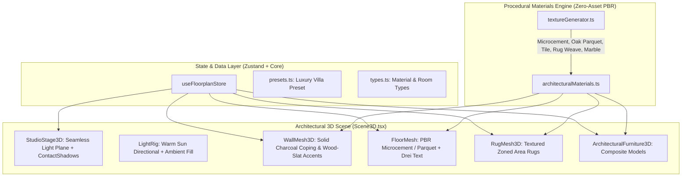

# Architectural 3D Visualizer & Render-Transformation Plan

> **For agentic workers:** REQUIRED SUB-SKILL: Use superpowers:subagent-driven-development to implement this plan task-by-task. Steps use checkbox (`- [ ]`) syntax for tracking.

**Goal:** Transform the 3D apartment planner from abstract colored bounding boxes on a dark background into a high-end, photorealistic architectural cutaway visualizer matching the reference aesthetic ([RapidFloorPlanGeneration.jpg](https://home-design.ai/nuxt_img/floor-plan-generator/RapidFloorPlanGeneration.jpg)), featuring bright architectural studio lighting, realistic soft contact shadows, procedural PBR floor textures (microcement, oak parquet, stone tiles), layered area rugs, architectural wall capping & wood-slat accent walls, high-detail procedural furniture models (cushioned sofas, dressed beds, kitchen island, plants), and elegant floor-stamped typography.

**Architecture:** The rendering pipeline is upgraded in layers: (1) **Studio & Lighting Layer** with off-white seamless stage, soft PCF/contact shadows, and natural directional sunlight; (2) **Material & Texture Layer** providing procedural PBR textures for floors, walls, and rugs; (3) **Architectural Furniture Layer** replacing single `boxGeometry` meshes with composite components built from `RoundedBox` and custom silhouettes for sofas, beds, dining sets, kitchen islands, and plants; (4) **Presentation Layer** featuring 3D floor-stamped room typography and external architectural hairline dimension chains.

**Architecture Diagram:**

**Tech Stack:** React 18, TypeScript, Three.js (`0.170.0`), `@react-three/fiber` (`8.17.10`), `@react-three/drei` (`9.114.0`: `ContactShadows`, `RoundedBox`, `Text`, `SoftShadows`), Zustand 5, Vitest.

**Spec / Reference:** [RapidFloorPlanGeneration.jpg](https://home-design.ai/nuxt_img/floor-plan-generator/RapidFloorPlanGeneration.jpg)

---

## User Review Required

> [!IMPORTANT]
> **Visueller Paradigmenwechsel: Studio-Light-Theme als Standard**
> Das Referenzbild nutzt einen strahlend hellen, warmen Architektur-Studio-Look (heller nahtloser Boden `#f4f4f6`, schwarze Wandschnitt-Abschlüsse, Eichenholz-Lamellen und weiche Sonnen-Schatten) anstelle des bisherigen dunkelblauen CAD-Hintergrunds (`#0b1120`). Wir machen diesen Look zum Standard-Modus („Architectural Studio“), behalten aber eine Umschaltmöglichkeit auf den technischen Blueprint-Modus bei.

> [!TIP]
> **Asset-freie prozedurale PBR-Texturen (Keine externen Downloads nötig)**
> Um vollständige Unabhängigkeit von externen CDNs oder großen Bilddateien zu gewährleisten, generieren wir Mikrozement-, Eichenparkett-, Marmor- und Teppich-Texturen über hochperformante HTML5-Canvas-Shader direkt im Browser. Diese Texturen skalieren verlustfrei auf beliebige Raummaße und laden in < 20 Millisekunden.

---

## Proposed Changes & Phased Execution

The roadmap is divided into 4 bite-sized, test-driven phases:

---

### Phase 1: Studio Stage, Soft Lighting & Architectural Wall Caps

Verleiht der Szene sofort die professionelle Studio-Atmosphäre aus dem Referenzbild:

#### [NEW] `src/components/viewer3d/StudioStage3D.tsx`
- Helle, nahtlose Endlos-Bodenplatte (`#f5f5f7` / `#eaebee`).
- Drei `ContactShadows` unterhalb der Gebäude-Bounding-Box für realistische Umgebungsverdeckung (Ambient Occlusion) und weiche Schatten.
- Warm ausgerichtetes Sonnenlicht (`#fff9f0`, Intensität 1.6) von oben links, erzeugt die charakteristischen langen, weichen Schatten nach rechts unten wie im Referenzfoto.
- Kühle Himmelsaufhellung (`#e0f2fe`, Intensität 0.45) für plastische Tiefenwirkung.

#### [MODIFY] `src/components/viewer3d/WallMesh3D.tsx`
- **Architektonischer Wandschnitt (Wall Cap / Coping):** Die Oberkante von vollen Wänden und Cutaway-Wänden erhält eine feine, tiefschwarze/anthrazitfarbene Abdeckplatte (`#1e1e24`, `thicknessCm + 0.4 cm`, `height = 1.5 cm`). Dies erzeugt sofort den hochwertigen Modellbau-/Architekturplan-Look.
- **Akzentwand-Unterstützung:** Optional vertikale Holzlamellen-Textur (Oak Acoustic Slats) auf Innenwänden für Wohn- und Essbereich.

#### [MODIFY] `src/components/viewer3d/Scene3D.tsx`
- Einbindung von `StudioStage3D`, `THREE.PCFSoftShadowMap` und Umschalter zwischen „Studio Render“ und „Blueprint Dark“.
- 3D-Raumbeschriftung flach auf dem Boden (`@react-three/drei` `Text`): Dezente, elegante Typografie („WOHNEN & ESSEN · 24,3 m²“, „SCHLAFEN · 22,0 m²“) in matter Schiefer-Farbe (`#64748b`).

---

### Phase 2: Prozedurale PBR-Texturen, Zonen-Teppiche & Bodenbeläge

Ersetzt die einfarbigen Bodenflächen durch lebendige Materialien:

#### [NEW] `src/core/materials/proceduralTextures.ts`
- **Mikrozement / Kalkstein (Microcement):** Helles, warmes, nahtloses Beton-/Terrazzo-Muster für offene Wohnbereiche und Küchen.
- **Eichen-Parkett (Oak Parquet):** Natürliche Holzmaserung mit einzelnen Dielenfugen für Schlafzimmer.
- **Badezimmer-Fliesen (Ceramic Stone Tile):** Großformatige Feinsteinzeug-Kacheln mit dezenten Fugen.
- **Webteppich (Woven Rug Fabric):** Warmer Woll-/Bouclé-Struktur-Shader für Wohn- und Schlafbereichsteppiche.

#### [NEW] `src/components/viewer3d/RugMesh3D.tsx`
- Flächenbündig auf dem Boden liegende Teppiche (`height = 0.8 cm`, abgerundete Ecken) unter Couchgruppen und Betten, die Sitzbereiche optisch verankern.

#### [MODIFY] `src/core/types.ts` & `src/core/wallMath.ts`
- Erweiterung von `RoomPolygon` um `flooringType?: 'microcement' | 'parquet' | 'tile'`.

---

### Phase 3: Detaillierte Architektonische Möbelmodelle (Composite Components)

Ersetzt monotone Quader durch stilisierte, detailreiche Architektur-Möbel:

#### [NEW] `src/components/viewer3d/furniture/ArchitecturalFurniture3D.tsx`
Router-Komponente, die anhand von `item.category` oder `item.modelType` die passende Geometrie rendert:
- **`SofaModularModel.tsx`:**
  - Basis mit abgerundeten Ecken (`RoundedBox`).
  - Dicke, einladende Sitzpolster und Rückenkissen mit Stofftextur (`#9ca3af` / `#475569`).
  - Eck-/Chaise-Lounge-Erweiterung und kleine Wurfkissen.
- **`BedMasterModel.tsx`:**
  - Gepolstertes Kopfteil mit vertikalen Steppnähten.
  - Niedriger Holzrahmen mit Nachttischen.
  - Dicke Matratze, geschlagenes Duvet/Bettdecke mit Faltenwurf-Silhouette und Kopfkissen-Paar.
- **`DiningSetModel.tsx`:**
  - Massiver Eichentisch mit gefaster Kante (`RoundedBox`).
  - Schlanke, ausgestellte Tischbeine.
  - Skandinavische Stühle mit gebogenen Schalen und Holzbeinen drumherum angeordnet.
- **`KitchenIslandModel.tsx`:**
  - Küchenblock mit durchgehendem Wasserfall-Marmortresen (weißer Quarz mit grauer Marmorierung).
  - Integriertes flaches Induktionskochfeld & Unterbauspüle mit minimalistischer Armatur.
  - 3 Barhocker mit Holz-/Leder-Sitzfläche an der Thekenseite.
- **`BiophilicPlantModel.tsx`:**
  - Eleganter weißer/terrakottafarbener zylindrischer Keramiktopf.
  - Ausladende organische Blätter (Monstera / Ficus Lyrata) als lebendiger grüner Blickfang.
- **`BathroomSuiteModel.tsx`:**
  - Freistehende ovale Designer-Badewanne mit Standarmatur.
  - Waschtisch mit Spiegel und wandhängendes WC.

#### [MODIFY] `src/core/presets.ts`
- **Neues Vorzeige-Preset „Luxus-Villa & Penthouse (Referenz-Layout)“:**
  - Großzügiger offener Wohn-/Essbereich mit Kücheninsel.
  - Kamin-Wand aus Naturstein.
  - Master-Schlafzimmer mit Teppich und Bibliothek-Raumteiler.
  - Designer-Badezimmer mit Wanne.
  - Eingangsbereich / Carport mit Fahrzeug.

---

### Phase 4: Architektonische Bemaßungsketten & 4K-Präsentations-Export

#### [NEW] `src/components/viewer3d/ArchitecturalDimensionLines3D.tsx`
- Feine, dezente Bemaßungs-Haarlinien außerhalb des Gebäudegrundrisses mit Pfeilticks und Maßzahlen (z. B. `620 cm`, `550 cm`, `1185 cm`), exakt wie im Vorbild.

#### [MODIFY] `src/components/layout/TopBar.tsx`
- Kamera-Perspektiven-Presets: „Top-Down Isometrie (65°)“, „Kamera-Frontal“, „Perspektiv-Flug“.
- Render-Button: „📸 Architektur-Render als PNG exportieren (High-Res 4K)“.

---

## Verification Plan

### Automated Tests
- `npm test`: Alle Geometrie-, Kollisions- und Store-Tests müssen weiterhin 100 % grün bleiben (31/31 Tests).
- Neue Unit-Tests für prozedurale Texturgenerierung und Möbel-Komponenten:
  - `tests/materials.test.ts`: Überprüft korrekte Textur- und Materialerstellung ohne WebGL-Abstürze.
  - `tests/architecturalPresets.test.ts`: Überprüft Bounding-Boxen und Kollisionsfreiheit des neuen Luxus-Villa-Presets.
- `npx tsc -b`: Vollständige Typsicherheit ohne any-Castings.
- `npm run build`: Erfolgreicher Vite-Produktions-Build in `dist/`.

### Manual Visual Verification
1. Öffnen von `http://localhost:5173` im Browser.
2. Laden des neuen „Luxus-Villa“-Presets.
3. Begutachtung der Szene:
   - Wirkt das Licht warm und plastisch mit weichen Kontaktschatten?
   - Haben die Wände die dunklen Wandschnitt-Kanten?
   - Sind Kücheninsel, Sofa und Bett detailreich texturiert statt bloße Farbblöcke?
   - Stehen Pflanzen und Zonen-Teppiche harmonisch im Raum?
   - Lässt sich jedes Möbelstück weiterhin zentimetergenau verschieben und kollisionsüberwachen?