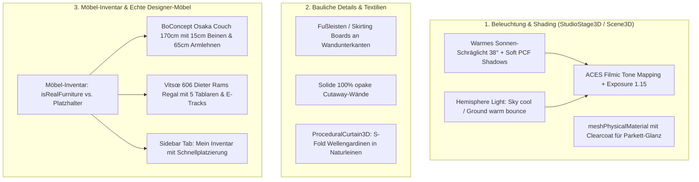

# Architektonische Beleuchtung, Möbel-Inventar & Designer-Möbel Implementation Plan

> **For agentic workers:** REQUIRED SUB-SKILL: Use superpowers:subagent-driven-development to implement this plan task-by-task. Steps use checkbox (`- [ ]`) syntax for tracking.

**Goal:** Transformation der 3D-Darstellung zur fotorealistischen Beleuchtungsqualität (ACES Filmic Tone Mapping, 38° Schräglicht, Hemisphere Bounce, Parkett-Glanz, Fußleisten), Implementierung eines Möbel-Inventars ("Echte Möbel" vs. "Platzhalter") und detailgetreuer Nachbau der BoConcept Osaka Couch (170cm) sowie des Vitsœ 606 Regalsystems (5 Tablare) mit bodenlangen Leinen-Wellengardinen.

**Architecture:** 
Der Renderer (`Scene3D`, `StudioStage3D`) wird auf physikalisches `ACESFilmicToneMapping` und gerichtetes Schräglicht umgestellt. Wände (`WallMesh3D`) erhalten Fußleisten und blickdichte Cutaways. Im Store (`useFloorplanStore`, `core/types.ts`) wird das Möbel-Inventar (`isRealFurniture`) verankert. Für die echten Möbel werden spezifische 3D-Modelle (`BoConceptOsakaModel`, `Vitsoe606Model`) und Textilien (`ProceduralCurtain3D` in Leinen) implementiert.

**Architecture Diagram:**

**Tech Stack:** React 19, TypeScript, Three.js, @react-three/fiber, @react-three/drei, Zustand, Vitest.

---

## Global Constraints
- **1 cm = 1 Three.js Unit:** Alle Maße strikt im Zentimeter-System.
- **Null externe Bild-Dateien:** Alles bleibt 100% prozedural und asset-frei.
- **Kein Kaminfeuer & kein Raumteiler:** Beide Elemente entfallen komplett.
- **BoConcept Osaka Couch:** Exakt 170 cm Breite, 87.5 cm Tiefe, 77 cm Höhe, 45 cm Sitzhöhe, 65 cm Armlehnenhöhe, 15 cm Beinhöhe.
- **Vitsœ 606 System:** 91.2 cm Breite, 22 cm Tiefe, 5 Tablare im 32 cm Vertikalraster mit E-Tracks und kuratierter Bestückung.
- **Gardinen:** Reiner Leinenstoff (slub texture, warmer Naturton).
- **Rückwärtskompatibilität:** Alle 72 bestehenden Vitest-Tests müssen grün bleiben.

---

## Tasks

### Task 1: Architektonische Beleuchtung, ACES-Tone-Mapping & Fußleisten
**Files:**
- Modify: `src/components/viewer3d/StudioStage3D.tsx`
- Modify: `src/components/viewer3d/Scene3D.tsx`
- Modify: `src/components/viewer3d/WallMesh3D.tsx`
- Test: `tests/lightingAtmosphere.test.ts`

- [ ] **Step 1: Write the failing test** (`tests/lightingAtmosphere.test.ts` für ACES Tone Mapping, Hemisphere Light, Parkett-Clearcoat und Fußleisten-Berechnung).
- [ ] **Step 2: Run test to make sure it fails**.
- [ ] **Step 3: Implement Lighting Overhaul & Skirting Boards**:
  - In `Scene3D.tsx`: Tone-Mapping auf `THREE.ACESFilmicToneMapping` mit `toneMappingExposure: 1.15`.
  - In `Scene3D.tsx`: Parkett- und Fliesenböden auf `meshPhysicalMaterial` mit `clearcoat: 0.18`, `roughness: 0.38`.
  - In `StudioStage3D.tsx`: Flaches `ambientLight` entfernen und durch `hemisphereLight` (`#e0f2fe` Himmel, `#f0e6d8` Boden, Intensität 0.35) ersetzen.
  - Sonnenlicht auf $38^\circ$ Schrägwinkel mit warmer Lichttemperatur (`#fff5ea`, Intensität 2.2) und weicher PCF-Schattenkamera ausrichten.
  - In `WallMesh3D.tsx`: Prozedurale Fußleisten (Höhe 8 cm, Tiefe 1.5 cm) am Wandfuß (unter Aussparung von Türen) hinzufügen und Cutaway-Wände auf `opacity: 1.0` (solide) setzen.
- [ ] **Step 4: Run test to make sure it passes**.
- [ ] **Step 5: Commit changes**.

---

### Task 2: Bodenlange Wellengardinen in Leinenstoff (Linen Fabric)
**Files:**
- Create: `src/components/viewer3d/decor/ProceduralCurtain3D.tsx`
- Modify: `src/components/viewer3d/Scene3D.tsx`
- Test: `tests/textilesDecor.test.ts`

- [ ] **Step 1: Write the failing test** (`tests/textilesDecor.test.ts` für Leinen-Material, Sinuswellen-Geometrie und Fensterplatzierung).
- [ ] **Step 2: Run test to make sure it fails**.
- [ ] **Step 3: Implement Linen S-Fold Curtains**:
  - In `ProceduralCurtain3D.tsx`: Bodenlange Wellenvorhänge mit Sinuswellen-Querschnitt ($Z = \sin(\dots) \cdot 3.5\text{ cm}$).
  - Leinenstoff: Warmer Naturton (`#f6f4ee`), feine Slub-Yarn-Textur, Transluzenz (`opacity: 0.88`, `roughness: 0.96`, `side: THREE.DoubleSide`).
  - Schlanke Deckenleiste (Ø 1.8 cm, Anthrazit) und automatische Cutaway-Kompensation.
  - Einbindung an allen Fensteröffnungen in `Scene3D.tsx`.
- [ ] **Step 4: Run test to make sure it passes**.
- [ ] **Step 5: Commit changes**.

---

### Task 3: Möbel-Inventar-System ("Echte Möbel" vs. "Platzhalter")
**Files:**
- Modify: `src/core/types.ts`
- Modify: `src/types/index.ts`
- Modify: `src/store/useFloorplanStore.ts`
- Modify: `src/components/sidebar/InspectorSidebar.tsx`
- Test: `tests/furnitureInventory.test.ts`

- [x] **Step 1: Write the failing test** (`tests/furnitureInventory.test.ts` für Inventar-Attributierung, Filterung und Umschaltung).
- [x] **Step 2: Run test to make sure it fails**.
- [x] **Step 3: Implement Furniture Inventory Feature**:
  - In `types`: Erweitere `FurnitureItem` um `isRealFurniture?: boolean`, `brand?: string`, `modelName?: string`.
  - In `useFloorplanStore.ts`: Action `toggleFurnitureRealStatus(id: string)`.
  - In `InspectorSidebar.tsx`:
    - Tab / Filter "Mein Inventar (Echte Möbel)" vs. "Katalog (Platzhalter)".
    - Badge "Echtes Möbel" vs. "Platzhalter" im Inspektor.
- [x] **Step 4: Run test to make sure it passes**.
- [x] **Step 5: Commit changes**.

---

### Task 4: Detailgetreue Nachbauten: BoConcept Osaka Couch & Vitsœ 606 Regal
**Files:**
- Create: `src/components/viewer3d/furniture/BoConceptOsakaModel.tsx`
- Create: `src/components/viewer3d/furniture/Vitsoe606Model.tsx`
- Modify: `src/components/viewer3d/furniture/ArchitecturalFurniture3D.tsx`
- Modify: `src/core/presets.ts`
- Test: `tests/designerFurniture.test.ts`

- [x] **Step 1: Write the failing test** (`tests/designerFurniture.test.ts` für Modellauflösung, Maßhaltigkeit und Staging).
- [x] **Step 2: Run test to make sure it fails**.
- [x] **Step 3: Implement BoConcept Osaka & Vitsœ 606 Models**:
  - `BoConceptOsakaModel.tsx`:
    - 170 × 87.5 × 77 cm (B×T×H).
    - 15 cm hohe, leicht ausgestellte Beine.
    - 2 Sitzkissen mit Sitzhöhe 45 cm.
    - 2 Rückenkissen bis 77 cm Gesamthöhe.
    - 2 schlanke Armlehnen mit 65 cm Höhe.
  - `Vitsoe606Model.tsx`:
    - 91.2 × 22 × 170 cm (B×T×H).
    - 2 vertikale Aluminium-E-Tracks mit Nuten.
    - 5 Tablare mit abgewinkelten Buchstützen-Flanschen.
    - Deterministisches Staging der 5 Böden mit Büchern, Bildbänden, Keramik und Hängepflanze.
  - Registrierung beider Modelle in `FURNITURE_CATALOG` (mit `isRealFurniture: true`) und `resolveFurnitureModelType`.
  - Ausstattung des `luxury-villa` Presets mit Osaka Couch und Vitsœ 606.
- [x] **Step 4: Run full test suite & build check** (`npm test` && `npm run build`).
- [x] **Step 5: Commit changes**.
