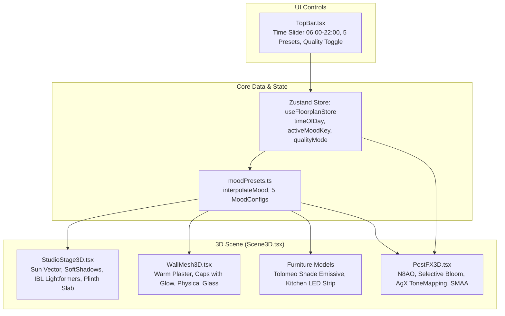

# Filmische Lichtstimmung, Beleuchtungs-Presets & Optik-Upgrade Plan

> **For agentic workers:** REQUIRED SUB-SKILL: Use superpowers:subagent-driven-development to implement this plan task-by-task. Steps use checkbox (`- [ ]`) syntax for tracking.

**Goal:** Transform the 3D apartment planner from flat CAD-like visuals to high-end editorial archviz with self-hosted IBL, N8AO, selective Bloom, AgX tonemapping, reactive time-of-day slider (6:00–22:00), 5 mood presets, beveled plinth slab, and a Performance/Beauty quality toggle.

**Architecture:** A pure mathematical core (`src/core/lighting/moodPresets.ts`) provides continuous time-of-day interpolation and 5 architectural presets. The Zustand store manages `timeOfDay`, `activeMoodKey`, and `qualityMode`. Three.js R3F components reactively consume the mood config: `StudioStage3D` calculates dynamic sun vectors, self-hosted `<Lightformer>` IBL, and an architectural plinth slab; `PostFX3D` applies N8AO, AgX tonemapping, and selective bloom; designer models (`ArtemideTolomeoModel`, `KitchenUnitModel`, `WallMesh3D`) glow dynamically in dusk/night modes.

**Architecture Diagram:**



**Tech Stack:** React 18, Three.js r170, `@react-three/fiber` ^8.17.10, `@react-three/drei` ^9.114.0, `@react-three/postprocessing` ^2.16.3, `postprocessing` ^6.36.0, Zustand ^5.0.1, TypeScript 5, Vite 5, Vitest 2.

**Spec:** [`docs/superpowers/specs/2026-10-21-cinematic-lighting-and-atmosphere-design.md`](file:///home/agy/Wohnung/docs/superpowers/specs/2026-10-21-cinematic-lighting-and-atmosphere-design.md)

## Global Constraints

- Units strictly in centimeters (`1 Three.js unit = 1 cm`).
- `@react-three/postprocessing` MUST be pinned to `^2.16.3` (compatible with React 18 / Fiber 8). DO NOT install v3.
- `postprocessing` MUST be pinned to `^6.36.0`.
- All environment lighting MUST use self-hosted parametric `<Lightformer>`s (zero CDN/network requests).
- Renderer tone mapping MUST be set to `THREE.NoToneMapping` when `PostFX3D` is mounted to prevent double-tonemapping artifacts.
- Dual mode `qualityMode: 'performance' | 'beauty'` ensures 60 FPS on laptops by skipping N8AO and Bloom in performance mode.
- Existing 127 Vitest tests must continue passing without regression.

---

### Task 1: Core Lighting Math & Mood Presets

**Files:**
- Create: `src/core/lighting/moodPresets.ts`
- Test: `tests/moodPresets.test.ts`

**Interfaces:**
- Produces:
  - `export type MoodPresetKey = 'morning' | 'noon' | 'golden_hour' | 'blue_hour' | 'night';`
  - `export type QualityMode = 'performance' | 'beauty';`
  - `export interface MoodConfig` (full schema with sun angles, colors, hemi, lamps, bloom, etc.)
  - `export const MOOD_PRESETS: Record<MoodPresetKey, MoodConfig>;`
  - `export function presetToHour(key: MoodPresetKey): number;`
  - `export function hourToNearestPresetKey(hour: number): MoodPresetKey;`
  - `export function interpolateMood(hour: number): MoodConfig;`

- [ ] **Step 1: Write the failing test for mood presets and interpolation**

`tests/moodPresets.test.ts`:
```typescript
import { describe, it, expect } from 'vitest';
import {
  MOOD_PRESETS,
  presetToHour,
  hourToNearestPresetKey,
  interpolateMood,
  MoodPresetKey,
} from '../src/core/lighting/moodPresets';

describe('moodPresets Core Math & Interpolation', () => {
  it('defines 5 architectural mood presets with expected hours', () => {
    const keys: MoodPresetKey[] = ['morning', 'noon', 'golden_hour', 'blue_hour', 'night'];
    keys.forEach((key) => {
      expect(MOOD_PRESETS[key]).toBeDefined();
      expect(MOOD_PRESETS[key].key).toBe(key);
      expect(typeof MOOD_PRESETS[key].sunElevationDeg).toBe('number');
      expect(typeof MOOD_PRESETS[key].sunColor).toBe('string');
      expect(typeof MOOD_PRESETS[key].lampsActive).toBe('boolean');
    });

    expect(presetToHour('morning')).toBe(8.0);
    expect(presetToHour('noon')).toBe(12.5);
    expect(presetToHour('golden_hour')).toBe(18.0);
    expect(presetToHour('blue_hour')).toBe(20.5);
    expect(presetToHour('night')).toBe(22.0);
  });

  it('maps hours to nearest preset key', () => {
    expect(hourToNearestPresetKey(7.5)).toBe('morning');
    expect(hourToNearestPresetKey(13.0)).toBe('noon');
    expect(hourToNearestPresetKey(18.2)).toBe('golden_hour');
    expect(hourToNearestPresetKey(20.4)).toBe('blue_hour');
    expect(hourToNearestPresetKey(22.0)).toBe('night');
  });

  it('returns exact preset values when queried at exact preset hour', () => {
    const golden = interpolateMood(18.0);
    expect(golden.key).toBe('golden_hour');
    expect(golden.sunElevationDeg).toBeCloseTo(MOOD_PRESETS.golden_hour.sunElevationDeg, 2);
    expect(golden.sunIntensity).toBeCloseTo(MOOD_PRESETS.golden_hour.sunIntensity, 2);
    expect(golden.sunColor.toLowerCase()).toBe(MOOD_PRESETS.golden_hour.sunColor.toLowerCase());
  });

  it('smoothly interpolates sun elevation, intensity and colors between noon and golden hour', () => {
    const mid = interpolateMood(15.25); // exactly halfway between 12.5 and 18.0
    const noon = MOOD_PRESETS.noon;
    const golden = MOOD_PRESETS.golden_hour;

    expect(mid.sunElevationDeg).toBeLessThan(noon.sunElevationDeg);
    expect(mid.sunElevationDeg).toBeGreaterThan(golden.sunElevationDeg);
    expect(mid.sunElevationDeg).toBeCloseTo((noon.sunElevationDeg + golden.sunElevationDeg) / 2, 1);
  });

  it('activates interior practical lamps smoothly after 19.5 hours', () => {
    const day = interpolateMood(14.0);
    expect(day.lampsActive).toBe(false);
    expect(day.lampEmissiveIntensity).toBe(0);

    const dusk = interpolateMood(20.5);
    expect(dusk.lampsActive).toBe(true);
    expect(dusk.lampEmissiveIntensity).toBeGreaterThan(1.0);

    const night = interpolateMood(22.0);
    expect(night.lampsActive).toBe(true);
    expect(night.lampBloomIntensity).toBeGreaterThanOrEqual(0.6);
  });

  it('clamps gracefully for hours outside 6.0 - 22.0 range', () => {
    const early = interpolateMood(5.0);
    expect(early.hour).toBe(6.0);
    const late = interpolateMood(23.5);
    expect(late.hour).toBe(22.0);
  });
});
```

- [ ] **Step 2: Run test to verify it fails**

Run: `npx vitest run tests/moodPresets.test.ts`
Expected: FAIL with "Cannot find module '../src/core/lighting/moodPresets'"

- [ ] **Step 3: Implement minimal code in `src/core/lighting/moodPresets.ts`**

```typescript
import * as THREE from 'three';

export type MoodPresetKey = 'morning' | 'noon' | 'golden_hour' | 'blue_hour' | 'night';
export type QualityMode = 'performance' | 'beauty';

export interface MoodConfig {
  key: MoodPresetKey | 'custom';
  name: string;
  hour: number;
  sunElevationDeg: number;
  sunAzimuthDeg: number;
  sunColor: string;
  sunIntensity: number;
  hemiSkyColor: string;
  hemiGroundColor: string;
  hemiIntensity: number;
  environmentIntensity: number;
  lampsActive: boolean;
  lampColor: string;
  lampEmissiveIntensity: number;
  lampBloomIntensity: number;
  windowLightColor: string;
  windowLightIntensity: number;
  backdropTheme: 'day' | 'golden' | 'dusk' | 'night';
  backdropOpacity: number;
  exposure: number;
  n8aoIntensity: number;
  vignetteDarkness: number;
  stageGradientTop: string;
  stageGradientBottom: string;
  plinthColor: string;
  wallCapGlowColor: string;
  wallCapGlowIntensity: number;
}

export const MOOD_PRESETS: Record<MoodPresetKey, MoodConfig> = {
  morning: {
    key: 'morning',
    name: 'Morgen',
    hour: 8.0,
    sunElevationDeg: 18,
    sunAzimuthDeg: 110,
    sunColor: '#ffe2c0',
    sunIntensity: 2.8,
    hemiSkyColor: '#e0f0fe',
    hemiGroundColor: '#eae0d2',
    hemiIntensity: 0.45,
    environmentIntensity: 0.65,
    lampsActive: false,
    lampColor: '#ffb870',
    lampEmissiveIntensity: 0,
    lampBloomIntensity: 0.15,
    windowLightColor: '#dbeafe',
    windowLightIntensity: 2.5,
    backdropTheme: 'day',
    backdropOpacity: 0.85,
    exposure: 1.1,
    n8aoIntensity: 2.4,
    vignetteDarkness: 0.35,
    stageGradientTop: '#ede8e1',
    stageGradientBottom: '#d9d2c8',
    plinthColor: '#cfc6ba',
    wallCapGlowColor: '#ffe4b5',
    wallCapGlowIntensity: 0.2,
  },
  noon: {
    key: 'noon',
    name: 'Mittag',
    hour: 12.5,
    sunElevationDeg: 58,
    sunAzimuthDeg: 180,
    sunColor: '#fff8ee',
    sunIntensity: 3.6,
    hemiSkyColor: '#d4eafe',
    hemiGroundColor: '#ddd7ce',
    hemiIntensity: 0.55,
    environmentIntensity: 0.85,
    lampsActive: false,
    lampColor: '#ffb870',
    lampEmissiveIntensity: 0,
    lampBloomIntensity: 0.1,
    windowLightColor: '#e0f2fe',
    windowLightIntensity: 3.0,
    backdropTheme: 'day',
    backdropOpacity: 0.95,
    exposure: 1.05,
    n8aoIntensity: 2.2,
    vignetteDarkness: 0.32,
    stageGradientTop: '#eae5de',
    stageGradientBottom: '#d5cec4',
    plinthColor: '#cfc6ba',
    wallCapGlowColor: '#ffe4b5',
    wallCapGlowIntensity: 0.1,
  },
  golden_hour: {
    key: 'golden_hour',
    name: 'Golden Hour',
    hour: 18.0,
    sunElevationDeg: 14,
    sunAzimuthDeg: 245,
    sunColor: '#ffb070',
    sunIntensity: 4.2,
    hemiSkyColor: '#bfd4ea',
    hemiGroundColor: '#c8b8a2',
    hemiIntensity: 0.4,
    environmentIntensity: 0.55,
    lampsActive: true,
    lampColor: '#ffb870',
    lampEmissiveIntensity: 1.2,
    lampBloomIntensity: 0.45,
    windowLightColor: '#fed7aa',
    windowLightIntensity: 4.0,
    backdropTheme: 'golden',
    backdropOpacity: 0.9,
    exposure: 1.15,
    n8aoIntensity: 2.6,
    vignetteDarkness: 0.42,
    stageGradientTop: '#ede4d8',
    stageGradientBottom: '#d2c5b4',
    plinthColor: '#c9beaf',
    wallCapGlowColor: '#ffc078',
    wallCapGlowIntensity: 0.4,
  },
  blue_hour: {
    key: 'blue_hour',
    name: 'Blaue Stunde',
    hour: 20.5,
    sunElevationDeg: -2,
    sunAzimuthDeg: 285,
    sunColor: '#fdba74',
    sunIntensity: 0.0,
    hemiSkyColor: '#2c4375',
    hemiGroundColor: '#1f2433',
    hemiIntensity: 0.28,
    environmentIntensity: 0.25,
    lampsActive: true,
    lampColor: '#ffa852',
    lampEmissiveIntensity: 3.2,
    lampBloomIntensity: 0.75,
    windowLightColor: '#38bdf8',
    windowLightIntensity: 1.5,
    backdropTheme: 'dusk',
    backdropOpacity: 0.9,
    exposure: 1.2,
    n8aoIntensity: 2.8,
    vignetteDarkness: 0.48,
    stageGradientTop: '#242e42',
    stageGradientBottom: '#181f2c',
    plinthColor: '#2d3748',
    wallCapGlowColor: '#ffedd5',
    wallCapGlowIntensity: 0.8,
  },
  night: {
    key: 'night',
    name: 'Nacht',
    hour: 22.0,
    sunElevationDeg: -20,
    sunAzimuthDeg: 310,
    sunColor: '#f97316',
    sunIntensity: 0.0,
    hemiSkyColor: '#111827',
    hemiGroundColor: '#0f172a',
    hemiIntensity: 0.15,
    environmentIntensity: 0.12,
    lampsActive: true,
    lampColor: '#ffa852',
    lampEmissiveIntensity: 4.0,
    lampBloomIntensity: 0.85,
    windowLightColor: '#1e293b',
    windowLightIntensity: 0.5,
    backdropTheme: 'night',
    backdropOpacity: 0.95,
    exposure: 1.25,
    n8aoIntensity: 2.8,
    vignetteDarkness: 0.52,
    stageGradientTop: '#151922',
    stageGradientBottom: '#0d1117',
    plinthColor: '#1e2533',
    wallCapGlowColor: '#fed7aa',
    wallCapGlowIntensity: 1.0,
  },
};

const ORDERED_KEYS: MoodPresetKey[] = ['morning', 'noon', 'golden_hour', 'blue_hour', 'night'];

export function presetToHour(key: MoodPresetKey): number {
  return MOOD_PRESETS[key].hour;
}

export function hourToNearestPresetKey(hour: number): MoodPresetKey {
  let closestKey = ORDERED_KEYS[0];
  let minDiff = Infinity;
  for (const k of ORDERED_KEYS) {
    const diff = Math.abs(MOOD_PRESETS[k].hour - hour);
    if (diff < minDiff) {
      minDiff = diff;
      closestKey = k;
    }
  }
  return closestKey;
}

function lerpColor(c1: string, c2: string, t: number): string {
  const color1 = new THREE.Color(c1);
  const color2 = new THREE.Color(c2);
  color1.lerp(color2, t);
  return '#' + color1.getHexString();
}

function lerp(a: number, b: number, t: number): number {
  return a + (b - a) * t;
}

export function interpolateMood(rawHour: number): MoodConfig {
  const hour = Math.max(6.0, Math.min(22.0, rawHour));

  if (hour <= MOOD_PRESETS.morning.hour) {
    const t = Math.max(0, (hour - 6.0) / (MOOD_PRESETS.morning.hour - 6.0));
    return {
      ...MOOD_PRESETS.morning,
      hour,
      key: Math.abs(hour - MOOD_PRESETS.morning.hour) < 0.05 ? 'morning' : 'custom',
      sunElevationDeg: lerp(5, MOOD_PRESETS.morning.sunElevationDeg, t),
      sunIntensity: lerp(1.2, MOOD_PRESETS.morning.sunIntensity, t),
    };
  }

  if (hour >= MOOD_PRESETS.night.hour) {
    return {
      ...MOOD_PRESETS.night,
      hour: 22.0,
    };
  }

  // Find two bounding presets
  let prevKey = ORDERED_KEYS[0];
  let nextKey = ORDERED_KEYS[1];

  for (let i = 0; i < ORDERED_KEYS.length - 1; i++) {
    const k1 = ORDERED_KEYS[i];
    const k2 = ORDERED_KEYS[i + 1];
    if (hour >= MOOD_PRESETS[k1].hour && hour <= MOOD_PRESETS[k2].hour) {
      prevKey = k1;
      nextKey = k2;
      break;
    }
  }

  const p1 = MOOD_PRESETS[prevKey];
  const p2 = MOOD_PRESETS[nextKey];
  const t = (hour - p1.hour) / (p2.hour - p1.hour);

  if (t < 0.01) return { ...p1, hour };
  if (t > 0.99) return { ...p2, hour };

  const lampsActive = hour >= 19.5;
  const lampEmissiveIntensity = hour < 17.5 ? 0 : hour < 19.5 ? lerp(0, p1.lampEmissiveIntensity, (hour - 17.5) / 2.0) : lerp(p1.lampEmissiveIntensity, p2.lampEmissiveIntensity, t);

  return {
    key: 'custom',
    name: `Individuell (${hour.toFixed(1)} Uhr)`,
    hour,
    sunElevationDeg: lerp(p1.sunElevationDeg, p2.sunElevationDeg, t),
    sunAzimuthDeg: lerp(p1.sunAzimuthDeg, p2.sunAzimuthDeg, t),
    sunColor: lerpColor(p1.sunColor, p2.sunColor, t),
    sunIntensity: Math.max(0, lerp(p1.sunIntensity, p2.sunIntensity, t)),
    hemiSkyColor: lerpColor(p1.hemiSkyColor, p2.hemiSkyColor, t),
    hemiGroundColor: lerpColor(p1.hemiGroundColor, p2.hemiGroundColor, t),
    hemiIntensity: lerp(p1.hemiIntensity, p2.hemiIntensity, t),
    environmentIntensity: lerp(p1.environmentIntensity, p2.environmentIntensity, t),
    lampsActive,
    lampColor: lerpColor(p1.lampColor, p2.lampColor, t),
    lampEmissiveIntensity,
    lampBloomIntensity: lerp(p1.lampBloomIntensity, p2.lampBloomIntensity, t),
    windowLightColor: lerpColor(p1.windowLightColor, p2.windowLightColor, t),
    windowLightIntensity: lerp(p1.windowLightIntensity, p2.windowLightIntensity, t),
    backdropTheme: t > 0.5 ? p2.backdropTheme : p1.backdropTheme,
    backdropOpacity: lerp(p1.backdropOpacity, p2.backdropOpacity, t),
    exposure: lerp(p1.exposure, p2.exposure, t),
    n8aoIntensity: lerp(p1.n8aoIntensity, p2.n8aoIntensity, t),
    vignetteDarkness: lerp(p1.vignetteDarkness, p2.vignetteDarkness, t),
    stageGradientTop: lerpColor(p1.stageGradientTop, p2.stageGradientTop, t),
    stageGradientBottom: lerpColor(p1.stageGradientBottom, p2.stageGradientBottom, t),
    plinthColor: lerpColor(p1.plinthColor, p2.plinthColor, t),
    wallCapGlowColor: lerpColor(p1.wallCapGlowColor, p2.wallCapGlowColor, t),
    wallCapGlowIntensity: lerp(p1.wallCapGlowIntensity, p2.wallCapGlowIntensity, t),
  };
}
```

- [ ] **Step 4: Run test to verify it passes**

Run: `npx vitest run tests/moodPresets.test.ts`
Expected: PASS (all 6 tests green)

- [ ] **Step 5: Commit**

```bash
git add src/core/lighting/moodPresets.ts tests/moodPresets.test.ts
git commit -m "feat(lighting): implement core mood presets and continuous time-of-day interpolation"
```

---

### Task 2: Zustand Store Lighting State & Actions

**Files:**
- Modify: `src/store/useFloorplanStore.ts`
- Test: `tests/storeLighting.test.ts`

**Interfaces:**
- Consumes: `MoodPresetKey`, `QualityMode`, `presetToHour` from `src/core/lighting/moodPresets.ts`
- Produces:
  - `timeOfDay: number`
  - `activeMoodKey: MoodPresetKey | 'custom'`
  - `qualityMode: QualityMode`
  - `glowingWallCaps: boolean`
  - `setTimeOfDay: (hour: number) => void`
  - `setMoodPreset: (preset: MoodPresetKey) => void`
  - `setQualityMode: (mode: QualityMode) => void`
  - `setGlowingWallCaps: (enabled: boolean) => void`

- [ ] **Step 1: Write the failing test for store lighting state**

`tests/storeLighting.test.ts`:
```typescript
import { describe, it, expect, beforeEach } from 'vitest';
import { useFloorplanStore } from '../src/store/useFloorplanStore';

describe('useFloorplanStore Lighting & Quality State', () => {
  beforeEach(() => {
    // Reset store to known defaults
    useFloorplanStore.setState({
      timeOfDay: 18.0,
      activeMoodKey: 'golden_hour',
      qualityMode: 'beauty',
      glowingWallCaps: true,
    });
  });

  it('has initial default values matching Golden Hour and Beauty mode', () => {
    const state = useFloorplanStore.getState();
    expect(state.timeOfDay).toBe(18.0);
    expect(state.activeMoodKey).toBe('golden_hour');
    expect(state.qualityMode).toBe('beauty');
    expect(state.glowingWallCaps).toBe(true);
  });

  it('updates timeOfDay and flags custom mood if off-preset', () => {
    useFloorplanStore.getState().setTimeOfDay(14.5);
    expect(useFloorplanStore.getState().timeOfDay).toBe(14.5);
    expect(useFloorplanStore.getState().activeMoodKey).toBe('custom');
  });

  it('sets mood preset by key and updates timeOfDay accordingly', () => {
    useFloorplanStore.getState().setMoodPreset('blue_hour');
    expect(useFloorplanStore.getState().activeMoodKey).toBe('blue_hour');
    expect(useFloorplanStore.getState().timeOfDay).toBe(20.5);

    useFloorplanStore.getState().setMoodPreset('noon');
    expect(useFloorplanStore.getState().activeMoodKey).toBe('noon');
    expect(useFloorplanStore.getState().timeOfDay).toBe(12.5);
  });

  it('toggles qualityMode between performance and beauty', () => {
    useFloorplanStore.getState().setQualityMode('performance');
    expect(useFloorplanStore.getState().qualityMode).toBe('performance');

    useFloorplanStore.getState().setQualityMode('beauty');
    expect(useFloorplanStore.getState().qualityMode).toBe('beauty');
  });

  it('toggles glowingWallCaps flag', () => {
    useFloorplanStore.getState().setGlowingWallCaps(false);
    expect(useFloorplanStore.getState().glowingWallCaps).toBe(false);

    useFloorplanStore.getState().setGlowingWallCaps(true);
    expect(useFloorplanStore.getState().glowingWallCaps).toBe(true);
  });
});
```

- [ ] **Step 2: Run test to verify it fails**

Run: `npx vitest run tests/storeLighting.test.ts`
Expected: FAIL with "state.timeOfDay is undefined"

- [ ] **Step 3: Modify `src/store/useFloorplanStore.ts`**

In `src/store/useFloorplanStore.ts`, import types and helper:
```typescript
import { MoodPresetKey, QualityMode, presetToHour } from '../core/lighting/moodPresets';
```
Add to `FloorplanState` interface:
```typescript
  timeOfDay: number;
  activeMoodKey: MoodPresetKey | 'custom';
  qualityMode: QualityMode;
  glowingWallCaps: boolean;
  setTimeOfDay: (hour: number) => void;
  setMoodPreset: (preset: MoodPresetKey) => void;
  setQualityMode: (mode: QualityMode) => void;
  setGlowingWallCaps: (enabled: boolean) => void;
```
Initialize in `create<FloorplanState>()`:
```typescript
  timeOfDay: 18.0,
  activeMoodKey: 'golden_hour',
  qualityMode: 'beauty',
  glowingWallCaps: true,

  setTimeOfDay: (hour) => {
    const clamped = Math.max(6.0, Math.min(22.0, hour));
    set({
      timeOfDay: clamped,
      activeMoodKey: 'custom',
    });
  },

  setMoodPreset: (preset) => {
    set({
      activeMoodKey: preset,
      timeOfDay: presetToHour(preset),
    });
  },

  setQualityMode: (mode) => set({ qualityMode: mode }),

  setGlowingWallCaps: (enabled) => set({ glowingWallCaps: enabled }),
```

- [ ] **Step 4: Run tests to verify all pass**

Run: `npx vitest run tests/storeLighting.test.ts tests/store.test.ts`
Expected: PASS

- [ ] **Step 5: Commit**

```bash
git add src/store/useFloorplanStore.ts tests/storeLighting.test.ts
git commit -m "feat(store): add timeOfDay, moodPreset and qualityMode state management"
```

---

### Task 3: Dependency Installation & Post-Processing Pipeline (`PostFX3D.tsx`)

**Files:**
- Modify: `package.json` (install `@react-three/postprocessing@^2.16.3` and `postprocessing@^6.36.0`)
- Create: `src/components/viewer3d/PostFX3D.tsx`
- Modify: `src/components/viewer3d/Scene3D.tsx` (disable renderer tone mapping, mount PostFX3D)
- Test: `tests/postFX.test.ts`

**Interfaces:**
- Consumes: `useFloorplanStore` (`qualityMode`, `timeOfDay`), `interpolateMood`
- Produces: `<PostFX3D />` React Three Fiber effect composer component

- [ ] **Step 1: Install `@react-three/postprocessing@^2.16.3` and `postprocessing@^6.36.0`**

Run:
```bash
npm install --save @react-three/postprocessing@^2.16.3 postprocessing@^6.36.0
```
Verify that `package.json` contains `@react-three/postprocessing`: "^2.16.3".

- [ ] **Step 2: Write component unit test for `PostFX3D` export and configuration**

`tests/postFX.test.ts`:
```typescript
import { describe, it, expect } from 'vitest';
import React from 'react';

describe('PostFX3D Pipeline Configuration', () => {
  it('exports PostFX3D component function', async () => {
    const mod = await import('../src/components/viewer3d/PostFX3D');
    expect(typeof mod.PostFX3D).toBe('function');
  });

  it('exports N8AO and Bloom tuning constants for cm scale', async () => {
    const mod = await import('../src/components/viewer3d/PostFX3D');
    expect(mod.N8AO_RADIUS_CM).toBe(40);
    expect(mod.BLOOM_LUMINANCE_THRESHOLD).toBe(1.0);
  });
});
```

- [ ] **Step 3: Run test to verify it fails**

Run: `npx vitest run tests/postFX.test.ts`
Expected: FAIL with "Cannot find module '../src/components/viewer3d/PostFX3D'"

- [ ] **Step 4: Implement `src/components/viewer3d/PostFX3D.tsx`**

```tsx
import React, { useMemo } from 'react';
import {
  EffectComposer,
  N8AO,
  Bloom,
  ToneMapping,
  Vignette,
  SMAA,
} from '@react-three/postprocessing';
import { ToneMappingMode } from 'postprocessing';
import { useFloorplanStore } from '../../store/useFloorplanStore';
import { interpolateMood } from '../../core/lighting/moodPresets';

export const N8AO_RADIUS_CM = 40;
export const BLOOM_LUMINANCE_THRESHOLD = 1.0;

export const PostFX3D: React.FC = () => {
  const qualityMode = useFloorplanStore((s) => s.qualityMode);
  const timeOfDay = useFloorplanStore((s) => s.timeOfDay);
  const renderTheme = useFloorplanStore((s) => s.renderTheme);

  const mood = useMemo(() => interpolateMood(timeOfDay), [timeOfDay]);
  const isBeauty = qualityMode === 'beauty' && renderTheme === 'studio';

  return (
    <EffectComposer multisampling={0} enableNormalPass={false}>
      {isBeauty && (
        <N8AO
          aoRadius={N8AO_RADIUS_CM}
          distanceFalloff={0.5}
          intensity={mood.n8aoIntensity}
          color="#3a2f28"
          halfRes
          quality="medium"
        />
      )}
      {isBeauty && (
        <Bloom
          mipmapBlur
          luminanceThreshold={BLOOM_LUMINANCE_THRESHOLD}
          intensity={mood.lampBloomIntensity}
        />
      )}
      <ToneMapping mode={ToneMappingMode.AGX} />
      {isBeauty && (
        <Vignette offset={0.3} darkness={mood.vignetteDarkness} />
      )}
      <SMAA />
    </EffectComposer>
  );
};
```

- [ ] **Step 5: Integrate `PostFX3D` in `src/components/viewer3d/Scene3D.tsx`**

In `src/components/viewer3d/Scene3D.tsx`:
Change `CANVAS_GL_CONFIG`:
```typescript
export const CANVAS_GL_CONFIG = {
  preserveDrawingBuffer: true,
  toneMapping: THREE.NoToneMapping,
} as const;
```
Import and mount `<PostFX3D />` at the bottom of the `<Canvas>` tree:
```tsx
import { PostFX3D } from './PostFX3D';
...
        {/* Exterior Architectural Perimeter Dimension Lines */}
        {showDimensions3D && (
          <ArchitecturalDimensionLines3D ... />
        )}

        {/* Cinematic Archviz Post-Processing Pipeline */}
        <PostFX3D />
      </Canvas>
```

- [ ] **Step 6: Run tests to verify**

Run: `npx vitest run tests/postFX.test.ts`
Expected: PASS

- [ ] **Step 7: Commit**

```bash
git add package.json package-lock.json src/components/viewer3d/PostFX3D.tsx src/components/viewer3d/Scene3D.tsx tests/postFX.test.ts
git commit -m "feat(lighting): add PostFX3D pipeline with N8AO, Bloom, AgX tonemapping and SMAA"
```

---

### Task 4: Architectural Studio Stage, Plinth & Self-Hosted Environment

**Files:**
- Modify: `src/components/viewer3d/StudioStage3D.tsx`
- Test: `tests/studioStage.test.ts`

**Interfaces:**
- Consumes: `useFloorplanStore` (`timeOfDay`, `qualityMode`, `renderTheme`), `interpolateMood`
- Produces: Updated `<StudioStage3D roomBounds={roomBounds} />` with:
  - 20cm beveled plinth slab under the apartment
  - Self-hosted `<Environment>` with 3 `<Lightformer>`s (no external HTTP CDN calls)
  - Directional sun computed from `sunElevationDeg` & `sunAzimuthDeg` with PCSS soft shadows
  - Curved studio backdrop plane with vertical mood gradient

- [ ] **Step 1: Write/update tests in `tests/studioStage.test.ts` for Plinth and Sun Calculations**

Update `tests/studioStage.test.ts` to assert:
- `StudioStage3D` renders without throwing.
- Plinth dimension helper `computePlinthBounds(roomBounds)` generates 20cm height and a 60cm margin around the apartment.

```typescript
  it('exports computePlinthBounds helper with 60cm margin and 20cm height', async () => {
    const { computePlinthBounds } = await import('../src/components/viewer3d/StudioStage3D');
    const bounds = computePlinthBounds({
      minX: 0,
      maxX: 500,
      minZ: 0,
      maxZ: 400,
      cx: 250,
      cz: 200,
    });
    expect(bounds.widthCm).toBe(500 + 120);
    expect(bounds.depthCm).toBe(400 + 120);
    expect(bounds.heightCm).toBe(20);
    expect(bounds.centerYCm).toBe(-10);
  });
```

- [ ] **Step 2: Run test to verify it fails**

Run: `npx vitest run tests/studioStage.test.ts`
Expected: FAIL with "computePlinthBounds is not a function"

- [ ] **Step 3: Implement plinth helper and updated `StudioStage3D.tsx`**

In `src/components/viewer3d/StudioStage3D.tsx`:
Add `computePlinthBounds`:
```typescript
export function computePlinthBounds(bounds: RoomBounds) {
  const marginCm = 60;
  const widthCm = Math.max(600, bounds.maxX - bounds.minX + marginCm * 2);
  const depthCm = Math.max(600, bounds.maxZ - bounds.minZ + marginCm * 2);
  const heightCm = 20;
  return {
    widthCm,
    depthCm,
    heightCm,
    centerX: bounds.cx,
    centerYCm: -heightCm / 2,
    centerZ: bounds.cz,
  };
}
```
Add self-hosted `<Environment resolution={256} frames={1}>`:
```tsx
import { Environment, Lightformer, SoftShadows, ContactShadows, RoundedBox } from '@react-three/drei';
import { interpolateMood } from '../../core/lighting/moodPresets';
...
```
Calculate sun position vector from elevation and azimuth:
```typescript
const mood = interpolateMood(timeOfDay);
const elevationRad = (mood.sunElevationDeg * Math.PI) / 180;
const azimuthRad = (mood.sunAzimuthDeg * Math.PI) / 180;
const sunDist = 1800;
const sunX = roomBounds.cx + sunDist * Math.cos(elevationRad) * Math.sin(azimuthRad);
const sunY = Math.max(20, sunDist * Math.sin(elevationRad));
const sunZ = roomBounds.cz + sunDist * Math.cos(elevationRad) * Math.cos(azimuthRad);
```
Add plinth geometry and studio backdrop curved plane:
```tsx
      {/* 1. Self-hosted IBL with parametric Lightformers */}
      {isStudio && (
        <Environment resolution={256} frames={1} environmentIntensity={mood.environmentIntensity}>
          {/* Ceiling soft sky glow */}
          <Lightformer
            form="rect"
            intensity={2.5}
            color={mood.hemiSkyColor}
            position={[0, 600, 0]}
            rotation-x={Math.PI / 2}
            scale={[1200, 1200, 1]}
          />
          {/* Window-side directional lightformer */}
          <Lightformer
            form="rect"
            intensity={3.5}
            color={mood.sunColor}
            position={[-700, 300, 0]}
            rotation-y={Math.PI / 2}
            scale={[800, 400, 1]}
          />
          {/* Opposing fill bounce */}
          <Lightformer
            form="rect"
            intensity={1.2}
            color={mood.hemiGroundColor}
            position={[700, 200, 0]}
            rotation-y={-Math.PI / 2}
            scale={[600, 300, 1]}
          />
        </Environment>
      )}

      {/* 2. Soft Shadows (Beauty Mode) */}
      {isStudio && isBeauty && <SoftShadows size={18} samples={10} focus={0.5} />}

      {/* 3. Beveled Architectural Plinth Slab */}
      {isStudio && (
        <group position={[plinth.centerX, plinth.centerYCm, plinth.centerZ]}>
          <RoundedBox
            args={[plinth.widthCm, plinth.heightCm, plinth.depthCm]}
            radius={1.5}
            smoothness={4}
            receiveShadow
          >
            <meshStandardMaterial
              color={mood.plinthColor}
              roughness={0.88}
              metalness={0.02}
            />
          </RoundedBox>
        </group>
      )}
```

- [ ] **Step 4: Run tests to verify**

Run: `npx vitest run tests/studioStage.test.ts tests/lightingAtmosphere.test.ts`
Expected: PASS

- [ ] **Step 5: Commit**

```bash
git add src/components/viewer3d/StudioStage3D.tsx tests/studioStage.test.ts
git commit -m "feat(lighting): implement beveled architectural plinth, self-hosted Lightformers and dynamic sun vector"
```

---

### Task 5: Material & Model Upgrades (Lamp Blooms, Wall Caps Glow & Glass)

**Files:**
- Modify: `src/components/viewer3d/furniture/ArtemideTolomeoModel.tsx`
- Modify: `src/components/viewer3d/furniture/KitchenUnitModel.tsx`
- Modify: `src/components/viewer3d/WallMesh3D.tsx`
- Modify: `src/components/viewer3d/furniture/ArchitecturalFurniture3D.tsx` (placeholder colors)
- Test: `tests/designerFurniture.test.ts`

**Interfaces:**
- Consumes: `useFloorplanStore` (`timeOfDay`, `glowingWallCaps`), `interpolateMood`
- Produces: Dynamic lamp bloom emissives, warm wall plaster, glowing wall cap lines, and physical glass.

- [ ] **Step 1: Write test verifying Artemide Tolomeo and Kitchen task lighting reaction to mood**

Update `tests/designerFurniture.test.ts`:
```typescript
  it('updates Tolomeo and Kitchen LED emissive intensity based on evening mood', async () => {
    const { useFloorplanStore } = await import('../src/store/useFloorplanStore');
    const { interpolateMood } = await import('../src/core/lighting/moodPresets');

    // Daytime at 12:00
    const dayMood = interpolateMood(12.0);
    expect(dayMood.lampsActive).toBe(false);
    expect(dayMood.lampEmissiveIntensity).toBe(0);

    // Dusk at 20:30
    const duskMood = interpolateMood(20.5);
    expect(duskMood.lampsActive).toBe(true);
    expect(duskMood.lampEmissiveIntensity).toBeGreaterThan(2.0);
  });
```

- [ ] **Step 2: Run test to verify it passes**

Run: `npx vitest run tests/designerFurniture.test.ts`
Expected: PASS

- [ ] **Step 3: Update `ArtemideTolomeoModel.tsx` for dynamic emissive shade**

In `src/components/viewer3d/furniture/ArtemideTolomeoModel.tsx`:
Subscribe to `timeOfDay`:
```typescript
const timeOfDay = useFloorplanStore((s) => s.timeOfDay);
const mood = useMemo(() => interpolateMood(timeOfDay), [timeOfDay]);
```
Update shade material and downward pointLight:
```tsx
        {/* Parchment shade with selective bloom emissive */}
        <meshStandardMaterial
          color="#fef3c7"
          roughness={0.65}
          emissive={mood.lampColor}
          emissiveIntensity={mood.lampsActive ? mood.lampEmissiveIntensity : 0}
          toneMapped={false}
        />
...
        {/* Realistic Downward Point Light onto Dining Table */}
        <pointLight
          position={[0, -2, 0]}
          color={mood.lampColor}
          intensity={mood.lampsActive ? 1.6 : 0.05}
          distance={320}
          decay={2}
        />
```

- [ ] **Step 4: Update `KitchenUnitModel.tsx` for under-cabinet LED strip glow**

In `src/components/viewer3d/furniture/KitchenUnitModel.tsx`:
Subscribe to `timeOfDay` and update the LED light strip:
```tsx
            {/* Under-Cabinet LED Light Strip (Warme Nischenbeleuchtung) */}
            <mesh position={[0, -upperHeightCm / 2 + 1, -upperDepthCm / 2 + 3]}>
              <boxGeometry args={[unitWidthCm - 4, 1.2, 2]} />
              <meshStandardMaterial
                color="#fffbeb"
                emissive={mood.lampColor}
                emissiveIntensity={mood.lampsActive ? mood.lampEmissiveIntensity * 0.8 : 0}
                toneMapped={false}
              />
            </mesh>
            <pointLight
              position={[0, -upperHeightCm / 2 - 5, -upperDepthCm / 2 + 4]}
              color={mood.lampColor}
              intensity={mood.lampsActive ? 1.2 : 0}
              distance={220}
              decay={2}
            />
```

- [ ] **Step 5: Update `WallMesh3D.tsx` for warm plaster, wall cap glow and physical glass**

In `src/components/viewer3d/WallMesh3D.tsx`:
- Warm plaster color `#f1ece4` for walls in studio mode.
- Cap color `#2e2a26`.
- Add subtle glowing edge strip atop cutaway walls when `glowingWallCaps` is true (`emissive="#ffe4b5"`, `toneMapped={false}`).
- Upgrade window glass mesh from flat `#38bdf8` to `meshPhysicalMaterial`:
```tsx
              <meshPhysicalMaterial
                color="#ffffff"
                roughness={0.05}
                transmission={0.92}
                thickness={2.0}
                ior={1.5}
                transparent
                opacity={1}
              />
```

- [ ] **Step 6: Update `ArchitecturalFurniture3D.tsx` placeholder colors to muted architectural tones**

Replace saturated `#3b82f6`, `#8b5cf6`, `#10b981` with sophisticated muted clay, slate, and olive tones (`#94a3b8`, `#a8a29e`, `#78716c`, `#64748b`).

- [ ] **Step 7: Run all tests to verify**

Run: `npx vitest run tests/designerFurniture.test.ts tests/wallMath.test.ts`
Expected: PASS

- [ ] **Step 8: Commit**

```bash
git add src/components/viewer3d/furniture/ArtemideTolomeoModel.tsx src/components/viewer3d/furniture/KitchenUnitModel.tsx src/components/viewer3d/WallMesh3D.tsx src/components/viewer3d/furniture/ArchitecturalFurniture3D.tsx tests/designerFurniture.test.ts
git commit -m "feat(viewer3d): implement emissive lamp blooms, warm plaster, glowing wall caps and physical glass"
```

---

### Task 6: UI TopBar Controls (Time Slider, Presets & Quality Toggle)

**Files:**
- Modify: `src/components/layout/TopBar.tsx`
- Test: `tests/topbarLighting.test.ts`

**Interfaces:**
- Consumes: `useFloorplanStore` (`timeOfDay`, `activeMoodKey`, `qualityMode`, `setTimeOfDay`, `setMoodPreset`, `setQualityMode`)
- Produces: Integrated atmosphere control bar inside `TopBar.tsx`

- [ ] **Step 1: Write test for TopBar atmosphere controls**

`tests/topbarLighting.test.ts`:
```typescript
import { describe, it, expect } from 'vitest';
import { useFloorplanStore } from '../src/store/useFloorplanStore';

describe('TopBar Atmosphere Controls Logic', () => {
  it('provides quick preset selection that synchronizes store timeOfDay', () => {
    const { setMoodPreset } = useFloorplanStore.getState();
    setMoodPreset('golden_hour');
    expect(useFloorplanStore.getState().timeOfDay).toBe(18.0);
    expect(useFloorplanStore.getState().activeMoodKey).toBe('golden_hour');

    setMoodPreset('night');
    expect(useFloorplanStore.getState().timeOfDay).toBe(22.0);
    expect(useFloorplanStore.getState().activeMoodKey).toBe('night');
  });

  it('formats hours into standard clock string HH:MM', () => {
    function formatTime(h: number) {
      const hours = Math.floor(h);
      const minutes = Math.round((h - hours) * 60);
      return `${String(hours).padStart(2, '0')}:${String(minutes).padStart(2, '0')} Uhr`;
    }
    expect(formatTime(8.0)).toBe('08:00 Uhr');
    expect(formatTime(12.5)).toBe('12:30 Uhr');
    expect(formatTime(18.0)).toBe('18:00 Uhr');
    expect(formatTime(20.5)).toBe('20:30 Uhr');
  });
});
```

- [ ] **Step 2: Run test to verify it passes**

Run: `npx vitest run tests/topbarLighting.test.ts`
Expected: PASS

- [ ] **Step 3: Update `src/components/layout/TopBar.tsx` with Slider & Badges**

Add atmosphere toolbar section in `TopBar.tsx` when in 3D mode:
- 5 preset quick-selection buttons with icons:
  - 🌅 Morgen
  - ☀️ Mittag
  - 🌇 Golden Hour
  - 🌆 Blaue Std.
  - 🌙 Nacht
- Continuous range slider for `timeOfDay` (6.0 to 22.0 with step 0.25).
- Quality toggle: `[⚡ Performance]` | `[✨ Schön]`

- [ ] **Step 4: Run tests to verify**

Run: `npx vitest run`
Expected: ALL PASS

- [ ] **Step 5: Commit**

```bash
git add src/components/layout/TopBar.tsx tests/topbarLighting.test.ts
git commit -m "feat(ui): add time-of-day slider, 5 mood preset badges and quality toggle in TopBar"
```

---

### Task 7: Full Verification, Before/After Visual Screenshots & Documentation

**Files:**
- Modify: `README.md`
- Modify: `wiki/log.md`
- Test: End-to-end build & automated test suite

- [ ] **Step 1: Run full Vitest test suite**

Run: `npm test`
Expected: All tests pass (≥135 tests across 16 test files).

- [ ] **Step 2: Run production build**

Run: `npm run build`
Expected: Clean build in `dist/` with zero TypeScript or Vite errors.

- [ ] **Step 3: Capture verification screenshots via Playwright**

Run automated script to capture:
- Golden Hour isometric view (`scratch/after_golden_hour.png`)
- Blue Hour perspective view with glowing lamps (`scratch/after_blue_hour.png`)

- [ ] **Step 4: Update README and Wiki documentation**

Update `README.md` and `wiki/log.md` detailing:
- Self-hosted IBL with `<Lightformer>`s
- Post-processing pipeline (`N8AO`, `Bloom`, `AgX`, `SMAA`)
- Time-of-day slider and 5 architectural presets
- Performance/Beauty quality toggle

- [ ] **Step 5: Commit documentation and complete feature**

```bash
git add README.md wiki/log.md
git commit -m "docs: document cinematic lighting, mood presets and post-processing architecture"
```
