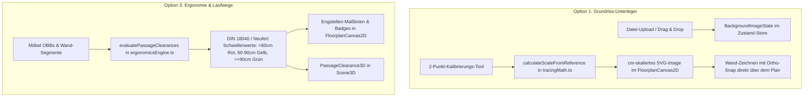

# Implementierungsplan: Grundriss-Unterleger (Option 1) & Laufwege-Heatmap (Option 3)

> **Für Agenten / Ausführende:** ERFORDERLICHE METHODIK: Nutze `superpowers:subagent-driven-development` oder folge TDD strikt Task für Task. Jeder Schritt enthält testbare Kriterien und Commit-Punkte.

**Ziel:**
1. **Option 1 (Grundriss-Unterleger & Tracing-Modus):** Ermöglicht das Laden eines Bildes (Exposé-Scan, Foto, PDF-Export als PNG/JPG/WebP/SVG), die zentimetergenaue 2-Punkt-Referenzkalibrierung, das freie Ausrichten/Sperren als Hintergrundebene und das fehlerfreie Abpausen mit dem bestehenden 90°-Fangmagneten.
2. **Option 3 (Ergonomie-, Laufwege- & Engstellen-Heatmap):** Analytische Erkennung aller lichten Durchgangsmaße zwischen Möbeln und Wänden gemäß DIN 18040 / Neufert mit Ampel-Klassifizierung (Grün $\ge 90\text{ cm}$, Gelb $60\text{–}90\text{ cm}$, Rot $< 60\text{ cm}$) sowie interaktiven Maßlinien-Badges im 2D-Editor und dezenten 3D-Boden-Warnungen.

---

## Architektur & Datenfluss



---

## Globale Randbedingungen & Standards

* **Maßstab:** $1\text{ Three.js / SVG Unit} = 1\text{ cm}$ strikt beibehalten (`EPSILON_CM = 0.05`).
* **Ergonomie-Normen:**
  * DIN 18040 (Barrierefreies Bauen / Wohnungen) & Neufert Bauentwurfslehre:
    * Hauptverkehrswege: Mindestens $90\text{ cm}$ lichte Breite.
    * Nebengänge & Bett-/Schrankabstände: Mindestens $60\text{ cm}$ lichte Breite.
    * Kritische Engstellen: Unter $60\text{ cm}$ (akute Behinderung im Alltag).
* **Zero-External-Dependencies:** Keine externen Bildverarbeitungs-Bibliotheken; native Browser-APIs (`FileReader`, `Image`, Canvas für Skalierung und SVG `<image>`).
* **Session-Sicherheit:** Unterleger-Metadaten und Heatmap-Zustand werden im Zustand-Store mit LocalStorage und Undo/Redo synchronisiert.

---

## User Review Required

> [!IMPORTANT]
> **Speichergröße von Bildern im LocalStorage:**
> Hochauflösende Exposé-Fotos (z. B. 10 MB) können das 5-MB-Kontingent des Browser-LocalStorage sprengen. Der Plan sieht vor:
> 1. Das Originalbild wird im Arbeitsspeicher (Blob-URL) gehalten.
> 2. Für den LocalStorage-Export wird das Bild im Tracing-Modus clientseitig automatisch auf eine Arbeitsauflösung von max. 1920 px skaliert (komprimiertes WebP/JPEG, ~200–400 kB).

---

## Geplante Änderungen nach Komponenten

### Komponente 1: Core Types & Mathematik-Engines

#### [MODIFY] [`src/core/types.ts`](../../../src/core/types.ts)
* Ergänzung von `BackgroundImageOverlay`:
```ts
export interface BackgroundImageOverlay {
  id: string;
  url: string; // Data URL oder Object URL
  filename: string;
  xCm: number; // Mittelpunkt X in cm
  zCm: number; // Mittelpunkt Z in cm
  widthCm: number; // Skalierte Breite in cm
  heightCm: number; // Skalierte Höhe in cm
  rotationDeg: number; // Drehung in Grad (0, 90, 180, 270 oder frei)
  opacity: number; // 0.1 bis 1.0 (Standard 0.45)
  visible: boolean; // Standard true
  locked: boolean; // Standard false (wenn gesperrt: keine Drag-Interaktion, reines Abpausen)
  naturalWidthPx: number;
  naturalHeightPx: number;
}
```
* Erweiterung von `EditorTool`:
```ts
export type EditorTool = 'select' | 'draw-wall' | 'add-door' | 'add-window' | 'measure' | 'calibrate-scale';
```
* Ergänzung der Ergonomie-Typen:
```ts
export type PassageSeverity = 'critical' | 'warning' | 'optimal';

export interface PassageClearance {
  id: string;
  entity1Id: string;
  entity1Type: 'furniture' | 'wall';
  entity1Name: string;
  entity2Id: string;
  entity2Type: 'furniture' | 'wall';
  entity2Name: string;
  clearanceCm: number;
  severity: PassageSeverity;
  point1: { x: number; z: number };
  point2: { x: number; z: number };
}

export interface PassageClearanceReport {
  passages: PassageClearance[];
  criticalCount: number;
  warningCount: number;
  minClearanceCm: number | null;
}
```

---

#### [NEW] [`src/core/tracingMath.ts`](../../../src/core/tracingMath.ts)
* Reine Berechnungsfunktionen für Bildskalierung und Referenzstrecken:
  * `calculateScaleFromReference(p1: Point2D, p2: Point2D, realDistanceCm: number, naturalWidthPx: number, naturalHeightPx: number)`:
    Berechnet die Pixel-Distanz $\sqrt{\Delta x^2 + \Delta y^2}$, ermittelt $\text{cmPerPixel} = \frac{\text{realDistanceCm}}{\text{pixelDist}}$ und liefert `widthCm` und `heightCm`.
  * `fitOverlayToViewport(naturalWidthPx: number, naturalHeightPx: number, viewBox: { x: number, y: number, w: number, h: number })`:
    Zentriert das Bild initial sinnvoll im sichtbaren Bereich des Grundrisses.

---

#### [NEW] [`src/core/ergonomicsEngine.ts`](../../../src/core/ergonomicsEngine.ts)
* Analysiert systematisch alle Engstellen der Wohnung:
  * `evaluatePassageClearances(furniture: FurnitureItem[], walls: Wall[], corners: Corner[], maxDistanceCm: number = 120): PassageClearanceReport`
  * Nutzt die bestehende SAT-Abstandsberechnung aus [`measureMath.ts`](../../../src/core/measureMath.ts).
  * Untersucht:
    1. Möbel $\leftrightarrow$ Möbel (z. B. Bett $\leftrightarrow$ Kleiderschrank, Couch $\leftrightarrow$ Couchtisch).
    2. Möbel $\leftrightarrow$ Wand (z. B. Schreibtischstuhl $\leftrightarrow$ Wand, Esstisch $\leftrightarrow$ Wand).
  * Filtert Duplikate und Möbelstücke, die bewusst aneinander grenzen (z. B. Wandanschlag mit Clearance $< 2\text{ cm}$).
  * Weist `severity` zu:
    * $< 60\text{ cm} \rightarrow \text{'critical'}$ (Rot)
    * $60\text{–}90\text{ cm} \rightarrow \text{'warning'}$ (Gelb)
    * $90\text{–}120\text{ cm} \rightarrow \text{'optimal'}$ (Grün)

---

### Komponente 2: State Management

#### [MODIFY] [`src/store/useFloorplanStore.ts`](../../../src/store/useFloorplanStore.ts)
* Neue State-Felder & Aktionen:
  * `backgroundImage: BackgroundImageOverlay | null`
  * `setBackgroundImage: (image: BackgroundImageOverlay | null) => void`
  * `updateBackgroundImage: (patch: Partial<BackgroundImageOverlay>) => void`
  * `calibrationState: { p1: { x: number; z: number } | null; p2: { x: number; z: number } | null; active: boolean }`
  * `startCalibration: () => void`
  * `setCalibrationPoint: (pt: { x: number; z: number }) => void`
  * `applyCalibration: (realDistanceCm: number) => void`
  * `cancelCalibration: () => void`
  * `showPassageHeatmap: boolean`
  * `setShowPassageHeatmap: (show: boolean) => void`
* Synchronisation mit `saveToLocalStorage` und `undoStack`.

---

### Komponente 3: 2D-Editor & Overlays

#### [NEW] [`src/components/editor2d/BackgroundOverlayControls.tsx`](../../../src/components/editor2d/BackgroundOverlayControls.tsx)
* Schwebende Toolbar im 2D-Canvas (oben rechts unter den Viewport-Controls), wenn ein Unterleger geladen ist:
  * Schnellanzeige des Bildnamens.
  * Schieberegler für Deckkraft ($10\%\dots100\%$).
  * Schloss-Button: `Gesperrt / Entsperrt` (verhindert versehentliches Verschieben beim Wand-Zeichnen).
  * Button `📏 2-Punkt-Kalibrieren`.
  * Button `Sichtbarkeit (Auge)`.
  * Button `Löschen`.

#### [MODIFY] [`src/components/editor2d/FloorplanCanvas2D.tsx`](../../../src/components/editor2d/FloorplanCanvas2D.tsx)
* **Unterleger-Ebene:** Rendert das SVG `<image>` unter dem Gitter und unter den Boden-Polygonen (`pointer-events: none`, wenn gesperrt).
* **Kalibrierungs-Vorschau:** Wenn `activeTool === 'calibrate-scale'`, werden Klicks als Referenzpunkte A und B registriert, eine leuchtende Cyan-Messlinie mit Fadenkreuz-Punkten gezeichnet und ein Eingabe-Dialog ("Reales Maß in cm eingeben") geöffnet.
* **Laufwege-Overlay:** Wenn `showPassageHeatmap === true`:
  * Rendert animierte/gestrichelte Verbindungslinien zwischen den Engstellen.
  * Farbcodierte DIN-Pills mit Schatten: z. B. `⚠️ 54 cm` (Rot), `⚡ 78 cm` (Gelb), `✓ 98 cm` (Grün).
  * Klick auf ein Badge zoomt oder fokussiert die Engstelle.

---

### Komponente 4: TopBar Integration

#### [MODIFY] [`src/components/layout/TopBar.tsx`](../../../src/components/layout/TopBar.tsx)
* Neuer Button **„Grundriss-Unterleger“** (`ImageIcon` / `FileUp`):
  * Öffnet Dateiauswahl für PNG, JPG, WebP, SVG.
  * Nach Auswahl automatische Platzierung und Aktivierung des Tracing-Modus.
* Neuer Toggle-Button **„Laufwege & Ergonomie“** (`Footprints` / `Activity`):
  * Schaltet die Heatmap-Analyse ein/aus.
  * Badge mit Warn-Indikator, wenn kritische Engstellen vorliegen: z. B. `Laufwege (2 ⚠️)`.

---

### Komponente 5: 3D Ergonomie-Visualisierung

#### [NEW] [`src/components/viewer3d/PassageClearance3D.tsx`](../../../src/components/viewer3d/PassageClearance3D.tsx)
* Visualisiert die Engstellen in der 3D-Szene:
  * Flache, dezent leuchtende Streifen auf Fußbodenhöhe ($Y = 0.2\text{ cm}$) zwischen den kollidierenden Kanten.
  * R3F `<Html>` Pill-Label bei kritischen Engstellen ($< 60\text{ cm}$), lesbar aus jedem Kamerawinkel.
* Deaktiviert im Performance-Modus oder wenn Heatmap ausgeschaltet ist.

#### [MODIFY] [`src/components/viewer3d/Scene3D.tsx`](../../../src/components/viewer3d/Scene3D.tsx)
* Mountet `<PassageClearance3D />` dynamisch in der 3D-Szene.

---

## Aufgabenplan (Bite-Sized Tasks)

### Task 1: Tracing-Mathematik & Skalierung
**Dateien:**
- Create: [`src/core/tracingMath.ts`](../../../src/core/tracingMath.ts)
- Test: [`tests/tracingMath.test.ts`](../../../tests/tracingMath.test.ts)

- [ ] **Schritt 1:** Test für `calculateScaleFromReference` schreiben (Prüfung von Diagonalen, Skalierungsfaktor cm/px, Grenzfall `dist <= 0`).
- [ ] **Schritt 2:** Test ausführen und verifizieren, dass er fehlschlägt.
- [ ] **Schritt 3:** `calculateScaleFromReference` in `src/core/tracingMath.ts` implementieren.
- [ ] **Schritt 4:** Testsuite ausführen und 100% grün bestätigen.
- [ ] **Schritt 5:** Git commit: `feat(tracing): implement reference scaling math`.

---

### Task 2: Ergonomie- & Engstellen-Engine (DIN 18040 / Neufert)
**Dateien:**
- Create: [`src/core/ergonomicsEngine.ts`](../../../src/core/ergonomicsEngine.ts)
- Test: [`tests/ergonomicsEngine.test.ts`](../../../tests/ergonomicsEngine.test.ts)

- [ ] **Schritt 1:** Test schreiben: Sofa und Couchtisch mit 50 cm Abstand (muss `critical` sein), Esstisch zu Wand mit 75 cm (muss `warning` sein), Durchgang mit 105 cm (muss `optimal` sein).
- [ ] **Schritt 2:** Test ausführen und Fehlschlag prüfen.
- [ ] **Schritt 3:** `evaluatePassageClearances` in `src/core/ergonomicsEngine.ts` implementieren.
- [ ] **Schritt 4:** Tests ausführen und Bestehen validieren.
- [ ] **Schritt 5:** Git commit: `feat(ergonomics): implement passage clearance evaluation based on DIN 18040`.

---

### Task 3: Zustand Store Erweiterung (Unterleger & Heatmap State)
**Dateien:**
- Modify: [`src/core/types.ts`](../../../src/core/types.ts)
- Modify: [`src/store/useFloorplanStore.ts`](../../../src/store/useFloorplanStore.ts)
- Test: [`tests/storeTracingErgonomics.test.ts`](../../../tests/storeTracingErgonomics.test.ts)

- [ ] **Schritt 1:** Test schreiben für `setBackgroundImage`, `updateBackgroundImage`, 2-Punkt-Kalibrierung und Heatmap-Toggle.
- [ ] **Schritt 2:** Typen und Store-Actions implementieren.
- [ ] **Schritt 3:** Tests verifizieren und Undo/Redo & LocalStorage-Sicherheit prüfen.
- [ ] **Schritt 4:** Git commit: `feat(store): add background image tracing and ergonomics heatmap state`.

---

### Task 4: 2D Grundriss-Unterleger & Kalibrierungs-UI
**Dateien:**
- Create: [`src/components/editor2d/BackgroundOverlayControls.tsx`](../../../src/components/editor2d/BackgroundOverlayControls.tsx)
- Modify: [`src/components/editor2d/FloorplanCanvas2D.tsx`](../../../src/components/editor2d/FloorplanCanvas2D.tsx)
- Modify: [`src/components/layout/TopBar.tsx`](../../../src/components/layout/TopBar.tsx)
- Test: [`tests/backgroundOverlayUI.test.ts`](../../../tests/backgroundOverlayUI.test.ts)

- [ ] **Schritt 1:** Test für das Rendern des `<image>` und der Floating-Controls schreiben.
- [ ] **Schritt 2:** Floating Overlay Controls und Canvas `<image>` Integration implementieren.
- [ ] **Schritt 3:** 2-Punkt-Kalibrierungs-Interaktion im 2D-Canvas einbauen (Klick A, Klick B, cm-Eingabe).
- [ ] **Schritt 4:** Tests und Build ausführen.
- [ ] **Schritt 5:** Git commit: `feat(editor2d): render scalable background plan overlay with calibration controls`.

---

### Task 5: 2D & 3D Ergonomie- & Laufwege-Heatmap Overlay
**Dateien:**
- Modify: [`src/components/editor2d/FloorplanCanvas2D.tsx`](../../../src/components/editor2d/FloorplanCanvas2D.tsx)
- Create: [`src/components/viewer3d/PassageClearance3D.tsx`](../../../src/components/viewer3d/PassageClearance3D.tsx)
- Modify: [`src/components/viewer3d/Scene3D.tsx`](../../../src/components/viewer3d/Scene3D.tsx)
- Modify: [`src/components/layout/TopBar.tsx`](../../../src/components/layout/TopBar.tsx)
- Test: [`tests/passageHeatmapUI.test.ts`](../../../tests/passageHeatmapUI.test.ts)

- [ ] **Schritt 1:** Test für die Visualisierung der DIN-Pills im 2D-Canvas und TopBar-Indikator schreiben.
- [ ] **Schritt 2:** 2D-Ampel-Badges und Verbindungslinien in `FloorplanCanvas2D.tsx` einbauen.
- [ ] **Schritt 3:** 3D-Bodenmarkierungen und Badges in `PassageClearance3D.tsx` implementieren.
- [ ] **Schritt 4:** TopBar-Toggle-Button mit Live-Zähler kritischer Engstellen integrieren.
- [ ] **Schritt 5:** Git commit: `feat(ergonomics): render passage clearance overlay in 2D and 3D`.

---

### Task 6: Wiki-Dokumentation & Gesamtsystem-Verifikation
**Dateien:**
- Modify: [`wiki/log.md`](../../../wiki/log.md)
- Modify: [`README.md`](../../../README.md)

- [ ] **Schritt 1:** Gesamte Testsuite (`npm test`) ausführen (alle Tests grün).
- [ ] **Schritt 2:** Production-Build (`npm run build`) fehlerfrei durchführen.
- [ ] **Schritt 3:** `wiki/log.md` gemäß Karpathy-Wiki SCHEMA aktualisieren.
- [ ] **Schritt 4:** Git commit: `docs(wiki): record floorplan tracing and ergonomics clearance implementation`.

---

## Verifikationsplan

### Automatisierte Tests
```bash
npm test tests/tracingMath.test.ts
npm test tests/ergonomicsEngine.test.ts
npm test tests/storeTracingErgonomics.test.ts
npm test tests/backgroundOverlayUI.test.ts
npm test tests/passageHeatmapUI.test.ts
npm test # Gesamte Suite: alle Tests müssen 100% grün sein
npm run build # Vollständiger TypeScript- & Vite-Production-Build
```

### Manuelle Verifikation
1. **Option 1 (Grundriss-Unterleger):**
   * Im 2D-Editor auf „Grundriss-Unterleger“ klicken und ein Test-Bild laden.
   * Auf „📏 Kalibrieren“ klicken, Start- und Endpunkt einer Wand anklicken und z. B. `380` cm eingeben.
   * Prüfen, ob das Bild exakt auf die 380 cm skaliert wird.
   * Bild sperren und eine Wand mit 90°-Fang darüber zeichnen.
   * Deckkraft mit dem Schieberegler von 10% bis 100% testen.
2. **Option 3 (Ergonomie- & Laufwege-Heatmap):**
   * TopBar-Schalter „Laufwege & Ergonomie“ aktivieren.
   * Ein Möbelstück (z. B. Couchtisch) dicht an das Sofa schieben ($< 60\text{ cm}$) $\rightarrow$ Rote `⚠️ X cm`-Markierung erscheint.
   * Möbelstück auf $75\text{ cm}$ abrücken $\rightarrow$ Gelbe Markierung.
   * Möbelstück auf $100\text{ cm}$ abrücken $\rightarrow$ Grüne Markierung.
   * In den 3D-Modus wechseln und prüfen, ob die Engstellen auch räumlich auf dem Boden ablesbar sind.
