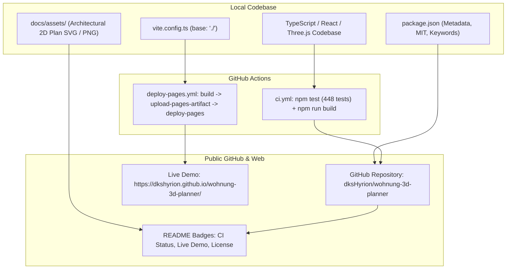

# GitHub Repository Enhancements Implementation Plan (Tasks A, B, C, D)

> **For agentic workers:** REQUIRED SUB-SKILL: Use superpowers:subagent-driven-development to implement this plan task-by-task. Steps use checkbox (`- [ ]`) syntax for tracking.

**Goal:** Enhance the public GitHub repository [`dksHyrion/wohnung-3d-planner`](https://github.com/dksHyrion/wohnung-3d-planner) with automated CI testing (Task A), a 1-click GitHub Pages live-demo deployment (Task B), visual architectural previews in [`README.md`](file:///home/agy/Wohnung/README.md) (Task C), and enriched metadata in [`package.json`](file:///home/agy/Wohnung/package.json) (Task D).

**Architecture:**
- **CI / CD Pipeline:** GitHub Actions workflows (`.github/workflows/ci.yml` and `.github/workflows/deploy-pages.yml`) execute on `ubuntu-latest` with Node 20. CI validates all 448 Vitest tests and production TypeScript builds on every push/PR. Pages workflow builds with relative asset resolution (`base: './'` in `vite.config.ts`) and deploys to `https://dkshyrion.github.io/wohnung-3d-planner/`.
- **Visual Presentation:** Pure architectural vector SVG and high-res PNG previews generated by the built-in export engine (`exportScaledFloorplanSvg`), embedded directly in `README.md`.
- **Package Manifest:** Standardized open-source metadata in `package.json` (MIT license, GitHub repository, keywords, homepage, and issues tracker).

**Architecture Diagram:**

**Tech Stack:**
- GitHub Actions (`actions/checkout@v4`, `actions/setup-node@v4`, `actions/upload-pages-artifact@v3`, `actions/deploy-pages@v4`)
- GitHub Pages REST API (`gh api`)
- Vite 5 (`base: './'`), Vitest 2, TypeScript 5
- ImageMagick (`convert`), SVG architectural export engine

**Spec:** Direct user instructions: *„Mache A, B, C und D nacheinander“*.

## Global Constraints
- All 448 automated Vitest tests across 41 files must remain 100% green.
- `npm run build` (`tsc -b && vite build`) must succeed with 0 errors.
- Zero leaks of private names or real-world addresses (privacy invariant).
- 100% offline-first compatibility in local development and production.

---

### Task 1 (Task D): Enrich `package.json` Metadata

**Files:**
- Modify: [`package.json`](file:///home/agy/Wohnung/package.json)
- Test: [`tests/packageMetadata.test.ts`](file:///home/agy/Wohnung/tests/packageMetadata.test.ts)

**Interfaces:**
- Consumes: Existing package configuration
- Produces: Standardized open-source fields (`description`, `license`, `repository`, `homepage`, `keywords`, `bugs`)

- [ ] **Step 1: Write failing test verifying package.json metadata**
- [ ] **Step 2: Run test to verify it fails**
- [ ] **Step 3: Update `package.json`**
- [ ] **Step 4: Run test to verify it passes**
- [ ] **Step 5: Commit Task D**

---

### Task 2 (Task A): GitHub Actions CI Workflow

**Files:**
- Create: [`.github/workflows/ci.yml`](file:///home/agy/Wohnung/.github/workflows/ci.yml)
- Modify: [`README.md`](file:///home/agy/Wohnung/README.md)
- Test: [`tests/workflowSyntax.test.ts`](file:///home/agy/Wohnung/tests/workflowSyntax.test.ts)

**Interfaces:**
- Consumes: `package.json`, `npm test`, `npm run build`
- Produces: GitHub CI status badge and automated test gate on GitHub

- [ ] **Step 1: Write test verifying CI workflow file existence and YAML validity**
- [ ] **Step 2: Run test to verify it fails**
- [ ] **Step 3: Create `.github/workflows/ci.yml`**
- [ ] **Step 4: Add CI Status Badge to `README.md`**
- [ ] **Step 5: Run tests and verify**
- [ ] **Step 6: Commit Task A**

---

### Task 3 (Task B): GitHub Pages Live-Demo Deployment

**Files:**
- Modify: [`vite.config.ts`](file:///home/agy/Wohnung/vite.config.ts)
- Create: [`.github/workflows/deploy-pages.yml`](file:///home/agy/Wohnung/.github/workflows/deploy-pages.yml)
- Modify: [`README.md`](file:///home/agy/Wohnung/README.md)
- Test: [`tests/workflowSyntax.test.ts`](file:///home/agy/Wohnung/tests/workflowSyntax.test.ts)

**Interfaces:**
- Consumes: `vite build` with relative asset links (`base: './'`)
- Produces: Live web app hosted at `https://dkshyrion.github.io/wohnung-3d-planner/`

- [ ] **Step 1: Update `tests/workflowSyntax.test.ts` to assert deploy-pages.yml**
- [ ] **Step 2: Update `vite.config.ts` with `base: './'`**
- [ ] **Step 3: Create `.github/workflows/deploy-pages.yml`**
- [ ] **Step 4: Add Live Demo badge and quick link to `README.md`**
- [ ] **Step 5: Verify build with `base: './'` and run test**
- [ ] **Step 6: Commit Task B**

---

### Task 4 (Task C): Visual Preview & Screenshots in `README.md`

**Files:**
- Create: [`docs/assets/floorplan-2d-55sqm.svg`](file:///home/agy/Wohnung/docs/assets/floorplan-2d-55sqm.svg)
- Create: [`docs/assets/floorplan-2d-55sqm.png`](file:///home/agy/Wohnung/docs/assets/floorplan-2d-55sqm.png)
- Create: [`docs/assets/banner.svg`](file:///home/agy/Wohnung/docs/assets/banner.svg)
- Modify: [`README.md`](file:///home/agy/Wohnung/README.md)
- Test: [`tests/assetsIntegrity.test.ts`](file:///home/agy/Wohnung/tests/assetsIntegrity.test.ts)

**Interfaces:**
- Consumes: `exportScaledFloorplanSvg` in `src/core/export/planSvgExport.ts`, `PRESET_FLOORPLANS['standard-55'].data`
- Produces: Architectural vector floorplan SVG and high-resolution raster image embedded in `README.md`

- [ ] **Step 1: Write test asserting asset presence and validity**
- [ ] **Step 2: Generate `docs/assets/floorplan-2d-55sqm.svg` & `banner.svg`**
- [ ] **Step 3: Embed previews in `README.md`**
- [ ] **Step 4: Run test to verify it passes**
- [ ] **Step 5: Commit Task C**

---

### Task 5: Final Push & GitHub Pipeline Verification

- [ ] **Step 1: Run complete test suite and production build**
- [ ] **Step 2: Push to GitHub `main` branch**
- [ ] **Step 3: Verify GitHub Actions run status**
