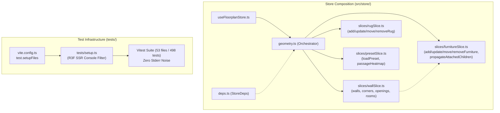

# Implementation Plan: DX, Test-Hygiene & Codebase-Struktur

> **For agentic workers:** REQUIRED SUB-SKILL: Use superpowers:subagent-driven-development to implement this plan task-by-task. Steps use checkbox (`- [ ]`) syntax for tracking.

**Goal:** Clean up the test suite noise (filtering expected React Three Fiber SSR markup warnings in Vitest) and modularize the monolithic 1038-line `src/store/geometry.ts` into maintainable, focused domain slices (`furnitureSlice`, `wallSlice`, `rugSlice`, `presetSlice`) while preserving 100% backward compatibility and test coverage.

**Architecture:**
1. A Vitest `setupFiles` hook (`tests/setup.ts`) intercepts React DOM warnings generated when rendering custom Three.js JSX tags (`<mesh>`, `<boxGeometry>`, `<roundedBox>`) with WebGL props (`castShadow`, `receiveShadow`) via `ReactDOMServer.renderToStaticMarkup`.
2. The 1038-line `src/store/geometry.ts` is decomposed into four focused slices under `src/store/slices/`:
   - `furnitureSlice.ts` (furniture items, attachments, catalog resets, `propagateAttachedChildren`)
   - `wallSlice.ts` (walls, corners, openings, room labels)
   - `rugSlice.ts` (area rugs)
   - `presetSlice.ts` (preset loading, passage heatmap)
3. `src/store/geometry.ts` acts as the orchestrator/composer, aggregating all slices and re-exporting `propagateAttachedChildren` so that existing consumers (`useFloorplanStore.ts`) experience zero breaking changes.

**Architecture Diagram:**



**Tech Stack:** React 18, Three.js (r170), `@react-three/fiber`, Zustand 5, TypeScript 5, Vite 5, Vitest 2.

**Spec:** Section 5 of the technical architecture review ("5. DX, Test-Hygiene & Codebase-Struktur").

## Global Constraints

- **Scale & Units:** `1 Three.js Unit = 1 cm`, `EPSILON_CM = 0.05`.
- **Test Integrity:** All 498 existing tests across 53 test files must continue to pass without regression.
- **Backwards Compatibility:** `createGeometryActions(deps)` signature and `propagateAttachedChildren` export in `src/store/geometry.ts` must remain identical.
- **Offline-First:** No new runtime dependencies.
- **Wiki Documentation:** Document changes in [`wiki/log.md`](file:///home/agy/Wohnung/wiki/log.md).

---

## User Review Required

> [!NOTE]
> The Vitest console filter in `tests/setup.ts` only suppresses the well-known React DOM warnings caused by `ReactDOMServer.renderToStaticMarkup` attempting to parse Three.js WebGL tags (`castShadow`, `receiveShadow`, `<extrudeGeometry />`, `useLayoutEffect on server`). Any genuine runtime errors or test assertion failures remain completely untouched and will fail loudly.

---

### Task 1: Vitest Test-Hygiene & Console Filter Setup

**Files:**
- Create: [`tests/setup.ts`](file:///home/agy/Wohnung/tests/setup.ts)
- Modify: [`vite.config.ts`](file:///home/agy/Wohnung/vite.config.ts:58-61)
- Test: [`tests/sprint2DataModel.test.ts`](file:///home/agy/Wohnung/tests/sprint2DataModel.test.ts)

**Interfaces:**
- Consumes: Vitest environment hooks, Node `console.error` and `console.warn`.
- Produces: `tests/setup.ts` registered in `vite.config.ts`.

- [ ] **Step 1: Write `tests/setup.ts` with console filter**

```typescript
// tests/setup.ts
const originalConsoleError = console.error;
const originalConsoleWarn = console.warn;

const R3F_DOM_WARNING_PATTERNS = [
  'React does not recognize the `castShadow` prop on a DOM element',
  'React does not recognize the `receiveShadow` prop on a DOM element',
  'is using incorrect casing. Use PascalCase for React components, or lowercase for HTML elements.',
  'useLayoutEffect does nothing on the server',
];

console.error = (...args: unknown[]) => {
  const message = typeof args[0] === 'string' ? args[0] : '';
  if (R3F_DOM_WARNING_PATTERNS.some((pattern) => message.includes(pattern))) {
    return;
  }
  originalConsoleError(...args);
};

console.warn = (...args: unknown[]) => {
  const message = typeof args[0] === 'string' ? args[0] : '';
  if (R3F_DOM_WARNING_PATTERNS.some((pattern) => message.includes(pattern))) {
    return;
  }
  originalConsoleWarn(...args);
};
```

- [ ] **Step 2: Update `vite.config.ts` to include `setupFiles`**

```diff
   test: {
     testTimeout: 15000,
+    setupFiles: ['./tests/setup.ts'],
   },
```

- [ ] **Step 3: Run targeted test to verify that stderr warnings are eliminated**

Run: `npx vitest run tests/sprint2DataModel.test.ts`
Expected: 45 tests pass, stderr is completely clean with 0 React DOM casing/prop warnings.

- [ ] **Step 4: Commit**

```bash
git add tests/setup.ts vite.config.ts
git commit -m "test(dx): filter expected R3F SSR markup warnings in vitest"
```

---

### Task 2: Furniture Slice Extraction

**Files:**
- Create: [`src/store/slices/furnitureSlice.ts`](file:///home/agy/Wohnung/src/store/slices/furnitureSlice.ts)
- Modify: [`src/store/geometry.ts`](file:///home/agy/Wohnung/src/store/geometry.ts)
- Test: [`tests/designerFurniture.test.ts`](file:///home/agy/Wohnung/tests/designerFurniture.test.ts)

**Interfaces:**
- Consumes: `StoreDeps` from `../deps`, `FurnitureItem` and `AlignmentGuide` from `../../core/types`, `computeFurnitureAlignment` from `../../core/alignmentMath`, `findWallSnap` from `../../core/wallMath`.
- Produces: `FurnitureActions`, `createFurnitureSlice(deps: StoreDeps): FurnitureActions`, `propagateAttachedChildren`.

- [ ] **Step 1: Create `src/store/slices/furnitureSlice.ts`**

Move `propagateAttachedChildren` and furniture actions from `src/store/geometry.ts`:
- `addFurniture`
- `updateFurniture`
- `moveFurniture`
- `removeFurniture`
- `toggleFurnitureRealStatus`
- `setFurnitureRealStatus`
- `resetFurnitureToCatalogDimensions`

- [ ] **Step 2: Update `src/store/geometry.ts` to delegate to `createFurnitureSlice`**

Export `propagateAttachedChildren` from `geometry.ts` as a re-export to maintain backward compatibility.

- [ ] **Step 3: Run furniture tests to verify behavior**

Run: `npx vitest run tests/designerFurniture.test.ts tests/furnitureInventory.test.ts`
Expected: All tests pass.

- [ ] **Step 4: Commit**

```bash
git add src/store/slices/furnitureSlice.ts src/store/geometry.ts
git commit -m "refactor(store): extract furnitureSlice from geometry monolith"
```

---

### Task 3: Wall & Opening Slice Extraction

**Files:**
- Create: [`src/store/slices/wallSlice.ts`](file:///home/agy/Wohnung/src/store/slices/wallSlice.ts)
- Modify: [`src/store/geometry.ts`](file:///home/agy/Wohnung/src/store/geometry.ts)
- Test: [`tests/wallMath.test.ts`](file:///home/agy/Wohnung/tests/wallMath.test.ts)
- Test: [`tests/sprint1Geometry.test.ts`](file:///home/agy/Wohnung/tests/sprint1Geometry.test.ts)

**Interfaces:**
- Consumes: `StoreDeps` from `../deps`, `propagateAttachedChildren` from `./furnitureSlice`, `wallMath` functions.
- Produces: `WallActions`, `createWallSlice(deps: StoreDeps): WallActions`.

- [ ] **Step 1: Create `src/store/slices/wallSlice.ts`**

Extract wall, corner, room, and opening actions:
- `updateWallLengthCm`
- `updateWallProps`
- `addWallWithCorners`
- `removeWall`
- `moveCorner`
- `removeCorner`
- `updateRoom`
- `addOpening`
- `updateOpening`
- `removeOpening`

- [ ] **Step 2: Delegate wall actions in `src/store/geometry.ts` to `createWallSlice`**

- [ ] **Step 3: Run wall and opening tests to verify behavior**

Run: `npx vitest run tests/wallMath.test.ts tests/sprint1Geometry.test.ts tests/doorLeaf.test.ts`
Expected: All tests pass.

- [ ] **Step 4: Commit**

```bash
git add src/store/slices/wallSlice.ts src/store/geometry.ts
git commit -m "refactor(store): extract wallSlice from geometry monolith"
```

---

### Task 4: Rug & Preset Slices Extraction and Geometry Orchestration

**Files:**
- Create: [`src/store/slices/rugSlice.ts`](file:///home/agy/Wohnung/src/store/slices/rugSlice.ts)
- Create: [`src/store/slices/presetSlice.ts`](file:///home/agy/Wohnung/src/store/slices/presetSlice.ts)
- Modify: [`src/store/geometry.ts`](file:///home/agy/Wohnung/src/store/geometry.ts)
- Test: [`tests/smartSnappingOpeningsRugs.test.ts`](file:///home/agy/Wohnung/tests/smartSnappingOpeningsRugs.test.ts)
- Test: [`tests/store.test.ts`](file:///home/agy/Wohnung/tests/store.test.ts)

**Interfaces:**
- Consumes: `StoreDeps` from `../deps`, `PRESET_FLOORPLANS` from `../../core/presets`, `evaluatePassageClearances` from `../../core/ergonomicsEngine`.
- Produces: `RugActions`, `PresetActions`, compact `createGeometryActions` in `src/store/geometry.ts` (<50 lines).

- [ ] **Step 1: Create `src/store/slices/rugSlice.ts`**

Contains:
- `addRug`
- `updateRug`
- `moveRug`
- `removeRug`

- [ ] **Step 2: Create `src/store/slices/presetSlice.ts`**

Contains:
- `loadPreset`
- `setShowPassageHeatmap`

- [ ] **Step 3: Refactor `src/store/geometry.ts` into a clean orchestrator**

```typescript
// src/store/geometry.ts
import type { StoreDeps } from './deps';
import type { FloorplanState } from './state';
import { createFurnitureSlice, propagateAttachedChildren } from './slices/furnitureSlice';
import { createWallSlice } from './slices/wallSlice';
import { createRugSlice } from './slices/rugSlice';
import { createPresetSlice } from './slices/presetSlice';

export type GeometryActions = Pick<
  FloorplanState,
  | 'setShowPassageHeatmap'
  | 'updateWallLengthCm'
  | 'updateWallProps'
  | 'addWallWithCorners'
  | 'removeWall'
  | 'moveCorner'
  | 'removeCorner'
  | 'updateRoom'
  | 'addOpening'
  | 'updateOpening'
  | 'removeOpening'
  | 'addFurniture'
  | 'updateFurniture'
  | 'moveFurniture'
  | 'removeFurniture'
  | 'toggleFurnitureRealStatus'
  | 'setFurnitureRealStatus'
  | 'resetFurnitureToCatalogDimensions'
  | 'addRug'
  | 'updateRug'
  | 'moveRug'
  | 'removeRug'
  | 'loadPreset'
>;

export { propagateAttachedChildren };

export function createGeometryActions(deps: StoreDeps): GeometryActions {
  return {
    ...createPresetSlice(deps),
    ...createWallSlice(deps),
    ...createFurnitureSlice(deps),
    ...createRugSlice(deps),
  };
}
```

- [ ] **Step 4: Run rug, preset and store tests**

Run: `npx vitest run tests/smartSnappingOpeningsRugs.test.ts tests/store.test.ts tests/storeUndoAutosave.test.ts`
Expected: All tests pass.

- [ ] **Step 5: Commit**

```bash
git add src/store/slices/rugSlice.ts src/store/slices/presetSlice.ts src/store/geometry.ts
git commit -m "refactor(store): modularize geometry store into dedicated domain slices"
```

---

### Task 5: Dedicated Unit Tests for Modular Store Slices

**Files:**
- Create: [`tests/storeSlices.test.ts`](file:///home/agy/Wohnung/tests/storeSlices.test.ts)

**Interfaces:**
- Consumes: `createFurnitureSlice`, `createWallSlice`, `createRugSlice`, `createPresetSlice`, `createGeometryActions`.
- Produces: Test assertions for isolated slice behavior and complete composition.

- [ ] **Step 1: Write `tests/storeSlices.test.ts`**

```typescript
import { describe, it, expect } from 'vitest';
import { useFloorplanStore } from '../src/store/useFloorplanStore';
import { propagateAttachedChildren } from '../src/store/slices/furnitureSlice';

describe('Modular Store Slices Isolation and Composition', () => {
  it('exports propagateAttachedChildren from furnitureSlice and re-exports from geometry', async () => {
    const geom = await import('../src/store/geometry');
    const furn = await import('../src/store/slices/furnitureSlice');
    expect(typeof geom.propagateAttachedChildren).toBe('function');
    expect(geom.propagateAttachedChildren).toBe(furn.propagateAttachedChildren);
  });

  it('exposes all geometry, wall, rug, and preset actions through store', () => {
    const state = useFloorplanStore.getState();
    expect(typeof state.addFurniture).toBe('function');
    expect(typeof state.updateFurniture).toBe('function');
    expect(typeof state.moveFurniture).toBe('function');
    expect(typeof state.removeFurniture).toBe('function');
    expect(typeof state.addWallWithCorners).toBe('function');
    expect(typeof state.updateWallLengthCm).toBe('function');
    expect(typeof state.addRug).toBe('function');
    expect(typeof state.loadPreset).toBe('function');
    expect(typeof state.setShowPassageHeatmap).toBe('function');
  });

  it('correctly propagates attached accessories via propagateAttachedChildren', () => {
    const parentBefore = {
      id: 'desk-1',
      name: 'Desk',
      category: 'office' as const,
      visual: 'desk' as const,
      widthCm: 160,
      heightCm: 75,
      depthCm: 80,
      x: 100,
      z: 100,
      elevationCm: 0,
      rotationYDeg: 0,
    };
    const childBefore = {
      id: 'monitor-1',
      name: 'Monitor',
      category: 'office' as const,
      visual: 'desk-monitor' as const,
      widthCm: 60,
      heightCm: 45,
      depthCm: 15,
      x: 100,
      z: 100,
      elevationCm: 75,
      rotationYDeg: 0,
      attachedToId: 'desk-1',
    };
    const parentAfter = {
      ...parentBefore,
      x: 150,
      z: 120,
    };
    const updated = propagateAttachedChildren(
      [parentBefore, childBefore],
      [parentAfter, childBefore],
      'desk-1'
    );
    const movedChild = updated.find((f) => f.id === 'monitor-1');
    expect(movedChild?.x).toBe(150);
    expect(movedChild?.z).toBe(120);
    expect(movedChild?.elevationCm).toBe(75);
  });
});
```

- [ ] **Step 2: Run test suite for `storeSlices.test.ts`**

Run: `npx vitest run tests/storeSlices.test.ts`
Expected: 3 passed tests.

- [ ] **Step 3: Commit**

```bash
git add tests/storeSlices.test.ts
git commit -m "test(store): add unit test suite for modular store slices"
```

---

### Task 6: Verification & Karpathy LLM-Wiki Audit Trail

**Files:**
- Modify: [`wiki/log.md`](file:///home/agy/Wohnung/wiki/log.md)
- Test: All tests across repository (`npm test`)
- Build: Production build (`npm run build`)

- [ ] **Step 1: Execute full test suite**

Run: `npm test`
Expected: All 54 test files pass, zero failures, zero R3F stderr noise.

- [ ] **Step 2: Execute production build**

Run: `npm run build`
Expected: `tsc -b && vite build` succeeds with zero errors.

- [ ] **Step 3: Update `wiki/log.md`**

Append entry detailing the DX test-hygiene setup and store slice modularization.

- [ ] **Step 4: Commit**

```bash
git add wiki/log.md
git commit -m "docs(wiki): log DX test-hygiene and store modularization"
```

---

## Verification Plan

### Automated Tests
1. **Targeted Console Filter Check:**
   `npx vitest run tests/sprint2DataModel.test.ts tests/sprint3HonestVisuals.test.ts`
   Confirm that all tests pass without any React DOM warnings logged in stderr.
2. **Modular Slice Suite:**
   `npx vitest run tests/storeSlices.test.ts`
   Confirm all slice composition tests pass.
3. **Full Automated Test Suite:**
   `npm test`
   Confirm 500+ tests across 54 files pass.
4. **TypeScript & Production Build:**
   `npm run build`
   Confirm strict typecheck and Vite chunk bundling succeed.

### Manual Verification
1. Start dev server (`npm run dev`).
2. Open the application in the browser.
3. Test adding furniture, moving walls, adding rugs, switching presets, and verifying that the 2D canvas and 3D viewport update without any console errors.
