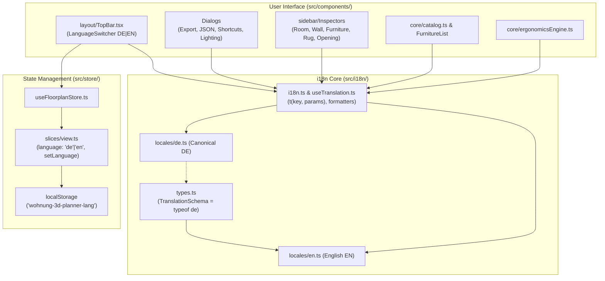

# Implementation Plan: UI Translation & Multilingual Support (DE / EN)

> **For agentic workers:** REQUIRED SUB-SKILL: Use superpowers:subagent-driven-development to implement this plan task-by-task. Steps use checkbox (`- [ ]`) syntax for tracking.

**Goal:** Implement a zero-dependency, type-safe, offline-first internationalization (i18n) system supporting German (DE) and English (EN) across all UI elements, toolbars, dialogs, inspectors, catalog items, and ergonomics notices, addressing GitHub Issue #1.

**Architecture:**
1. A lightweight, type-safe i18n subsystem in `src/i18n/` with canonical German dictionary (`de.ts`) enforcing 100% key parity on English dictionary (`en.ts`) at compile-time via TypeScript types.
2. Store integration in Zustand (`src/store/view.ts` and `src/store/state.ts`) managing `language: 'de' | 'en'` with persistent synchronization in `localStorage` (`'wohnung-3d-planner-lang'`) and automatic fallback to `'de'`.
3. A tactile `DE | EN` toggle button integrated into the `TopBar` header, with zero runtime CDN/network dependencies in full accordance with the offline-first architectural invariant.
4. UI component translation across TopBar, Dialogs (Export, JSON, Shortcuts, Lighting), Sidebar Inspectors, Overlay Controls, and Ergonomics Engine guidelines.

**Architecture Diagram:**



**Tech Stack:** React 18, Zustand 5, TypeScript 5, Lucide-React, Vitest 2.

**Spec:** GitHub Issue #1: "UI translation to English" (Feature Request by `@blender3darchitect`).

## Global Constraints

- **Offline-First:** 100% offline-capable; NO external i18n CDN libraries or runtime network fetches.
- **Visual Decoupling:** Invariant 3B in `AGENTS.md` strictly preserved: 3D model visuals and SAT collision bounds continue to depend solely on `item.visual` (`FurnitureVisualType`), never on localized display strings.
- **Default & Backwards Compatibility:** Default language is `'de'`, preserving exact strings and ensuring all 520 existing tests across 54 test files pass unchanged.
- **Strict Typing:** All translation keys checked at compile time; missing keys in `en.ts` trigger TypeScript compiler errors.
- **Wiki Documentation:** Record the i18n architecture in `wiki/i18n.md` and log changes in `wiki/log.md`.

---

### Task 1: Type-Safe i18n Subsystem & Dictionaries (DE / EN)

**Files:**
- Create: `src/i18n/types.ts`
- Create: `src/i18n/locales/de.ts`
- Create: `src/i18n/locales/en.ts`
- Create: `src/i18n/i18n.ts`
- Create: `src/i18n/useTranslation.ts`
- Test: `tests/i18n.test.ts`

**Interfaces:**
- Produces: `type Language = 'de' | 'en'`
- Produces: `function t(key: NestedKeyOf<TranslationSchema>, params?: Record<string, string | number>, lang?: Language): string`
- Produces: `function useTranslation(): { t: (key: string, params?: Record<string, string | number>) => string; language: Language; setLanguage: (lang: Language) => void }`

- [ ] **Step 1: Write failing unit test for i18n core**

Create `tests/i18n.test.ts`:
```ts
import { describe, it, expect } from 'vitest';
import { t, getTranslation, setGlobalLanguage, getGlobalLanguage } from '../src/i18n/i18n';
import { de } from '../src/i18n/locales/de';
import { en } from '../src/i18n/locales/en';

describe('i18n core subsystem', () => {
  it('resolves top-level and nested keys in German (default)', () => {
    setGlobalLanguage('de');
    expect(t('common.cancel')).toBe('Abbrechen');
    expect(t('topbar.tools.select')).toBe('Auswählen');
    expect(t('topbar.tools.wall')).toBe('Wand zeichnen');
  });

  it('resolves top-level and nested keys in English', () => {
    setGlobalLanguage('en');
    expect(t('common.cancel')).toBe('Cancel');
    expect(t('topbar.tools.select')).toBe('Select');
    expect(t('topbar.tools.wall')).toBe('Draw Wall');
  });

  it('interpolates dynamic parameters correctly', () => {
    setGlobalLanguage('de');
    expect(t('export.scaleValue', { scale: '1:50' })).toBe('Maßstab 1:50');
    setGlobalLanguage('en');
    expect(t('export.scaleValue', { scale: '1:50' })).toBe('Scale 1:50');
  });

  it('falls back gracefully to key or German if key is missing in English', () => {
    expect(getTranslation('en', 'common.save')).toBe('Save');
  });

  it('guarantees 100% dictionary key parity between German and English', () => {
    function getKeys(obj: any, prefix = ''): string[] {
      return Object.keys(obj).flatMap((key) => {
        const path = prefix ? `${prefix}.${key}` : key;
        return typeof obj[key] === 'object' && obj[key] !== null
          ? getKeys(obj[key], path)
          : [path];
      });
    }

    const deKeys = getKeys(de).sort();
    const enKeys = getKeys(en).sort();
    expect(enKeys).toEqual(deKeys);
  });
});
```

- [ ] **Step 2: Run test to verify it fails**

Run: `npx vitest run tests/i18n.test.ts`
Expected: FAIL (files `src/i18n/i18n` do not exist).

- [ ] **Step 3: Implement `types.ts`, `locales/de.ts`, `locales/en.ts`, `i18n.ts`, `useTranslation.ts`**

`src/i18n/types.ts`:
```ts
export type Language = 'de' | 'en';

export type TranslationSchema = {
  common: {
    cancel: string;
    save: string;
    delete: string;
    close: string;
    edit: string;
    apply: string;
    reset: string;
    width: string;
    height: string;
    depth: string;
    elevation: string;
    rotation: string;
    color: string;
    area: string;
    loading: string;
    error: string;
    none: string;
  };
  topbar: {
    brand: string;
    tools: {
      select: string;
      wall: string;
      door: string;
      window: string;
      measure: string;
    };
    views: {
      mode2d: string;
      mode3d: string;
      split: string;
    };
    cameraPresets: {
      perspective: string;
      isometric: string;
      topDown: string;
      firstPerson: string;
    };
    actions: {
      undo: string;
      redo: string;
      resetPlan: string;
      resetConfirm: string;
      lighting: string;
      export: string;
      json: string;
      overlay: string;
      shortcuts: string;
      wallSnapping: string;
      dimensions: string;
      clearances: string;
      decor: string;
    };
    language: {
      switchLanguage: string;
      de: string;
      en: string;
    };
  };
  lighting: {
    title: string;
    timeOfDay: string;
    presets: {
      morning: string;
      midday: string;
      goldenHour: string;
      blueHour: string;
      night: string;
      neutral: string;
      blueprint: string;
    };
    quality: {
      title: string;
      fast: string;
      beautiful: string;
      hint: string;
    };
    options: {
      wallCaps: string;
      windowSun: string;
      roomLights: string;
    };
  };
  dialogs: {
    shortcuts: {
      title: string;
      toolsGroup: string;
      viewsGroup: string;
      actionsGroup: string;
      navigation2D: string;
      navigation3D: string;
      mouseWheel: string;
      deleteSelected: string;
      undoAction: string;
      redoAction: string;
    };
    export: {
      title: string;
      scale: string;
      format: string;
      scaleValue: string;
      includeFurniture: string;
      includeDimensions: string;
      includeRoomLabels: string;
      includeClearances: string;
      downloadSvg: string;
      downloadPng: string;
      close: string;
    };
    json: {
      title: string;
      description: string;
      copy: string;
      copied: string;
      download: string;
      load: string;
      invalidJson: string;
    };
    overlay: {
      title: string;
      opacity: string;
      calibrate: string;
      calibratePrompt: string;
      calibrateApply: string;
      lock: string;
      unlock: string;
      hide: string;
      show: string;
      remove: string;
      uploadNew: string;
    };
    mobile: {
      bannerText: string;
      dismiss: string;
    };
  };
  inspector: {
    noSelection: string;
    noSelectionHint: string;
    catalogTitle: string;
    wall: {
      title: string;
      length: string;
      thickness: string;
      height: string;
      deleteWall: string;
    };
    room: {
      title: string;
      name: string;
      flooring: string;
      area: string;
      ceilingHeight: string;
      deleteRoom: string;
      flooringTypes: {
        parquet: string;
        tile: string;
        microcement: string;
        carpet: string;
      };
      roomNames: {
        livingRoom: string;
        bedroom: string;
        kitchen: string;
        bathroom: string;
        hallway: string;
        balcony: string;
        office: string;
        dining: string;
      };
    };
    opening: {
      doorTitle: string;
      windowTitle: string;
      width: string;
      height: string;
      sillHeight: string;
      flipSwing: string;
      flipHinge: string;
      deleteOpening: string;
    };
    furniture: {
      title: string;
      dimensions: string;
      elevation: string;
      rotation: string;
      color: string;
      alignToWall: string;
      hasNightstands: string;
      sofaBedUnfolded: string;
      wardrobeDoorsOpen: string;
      monitorsCount: string;
      deleteFurniture: string;
      duplicate: string;
      collisionAlert: string;
    };
    rug: {
      title: string;
      pattern: string;
      deleteRug: string;
    };
  };
  catalog: {
    categories: {
      living: string;
      bedroom: string;
      kitchen: string;
      bathroom: string;
      storage: string;
      office: string;
      lighting: string;
      decor: string;
    };
    searchPlaceholder: string;
    itemsCount: string;
  };
  ergonomics: {
    dinNotice: string;
    passageWarning: string;
    passageOk: string;
    wheelchairCircleNotice: string;
  };
};
```

Implement `src/i18n/locales/de.ts` and `src/i18n/locales/en.ts` matching `TranslationSchema`.
Implement `src/i18n/i18n.ts`:
```ts
import { Language, TranslationSchema } from './types';
import { de } from './locales/de';
import { en } from './locales/en';

const dictionaries: Record<Language, TranslationSchema> = { de, en };

let currentLanguage: Language = 'de';

export function setGlobalLanguage(lang: Language) {
  currentLanguage = lang;
}

export function getGlobalLanguage(): Language {
  return currentLanguage;
}

export function getTranslation(lang: Language, keyPath: string, params?: Record<string, string | number>): string {
  const dict = dictionaries[lang] || dictionaries.de;
  const parts = keyPath.split('.');
  let current: any = dict;
  for (const part of parts) {
    if (current && typeof current === 'object' && part in current) {
      current = current[part];
    } else {
      // Fallback to German
      let fallback: any = dictionaries.de;
      for (const fPart of parts) {
        if (fallback && typeof fallback === 'object' && fPart in fallback) {
          fallback = fallback[fPart];
        } else {
          return keyPath;
        }
      }
      current = fallback;
      break;
    }
  }

  if (typeof current !== 'string') return keyPath;

  if (params) {
    return Object.entries(params).reduce(
      (str, [k, v]) => str.replace(new RegExp(`\\{${k}\\}`, 'g'), String(v)),
      current
    );
  }

  return current;
}

export function t(keyPath: string, params?: Record<string, string | number>): string {
  return getTranslation(currentLanguage, keyPath, params);
}
```

Implement `src/i18n/useTranslation.ts` connecting `t` with `useFloorplanStore((s) => s.language)`.

- [ ] **Step 4: Run unit tests to verify they pass**

Run: `npx vitest run tests/i18n.test.ts`
Expected: PASS (all 5 assertions succeed).

- [ ] **Step 5: Commit changes**

```bash
git add src/i18n/ tests/i18n.test.ts
git commit -m "feat(i18n): create type-safe i18n subsystem with DE and EN dictionaries"
```

---

### Task 2: Zustand Store State & View Slice Integration

**Files:**
- Modify: `src/store/state.ts`
- Modify: `src/store/view.ts`
- Modify: `src/store/useFloorplanStore.ts`
- Test: `tests/storeI18n.test.ts`

**Interfaces:**
- Produces: `FloorplanState.language: Language`
- Produces: `FloorplanState.setLanguage: (lang: Language) => void`
- Consumes: `Language`, `setGlobalLanguage` from `src/i18n/i18n`

- [ ] **Step 1: Write failing test for store language state and persistence**

Create `tests/storeI18n.test.ts`:
```ts
import { describe, it, expect, beforeEach } from 'vitest';
import { useFloorplanStore } from '../src/store/useFloorplanStore';
import { getGlobalLanguage } from '../src/i18n/i18n';

describe('Store i18n language slice', () => {
  beforeEach(() => {
    localStorage.clear();
    useFloorplanStore.getState().setLanguage('de');
  });

  it('initializes with default language "de"', () => {
    expect(useFloorplanStore.getState().language).toBe('de');
  });

  it('switches language and synchronizes with localStorage and global i18n state', () => {
    useFloorplanStore.getState().setLanguage('en');
    expect(useFloorplanStore.getState().language).toBe('en');
    expect(localStorage.getItem('wohnung-3d-planner-lang')).toBe('en');
    expect(getGlobalLanguage()).toBe('en');

    useFloorplanStore.getState().setLanguage('de');
    expect(useFloorplanStore.getState().language).toBe('de');
    expect(localStorage.getItem('wohnung-3d-planner-lang')).toBe('de');
    expect(getGlobalLanguage()).toBe('de');
  });
});
```

- [ ] **Step 2: Run test to verify it fails**

Run: `npx vitest run tests/storeI18n.test.ts`
Expected: FAIL (`setLanguage` is not a function).

- [ ] **Step 3: Update store types and view actions**

In `src/store/state.ts`:
Add `language: Language;` and `setLanguage: (lang: Language) => void;`.

In `src/store/view.ts`:
```ts
setLanguage: (lang: Language) => {
  try {
    localStorage.setItem('wohnung-3d-planner-lang', lang);
  } catch {}
  setGlobalLanguage(lang);
  set({ language: lang });
},
```

In `src/store/useFloorplanStore.ts`:
Initialize `language: (typeof window !== 'undefined' && localStorage.getItem('wohnung-3d-planner-lang') as Language) || 'de'`.

- [ ] **Step 4: Run test to verify it passes**

Run: `npx vitest run tests/storeI18n.test.ts`
Expected: PASS.

- [ ] **Step 5: Commit changes**

```bash
git add src/store/ tests/storeI18n.test.ts
git commit -m "feat(store): integrate language state and persistence into useFloorplanStore"
```

---

### Task 3: TopBar UI Localization & Language Switcher Toggle

**Files:**
- Create: `src/components/layout/LanguageSwitch.tsx`
- Modify: `src/components/layout/TopBar.tsx`
- Test: `tests/languageSwitch.test.tsx`
- Test: `tests/topbarI18n.test.tsx`

**Interfaces:**
- Produces: `<LanguageSwitch />` component with `DE` / `EN` toggle button.
- Modifies: `TopBar.tsx` tooltips, button labels, and accessibility attributes using `useTranslation()`.

- [ ] **Step 1: Write failing component test for `<LanguageSwitch />` and localized TopBar**

Create `tests/languageSwitch.test.tsx`:
```tsx
import { describe, it, expect, beforeEach } from 'vitest';
import React from 'react';
import ReactDOMServer from 'react-dom/server';
import { useFloorplanStore } from '../src/store/useFloorplanStore';
import { LanguageSwitch } from '../src/components/layout/LanguageSwitch';
import { TopBar } from '../src/components/layout/TopBar';

describe('LanguageSwitch and TopBar localization', () => {
  beforeEach(() => {
    useFloorplanStore.getState().setLanguage('de');
  });

  it('renders DE active when language is de', () => {
    const html = ReactDOMServer.renderToStaticMarkup(<LanguageSwitch />);
    expect(html).toContain('DE');
    expect(html).toContain('EN');
    expect(html).toContain('aria-pressed="true"');
  });

  it('renders localized tools in German by default', () => {
    useFloorplanStore.getState().setLanguage('de');
    const html = ReactDOMServer.renderToStaticMarkup(<TopBar />);
    expect(html).toContain('Auswählen');
    expect(html).toContain('Wand zeichnen');
  });

  it('renders localized tools in English when language is en', () => {
    useFloorplanStore.getState().setLanguage('en');
    const html = ReactDOMServer.renderToStaticMarkup(<TopBar />);
    expect(html).toContain('Select');
    expect(html).toContain('Draw Wall');
  });
});
```

- [ ] **Step 2: Run test to verify it fails**

Run: `npx vitest run tests/languageSwitch.test.tsx`
Expected: FAIL (`LanguageSwitch` does not exist, TopBar has hardcoded German).

- [ ] **Step 3: Implement `LanguageSwitch.tsx` and update `TopBar.tsx`**

Create `src/components/layout/LanguageSwitch.tsx`:
A sleek segmented pill button (`DE | EN`) matching the dark slate CAD theme:
```tsx
import React from 'react';
import { useFloorplanStore } from '../../store/useFloorplanStore';
import { useTranslation } from '../../i18n/useTranslation';

export const LanguageSwitch: React.FC = () => {
  const { language, setLanguage, t } = useTranslation();

  return (
    <div
      role="group"
      aria-label={t('topbar.language.switchLanguage')}
      className="inline-flex items-center rounded-lg bg-slate-800 p-0.5 border border-slate-700 text-xs font-medium"
    >
      <button
        type="button"
        onClick={() => setLanguage('de')}
        aria-pressed={language === 'de'}
        className={`px-2 py-1 rounded transition-colors ${
          language === 'de'
            ? 'bg-slate-700 text-white font-semibold shadow-sm'
            : 'text-slate-400 hover:text-slate-200'
        }`}
      >
        DE
      </button>
      <button
        type="button"
        onClick={() => setLanguage('en')}
        aria-pressed={language === 'en'}
        className={`px-2 py-1 rounded transition-colors ${
          language === 'en'
            ? 'bg-slate-700 text-white font-semibold shadow-sm'
            : 'text-slate-400 hover:text-slate-200'
        }`}
      >
        EN
      </button>
    </div>
  );
};
```

In `src/components/layout/TopBar.tsx`:
- Import `useTranslation` and `<LanguageSwitch />`.
- Replace hardcoded tool names, camera presets, and action tooltips with `t('topbar....')`.
- Insert `<LanguageSwitch />` in the TopBar action header alongside the Help/Shortcuts icon.

- [ ] **Step 4: Run test to verify it passes**

Run: `npx vitest run tests/languageSwitch.test.tsx`
Expected: PASS.

- [ ] **Step 5: Run existing TopBar test to verify backwards compatibility**

Run: `npx vitest run tests/topbarLighting.test.ts`
Expected: PASS.

- [ ] **Step 6: Commit changes**

```bash
git add src/components/layout/ tests/languageSwitch.test.tsx
git commit -m "feat(ui): add LanguageSwitch and localize TopBar components"
```

---

### Task 4: Dialogs Localization (Export, JSON, Shortcuts, Lighting, Mobile)

**Files:**
- Modify: `src/components/layout/KeyboardShortcutsDialog.tsx`
- Modify: `src/components/layout/PlanExportDialog.tsx`
- Modify: `src/components/layout/JsonPlanDialog.tsx`
- Modify: `src/components/layout/LightingControls.tsx`
- Modify: `src/components/layout/MobileNoticeBanner.tsx`
- Test: `tests/dialogsI18n.test.tsx`

**Interfaces:**
- Consumes: `useTranslation()` in each dialog component.
- Preserves all dialog props, accessibility attributes, and event handlers.

- [ ] **Step 1: Write failing test verifying dialog rendering in German and English**

Create `tests/dialogsI18n.test.tsx`:
```tsx
import { describe, it, expect, beforeEach } from 'vitest';
import React from 'react';
import ReactDOMServer from 'react-dom/server';
import { useFloorplanStore } from '../src/store/useFloorplanStore';
import { KeyboardShortcutsDialog } from '../src/components/layout/KeyboardShortcutsDialog';
import { PlanExportDialog } from '../src/components/layout/PlanExportDialog';
import { JsonPlanDialog } from '../src/components/layout/JsonPlanDialog';
import { LightingControls } from '../src/components/layout/LightingControls';

describe('Dialogs Localization (DE / EN)', () => {
  beforeEach(() => {
    useFloorplanStore.getState().setLanguage('en');
    useFloorplanStore.setState({ showKeyboardShortcuts: true });
  });

  it('renders KeyboardShortcutsDialog in English', () => {
    const html = ReactDOMServer.renderToStaticMarkup(<KeyboardShortcutsDialog />);
    expect(html).toContain('Keyboard Shortcuts');
    expect(html).toContain('Undo');
    expect(html).toContain('Redo');
    expect(html).toContain('Delete selected element');
  });

  it('renders PlanExportDialog in English', () => {
    const html = ReactDOMServer.renderToStaticMarkup(
      <PlanExportDialog isOpen={true} onClose={() => {}} />
    );
    expect(html).toContain('Export Floorplan');
    expect(html).toContain('Scale');
    expect(html).toContain('Download SVG');
  });

  it('renders LightingControls in English', () => {
    const html = ReactDOMServer.renderToStaticMarkup(
      <LightingControls isOpen={true} onClose={() => {}} />
    );
    expect(html).toContain('Lighting &amp; Atmosphere');
    expect(html).toContain('Golden Hour');
    expect(html).toContain('Night');
  });
});
```

- [ ] **Step 2: Run test to verify it fails**

Run: `npx vitest run tests/dialogsI18n.test.tsx`
Expected: FAIL (strings are still in German).

- [ ] **Step 3: Update Dialog components with `useTranslation()`**

- `src/components/layout/KeyboardShortcutsDialog.tsx`: Replace group headings and shortcut descriptions with `t('dialogs.shortcuts....')`.
- `src/components/layout/PlanExportDialog.tsx`: Replace labels, scale hints, layer checkboxes, and button labels with `t('dialogs.export....')`.
- `src/components/layout/JsonPlanDialog.tsx`: Replace headers, descriptions, copy/download/load buttons with `t('dialogs.json....')`.
- `src/components/layout/LightingControls.tsx`: Replace preset titles and options with `t('lighting....')`.
- `src/components/layout/MobileNoticeBanner.tsx`: Replace warning text with `t('dialogs.mobile....')`.

- [ ] **Step 4: Run tests to verify they pass**

Run: `npx vitest run tests/dialogsI18n.test.tsx tests/keyboardShortcutsDialog.test.tsx`
Expected: PASS (both English assertions and original German assertions pass).

- [ ] **Step 5: Commit changes**

```bash
git add src/components/layout/ tests/dialogsI18n.test.tsx
git commit -m "feat(ui): localize all modal dialogs and lighting controls"
```

---

### Task 5: Sidebar Inspectors & 2D Background Overlay Controls Localization

**Files:**
- Modify: `src/components/sidebar/InspectorSidebar.tsx`
- Modify: `src/components/sidebar/WallInspector.tsx`
- Modify: `src/components/sidebar/RoomInspector.tsx`
- Modify: `src/components/sidebar/FurnitureInspector.tsx`
- Modify: `src/components/sidebar/OpeningInspector.tsx`
- Modify: `src/components/sidebar/RugInspector.tsx`
- Modify: `src/components/editor2d/BackgroundOverlayControls.tsx`
- Test: `tests/inspectorsI18n.test.tsx`

**Interfaces:**
- Consumes: `useTranslation()` in each inspector and overlay control component.
- Ensures all DIN / dimensions (cm, m²) remain intact while translating titles, parameter labels, flooring names, and actions.

- [ ] **Step 1: Write failing test for localized inspectors and overlay controls**

Create `tests/inspectorsI18n.test.tsx`:
```tsx
import { describe, it, expect, beforeEach } from 'vitest';
import React from 'react';
import ReactDOMServer from 'react-dom/server';
import { useFloorplanStore } from '../src/store/useFloorplanStore';
import { WallInspector } from '../src/components/sidebar/WallInspector';
import { RoomInspector } from '../src/components/sidebar/RoomInspector';
import { FurnitureInspector } from '../src/components/sidebar/FurnitureInspector';

describe('Inspectors Localization (DE / EN)', () => {
  beforeEach(() => {
    useFloorplanStore.getState().setLanguage('en');
  });

  it('renders WallInspector in English', () => {
    const wall = { id: 'w1', startCornerId: 'c1', endCornerId: 'c2', thicknessCm: 15, heightCm: 250 };
    const html = ReactDOMServer.renderToStaticMarkup(<WallInspector wall={wall as any} />);
    expect(html).toContain('Wall Properties');
    expect(html).toContain('Thickness');
    expect(html).toContain('Height');
    expect(html).toContain('Delete Wall');
  });

  it('renders RoomInspector in English', () => {
    const room = { id: 'r1', name: 'Living Room', cornerIds: ['c1', 'c2', 'c3'], flooring: 'parquet' };
    const html = ReactDOMServer.renderToStaticMarkup(<RoomInspector room={room as any} />);
    expect(html).toContain('Room Properties');
    expect(html).toContain('Flooring');
    expect(html).toContain('Ceiling Height');
    expect(html).toContain('Delete Room');
  });
});
```

- [ ] **Step 2: Run test to verify it fails**

Run: `npx vitest run tests/inspectorsI18n.test.tsx`
Expected: FAIL.

- [ ] **Step 3: Update Inspector components and BackgroundOverlayControls**

- Localize `InspectorSidebar.tsx`: Empty state hint, tabs.
- Localize `WallInspector.tsx`: "Wandeigenschaften" -> `t('inspector.wall.title')`, etc.
- Localize `RoomInspector.tsx`: "Raumeigenschaften", "Bodenbelag", "Deckenhöhe", Room preset suggestions.
- Localize `OpeningInspector.tsx`: "Tür" / "Fenster", "Brüstungshöhe", "Anschlagseite wechseln".
- Localize `FurnitureInspector.tsx`: "Möbel-Eigenschaften", "Nachttische anzeigen", "Schlafsofa ausklappen", etc.
- Localize `RugInspector.tsx`: "Teppich", "Muster".
- Localize `BackgroundOverlayControls.tsx`: "Deckkraft", "Kalibrieren", "Löschen". Ensure German tests in `tests/backgroundOverlayUI.test.ts` pass when `language === 'de'`.

- [ ] **Step 4: Run test to verify it passes**

Run: `npx vitest run tests/inspectorsI18n.test.tsx tests/backgroundOverlayUI.test.ts`
Expected: PASS.

- [ ] **Step 5: Commit changes**

```bash
git add src/components/sidebar/ src/components/editor2d/ tests/inspectorsI18n.test.tsx
git commit -m "feat(ui): localize inspectors and background overlay controls"
```

---

### Task 6: Catalog Categories & Ergonomics Messages Localization

**Files:**
- Modify: `src/core/catalog.ts`
- Modify: `src/core/ergonomicsEngine.ts`
- Modify: `src/components/sidebar/InspectorSidebar.tsx` (Furniture Catalog listing)
- Test: `tests/catalogErgonomicsI18n.test.ts`

**Interfaces:**
- Produces: `getCatalogCategoryLabel(category: FurnitureCategory, lang: Language): string`
- Produces: Localized ergonomics warnings in `PassageClearanceReport` and clearance tooltips.

- [ ] **Step 1: Write failing test for catalog category and ergonomics localization**

Create `tests/catalogErgonomicsI18n.test.ts`:
```ts
import { describe, it, expect } from 'vitest';
import { getCatalogCategoryLabel } from '../src/core/catalog';
import { formatClearanceWarning } from '../src/core/ergonomicsEngine';

describe('Catalog and Ergonomics Localization', () => {
  it('translates furniture category labels', () => {
    expect(getCatalogCategoryLabel('living', 'de')).toBe('Wohnen');
    expect(getCatalogCategoryLabel('living', 'en')).toBe('Living');
    expect(getCatalogCategoryLabel('storage', 'de')).toBe('Aufbewahrung');
    expect(getCatalogCategoryLabel('storage', 'en')).toBe('Storage');
    expect(getCatalogCategoryLabel('bedroom', 'en')).toBe('Bedroom');
  });

  it('translates ergonomics clearance warning messages', () => {
    const warningDe = formatClearanceWarning(75, 90, 'de');
    const warningEn = formatClearanceWarning(75, 90, 'en');
    expect(warningDe).toContain('Hauptdurchgang zu schmal');
    expect(warningEn).toContain('Passage too narrow');
  });
});
```

- [ ] **Step 2: Run test to verify it fails**

Run: `npx vitest run tests/catalogErgonomicsI18n.test.ts`
Expected: FAIL.

- [ ] **Step 3: Implement catalog category label mapper & ergonomics message formatter**

- In `src/core/catalog.ts`: Add `getCatalogCategoryLabel(category: FurnitureCategory, lang: Language): string` using dictionary keys.
- In `src/core/ergonomicsEngine.ts`: Support localized warnings / hints based on active language.
- In `src/components/sidebar/InspectorSidebar.tsx`: Display localized category tabs in catalog drawer.

- [ ] **Step 4: Run test to verify it passes**

Run: `npx vitest run tests/catalogErgonomicsI18n.test.ts`
Expected: PASS.

- [ ] **Step 5: Commit changes**

```bash
git add src/core/catalog.ts src/core/ergonomicsEngine.ts tests/catalogErgonomicsI18n.test.ts
git commit -m "feat(core): localize catalog categories and ergonomics advice"
```

---

### Task 7: Full Verification, Documentation & GitHub Issue #1 Response

**Files:**
- Create: `wiki/i18n.md`
- Modify: `wiki/index.md`
- Modify: `wiki/log.md`
- Test: Full Vitest suite (`npx vitest run`)
- Build: Production build (`npm run build`)

- [ ] **Step 1: Run full test suite and build**

Run: `npx vitest run`
Expected: PASS (all 54+ test files, 530+ tests passing with zero errors).

Run: `npm run build`
Expected: PASS (clean TypeScript type check and production bundle).

- [ ] **Step 2: Document i18n architecture in Karpathy LLM-Wiki**

Create `wiki/i18n.md` documenting:
- Architectural invariant: 100% offline-first, zero-dependency.
- Strict visual decoupling (`visual` vs localized display name).
- How to add new languages or translation keys.
- Parity test enforcement (`tests/i18n.test.ts`).

Update `wiki/index.md` and append an entry in `wiki/log.md`.

- [ ] **Step 3: Prepare GitHub Issue #1 response draft**

Draft a helpful reply to user `@blender3darchitect` on Issue #1:
```markdown
Hey @blender3darchitect,

We have implemented full English (EN) and German (DE) localization across the entire application in response to your request! 🎉

- **Language Switcher:** A new `DE | EN` toggle button is available directly in the top navigation bar.
- **Persistent Preference:** Your language selection is automatically saved in `localStorage` and remembered on subsequent visits.
- **Coverage:** All toolbars, sidebar inspectors, dialogs (Export, JSON, Shortcuts, Lighting), catalog categories, and DIN 18040 ergonomics guidelines are translated.
- **100% Offline-First:** Zero external CDN fetches or telemetry, strictly preserving local and offline CAD performance.

Thank you for opening the issue and helping improve wohnung-3d-planner!
```

- [ ] **Step 4: Commit documentation and plan completion**

```bash
git add wiki/
git commit -m "docs(wiki): document i18n architecture and update wiki log"
```
