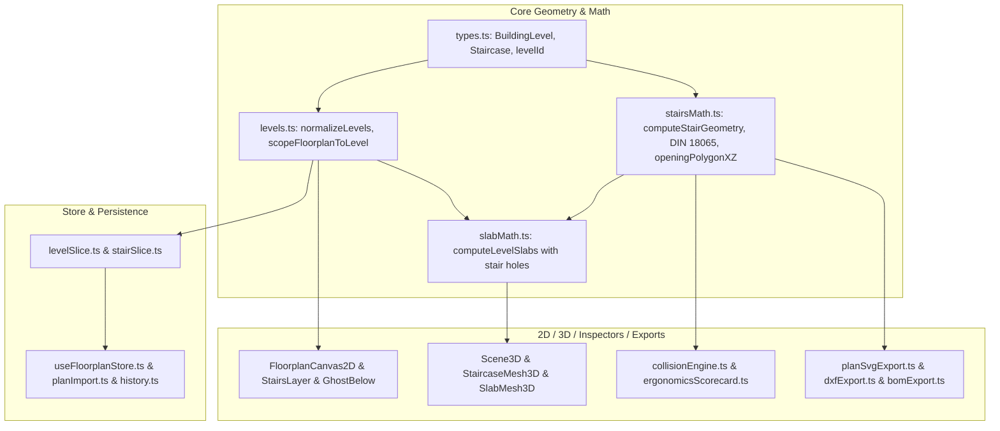

# Multi-Floor Architecture, Floor Slabs & Parametric Stairs Implementation Plan

> **For agentic workers:** Execute task-by-task using TDD (failing test -> minimal implementation -> passing test -> full `npm run build && npm test`).

**Goal:** Enable multi-story buildings (`EG`/`OG`/`DG`/`UG`), automatic inter-floor slabs with staircase cutout holes, parametric stairs (`straight`, `l-shaped`, `u-shaped`), DIN 18065 & cross-floor ergonomics/collision checks, and multi-floor SVG/DXF/BOM/3D exports while keeping 100% backward compatibility with all single-floor plans.

**Architecture:** Option A (`levelId`-scoped flat `FloorplanData` arrays + `levels?: BuildingLevel[]` + `stairs?: Staircase[]`). `scopeFloorplanToLevel(data, levelId)` isolates each level so all existing geometry, collision, ergonomics, and export engines operate cleanly per level without duplicating logic.

**Tech Stack:** TypeScript 5 (strict), React 18, Three.js r170, React Three Fiber, Zustand 5, Vitest.

**Spec:** [2026-11-18-multi-floor-stairs-design.md](../specs/2026-11-18-multi-floor-stairs-design.md)

## Global Constraints
- `1 Three.js Unit = 1.0 cm`, `+Y` points upwards, `EPSILON_CM = 0.05`.
- 100% offline-first (zero external fetches).
- 100% backward compatibility: entities missing `levelId` belong to `DEFAULT_LEVEL_ID = 'level-0'`.
- 100% i18n key parity between `src/i18n/locales/de.ts` and `src/i18n/locales/en.ts`.

---

## Sprint 12: Multi-Level Data Model, Store, 2D Ghost-Below & 3D Stacked View

### Task 12.1: Core Level Types & `src/core/levels.ts`
- **Files:** `src/core/types.ts`, `src/core/levels.ts`, `tests/sprint12MultiFloorStore.test.ts`
- **TDD:** Write tests for `normalizeLevels`, `recomputeLevelElevations`, `getEntityLevelId`, `scopeFloorplanToLevel`, `createNextLevel` (above & below), and `copyExteriorWallsToLevel`.

### Task 12.2: Store (`levelSlice.ts`), `state.ts`, `geometry.ts`, `useFloorplanStore.ts`, `history.ts`, `planImport.ts`
- **Files:** `src/store/state.ts`, `src/store/slices/levelSlice.ts`, `src/store/geometry.ts`, `src/store/slices/wallSlice.ts`, `src/store/slices/furnitureSlice.ts`, `src/store/slices/rugSlice.ts`, `src/store/useFloorplanStore.ts`, `src/store/history.ts`, `src/store/planImport.ts`, `src/store/slices/presetSlice.ts`
- **Behavior:** Stamp new walls/corners/openings/furniture/rugs/fixtures/slopes/rooms with `activeLevelId`, manage `levels[]`, `activeLevelId`, `levelViewMode` (`'active-only' | 'all-stacked' | 'ghost-below'`), `showGhostBelow2D`, and persist `levels` & `stairs` in JSON/Undo.

### Task 12.3: 2D Level Scoping + Ghost-Below, 3D Level Stacking & `LevelManagerSection.tsx`
- **Files:** `src/components/sidebar/LevelManagerSection.tsx`, `src/components/sidebar/InspectorSidebar.tsx`, `src/components/editor2d/FloorplanCanvas2D.tsx`, `src/components/editor2d/FloorplanSvg2D.tsx`, `src/components/editor2d/layers/*`, `src/components/viewer3d/Scene3D.tsx`, `src/i18n/locales/de.ts`, `src/i18n/locales/en.ts`
- **Verify:** `npm run build && npm test`.

---

## Sprint 13: Parametric Stairs (`straight` / `l-shaped` / `u-shaped`) & Floor Slabs with Cutouts

### Task 13.1: `src/core/stairsMath.ts` & `src/core/slabMath.ts`
- **Files:** `src/core/types.ts`, `src/core/stairsMath.ts`, `src/core/slabMath.ts`, `tests/sprint13StairsAndSlabs.test.ts`
- **Behavior:** Compute DIN 18065 step count & `2s + a`, 3D step/landing/railing boxes, 2D CAD tread lines & arrow path, `openingPolygonXZ` for upper slab cutouts, and `computeLevelSlabs` (subtracting stair `openingPolygonXZ` from floor slabs and upper floor shapes).

### Task 13.2: Store (`stairSlice.ts`) + Persistence
- **Files:** `src/store/slices/stairSlice.ts`, `src/store/geometry.ts`, `src/store/state.ts`, `src/store/history.ts`, `src/store/planImport.ts`, `src/App.tsx`
- **Behavior:** `addStair`, `updateStair`, `moveStair`, `removeStair`, `selectedType === 'stair'`, Delete-key removal.

### Task 13.3: 2D `StairsLayer`, 3D `StaircaseMesh3D.tsx` + `SlabMesh` & `StairInspector.tsx`
- **Files:** `src/components/viewer3d/StaircaseMesh3D.tsx`, `src/components/viewer3d/Scene3D.tsx`, `src/components/editor2d/layers/FurnitureAndOverlaysLayers.tsx`, `src/components/editor2d/FloorplanCanvas2D.tsx`, `src/components/sidebar/StairInspector.tsx`, `src/components/sidebar/InspectorSidebar.tsx`, `src/i18n/locales/de.ts`, `src/i18n/locales/en.ts`
- **Verify:** `npm run build && npm test`.

---

## Sprint 14: Cross-Floor Collision, DIN 18065, Ergonomics & Multi-Floor Exports

### Task 14.1: Level-Scoped Collision + Stair Checks (`collisionEngine.ts`) & Cross-Floor Ergonomics (`ergonomicsScorecard.ts`)
- **Files:** `src/core/collisionEngine.ts`, `src/core/ergonomicsEngine.ts`, `src/core/ergonomicsScorecard.ts`, `tests/sprint14MultiFloorExportErgonomics.test.ts`
- **Behavior:** Isolate wall/furniture/opening collision checks per `levelId`, evaluate stair wall/furniture collisions & DIN 18065 step/headroom diagnostics, and seed upper-level reachability via staircases.

### Task 14.2: Multi-Floor SVG, DXF, BOM & GLB/USDZ Exports
- **Files:** `src/core/export/planSvgExport.ts`, `src/core/export/dxfExport.ts`, `src/core/export/bomExport.ts`, `src/components/layout/TopBar.tsx`, `wiki/*`
- **Behavior:** Render stairs (`.arch-stair` / `STAIRS` layer) and level title in SVG/DXF, report per-level rooms/furniture/stairs in BOM CSV/MD, keep 3D stacked `.glb`/`.usdz` export working seamlessly.
- **Verify:** `npm run build && npm test`.
