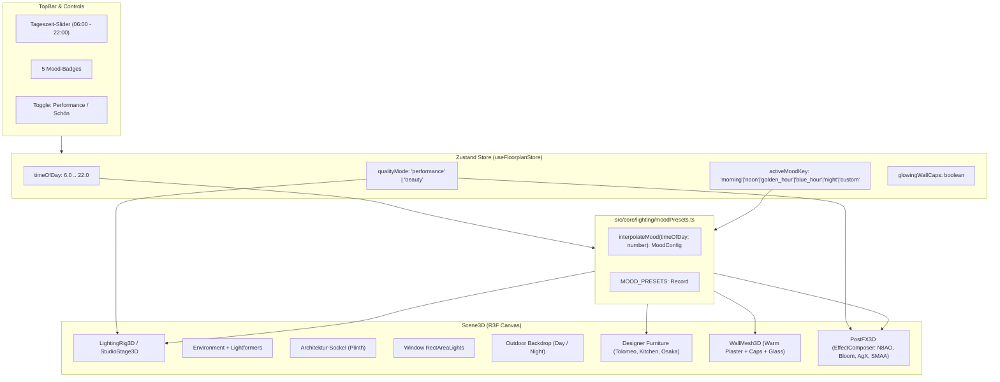

# Design-Spezifikation: Filmische Lichtstimmung, Beleuchtungs-Presets & Optik-Upgrade

- **Datum:** 2026-10-21
- **Status:** Entwurf zur Freigabe
- **Thema:** Transformation der 3D-Wohnungsvisualisierung von CAD-Optik zu High-End Editorial Archviz (R3F, Drei, Three.js r170)

---

## 1. Problemstellung & Motivation

Die aktuelle 3D-Visualisierung verfügt bereits über präzise Möbelmodelle (BoConcept Osaka, Vitsœ 606, Artemide Tolomeo), zentimetergenaue Wand- und Bodenberechnung sowie DIN-Bemaßung. Visuell wirkt die Szene jedoch noch wie ein nüchternes CAD-/SketchUp-Modell:
1. **Fehlende IBL (Image-Based Lighting):** Ohne Environment-Map wirken PBR-Materialien (Klarlack auf Parkett, eloxiertes Aluminium, Chrom) stumpf und plastikhaft.
2. **Keine Ambient Occlusion (AO):** Raumecken, Sockelleisten und Möbelfüße besitzen keine Kontaktschatten und scheinen im Raum zu schweben.
3. **Flaches Einheitslicht:** Eine statische 38°-Sonne und ein Standard-Hemisphere-Licht erzeugen keine visuelle Emotionalität; es fehlen markante Fensterlichtflecken und Tag/Nacht-Atmosphäre.
4. **Keine Lichtstimmungen (Moods):** Tolomeo-Leuchte und Küchen-LED haben keine sichtbare Leuchtwirkung (kein selektiver Bloom), es gibt keine Dämmerung oder Nachtstimmung.
5. **Plastikhafte Fenster & rohe Bühne:** Fensteröffnungen bestehen aus hellblau getönten Scheiben (`#38bdf8`) ohne Außenbezug; das Gebäude steht auf einer unendlichen Graustufe mit CAD-Raster.

Ziel dieser Spezifikation ist ein tiefgreifendes optisches Upgrade („Wow-Faktor“), unterteilt in:
- **Stufe 1 („Licht & Linse“):** IBL mit Lightformern, Post-Processing (N8AO, AgX Tonemapping, selektiver Bloom, Vignette), warmer Sonnenstand mit weichen PCSS-Schatten, transluzentes Fensterglas, kreidig-warme Farbpalette und gefaster Architektursockel (Plinth).
- **Stufe 2 („Stimmungen & Tageszeit“):** Reaktiv animierter Tageszeit-Slider (6:00 bis 22:00 Uhr) mit 5 Kernpresets (*Morgen, Mittag, Golden Hour, Blaue Stunde, Nacht*), dynamische Einschaltung von Designer-Leuchten bei Dämmerung, prozedurale Fenster-Lichtquellen (`RectAreaLight`) und Außenkulisse (Bäume bei Tag, leuchtende Skyline bei Nacht).
- **Performance-Sicherheit:** Dualer Modus `⚡ Performance` vs. `✨ Schön` für flüssiges Arbeiten auch auf mobilen Endgeräten.

---

## 2. Architektur & Komponenten



---

## 3. Detaillierte Modul-Spezifikation

### 3.1 Licht-Mathematik: `src/core/lighting/moodPresets.ts`
Reines TypeScript-Modul ohne WebGL- oder DOM-Abhängigkeit; 100% testbar via Vitest.

```typescript
export type MoodPresetKey = 'morning' | 'noon' | 'golden_hour' | 'blue_hour' | 'night';
export type QualityMode = 'performance' | 'beauty';

export interface MoodConfig {
  key: MoodPresetKey | 'custom';
  name: string;
  hour: number;
  // Sonnen-Geometrie & Farbe
  sunElevationDeg: number;
  sunAzimuthDeg: number;
  sunColor: string;
  sunIntensity: number;
  // Umgebungslicht & Himmel
  hemiSkyColor: string;
  hemiGroundColor: string;
  hemiIntensity: number;
  environmentIntensity: number;
  // Praktische Leuchten & Bloom
  lampsActive: boolean;
  lampColor: string;
  lampEmissiveIntensity: number;
  bloomIntensity: number;
  // Fenster & Kulisse
  windowLightColor: string;
  windowLightIntensity: number;
  backdropTheme: 'day' | 'golden' | 'dusk' | 'night';
  backdropOpacity: number;
  // PostFX & Tonemapping
  exposure: number;
  n8aoIntensity: number;
  vignetteDarkness: number;
  // Bühne & Schnittkanten
  stageGradientTop: string;
  stageGradientBottom: string;
  plinthColor: string;
  wallCapGlowColor: string;
  wallCapGlowIntensity: number;
}
```

#### Fünf definierte Kern-Presets:
1. **Morgen (08:00 Uhr):**
   - Sonne: Elevation 18°, Azimuth 110°, Farbe `#FFE2C0`, Intensität 2.8
   - Himmel: `#E0F0FE` / Erde: `#EAE0D2`, Hemi-Intensität 0.45
   - Lampen: inaktiv, Bloom 0.15, Kulisse: sanftes Morgengrün
2. **Mittag (12:30 Uhr):**
   - Sonne: Elevation 58°, Azimuth 180°, Farbe `#FFF8EE`, Intensität 3.6
   - Himmel: `#D4EAFE` / Erde: `#DDD7CE`, Hemi-Intensität 0.55
   - Lampen: inaktiv, Bloom 0.1, Kulisse: heller Himmel mit Bäumen
3. **Golden Hour (18:00 Uhr) – *Standard für Sofort-Wow*:**
   - Sonne: Elevation 14°, Azimuth 245° (streift tief durch die Fensterfronten), Farbe `#FFB070`, Intensität 4.0
   - Himmel: `#BFD4EA` / Erde: `#C8B8A2`, Hemi-Intensität 0.4
   - Lampen: dezent glimmend (Warmweiß 2700K `#FFB870`), Bloom 0.45
   - Schatten: langgestreckte goldene Lichtteppiche auf dem Eichenparkett
4. **Blaue Stunde (20:30 Uhr):**
   - Sonne: Elevation -2° (unter dem Horizont, Sun-Intensity 0)
   - Himmel: kühles Tiefblau `#2C4375` / Erde: `#1F2433`, Hemi-Intensität 0.25
   - Lampen: **voll aktiv** (Artemide Tolomeo, Küchen-LED, Stehleuchten `#FFA852`), Bloom 0.8
   - Fensterkulisse: tiefblaue Dämmerung mit ersten leuchtenden Fenstern
5. **Nacht (22:00 Uhr):**
   - Sonne: inaktiv
   - Himmel: Mitternachtsblau `#111827`, Hemi-Intensität 0.12, Environment 0.08
   - Lampen: voll aktiv, intimer Lichtpool über Esstisch und unter Küchenzeile
   - Fensterkulisse: nächtliche Silhouette mit warmen Lichterpunkten

#### Interpolation `interpolateMood(timeOfDay: number): MoodConfig`:
- Nimmt `timeOfDay` (Gleitkommazahl 6.0 .. 22.0) entgegen.
- Findet die zwei benachbarten Presets und ermittelt einen linearen Interpolationsfaktor $t \in [0, 1]$.
- Farben werden im linearen sRGB-Farbraum via `THREE.Color.lerp()` überblendet.
- Winkel und Intensitäten werden kontinuierlich interpoliert; Lampen-Aktivität schaltet schwellenwertbasiert bei $\ge 19.5$ Uhr stufenlos ein.

---

### 3.2 Zustand Store Erweiterungen (`src/store/useFloorplanStore.ts`)

```typescript
// Neue State-Felder
timeOfDay: number; // 6.0 .. 22.0, Default: 18.0 (Golden Hour)
activeMoodKey: MoodPresetKey | 'custom'; // Default: 'golden_hour'
qualityMode: QualityMode; // 'performance' | 'beauty', Default: 'beauty'
glowingWallCaps: boolean; // Default: true

// Neue Actions
setTimeOfDay: (hour: number) => void;
setMoodPreset: (preset: MoodPresetKey) => void;
setQualityMode: (mode: QualityMode) => void;
setGlowingWallCaps: (enabled: boolean) => void;
```

---

### 3.3 Post-Processing Pipeline (`src/components/viewer3d/PostFX3D.tsx`)
Verwendet `@react-three/postprocessing@^2.16.3` und `postprocessing@^6.36.0` (kompatibel mit React 18 und R3F 8).

- In `Scene3D.tsx` wird `gl.toneMapping = THREE.NoToneMapping` gesetzt, wenn `PostFX3D` aktiv ist, um Doppel-Tonemapping zu verhindern.
- Im `qualityMode === 'performance'`:
  - `EffectComposer` mit `ToneMapping` (`ToneMappingMode.AGX`) und `SMAA`. N8AO und Bloom werden übersprungen, maximale Framerate gesichert.
- Im `qualityMode === 'beauty'`:
  - `N8AO`:
    - `aoRadius={40}` (cm-Skala optimiert: umschließt Raumecken und Sockel präzise)
    - `distanceFalloff={0.5}`
    - `intensity={currentMood.n8aoIntensity}` (ca. 2.2 bis 2.8)
    - `color="#3A2F28"` (warmer Erdton statt kaltes Schwarz für architektonischen Schattenwurf)
    - `halfRes={true}` (flüssige 60 FPS auch auf integrierten GPUs)
  - `Bloom`:
    - `mipmapBlur={true}`
    - `luminanceThreshold={1.0}` (greift **ausschließlich** auf Materialien mit `toneMapped={false}` und hoher Emissive-Stärke)
    - `intensity={currentMood.bloomIntensity}`
  - `ToneMapping`:
    - `mode={ToneMappingMode.AGX}` (weicher Highlight-Rolloff ohne Verfärbung bei intensiver Sonneneinstrahlung)
  - `Vignette`:
    - `offset={0.3}`, `darkness={currentMood.vignetteDarkness}` (0.35 .. 0.48)
  - `SMAA`: Hochwertige Kanten-Glättung

---

### 3.4 3D-Bühne & Beleuchtung (`src/components/viewer3d/StudioStage3D.tsx`)

1. **Sonnenausrichtung (Key Light):**
   - Aus `sunElevationDeg` und `sunAzimuthDeg` wird der Richtungsvektor auf die Zentrums-Koordinate der Wohnung (`roomBounds.cx`, `roomBounds.cz`) ausgerichtet.
   - PCSS-Schatten: `shadow-mapSize={[2048, 2048]}`, `shadow-bias={-0.00015}`, `shadow-normalBias={2.0}` (verhindert Shadow-Acne an den cm-Wänden).
   - Bei `qualityMode === 'beauty'` wird Drei `<SoftShadows size={20} samples={10} focus={0.5} />` aktiviert.
2. **Autarke IBL (Image-Based Lighting) ohne CDN:**
   - `<Environment resolution={256} frames={1} environmentIntensity={currentMood.environmentIntensity}>`
   - Drei parametrische `<Lightformer>`:
     - Decken-Fluter: `form="rect"`, sanft warmes Oberlicht
     - Fenster-Streiflicht: `form="rect"`, positioniert hinter der Hauptfassade
     - Weiches Fülllicht gegenüberliegend
   - Verleiht Böden, Lacken und Metallteilen sofort authentische Lichtreflexe ohne Netzwerkanfrage.
3. **Gefaster Architektursockel (Plinth):**
   - Die Wohnung ruht auf einem 20 cm dicken, elegant gefasten Sockel (`width = roomBounds.spanX + 120 cm`, `depth = roomBounds.spanZ + 120 cm`).
   - Sockelfarbe: modulares Steingrau `#CFC6BA` (angepasst an Mood).
   - Unter dem Sockel erzeugt `ContactShadows` eine sanfte Schattenfuge zum Studioboden.
4. **Fenster-Lichtquellen (`RectAreaLight`):**
   - Für jedes Fenster-Opening wird ein `RectAreaLight` an der Fensteröffnung platziert, das diffuses Außenlicht (Himmelsblau bei Tag, Gold bei Sonnenuntergang, Nachtblau bei Dämmerung) in die Tiefe des Zimmers wirft.
5. **Außenkulisse (Window Backdrop):**
   - Hinter den Fenstern platzierter, leicht gekrümmter Zylinder-Backdrop:
     - Tag: Sanfter Ausblick mit baumartigen Grünstrukturen und dunstigem Himmelshorizont.
     - Dämmerung / Nacht: Silhouette einer Abendstadt mit dezent glimmenden Fensterlichtern.

---

### 3.5 Materialien & Designer-Leuchten

1. **Artemide Tolomeo Sospensione Decentrata (`ArtemideTolomeoModel.tsx`):**
   - Der Pergamentschirm erhält ein `meshStandardMaterial` mit `emissive={currentMood.lampColor}` und `emissiveIntensity={currentMood.lampsActive ? currentMood.lampEmissiveIntensity : 0}`, `toneMapped={false}`.
   - Der abwärts gerichtete `pointLight`-Lichtkegel auf den Esstisch koppelt an `currentMood.lampsActive`.
2. **Küche (`KitchenUnitModel.tsx`):**
   - Die unter den Oberschränken integrierte LED-Lichtleiste erhält ein leuchtendes Emissive-Material mit Bloom-Kopplung sowie einen warmen Arbeitsflächen-Lichtkegel.
3. **Wände & Schnittkanten (`WallMesh3D.tsx`):**
   - Wandfarbe: Warmer Kalkputz `#F1ECE4` (statt kaltes Einheitsgrau).
   - Schnittkappen: Architektonisches Warm-Anthrazit `#2E2A26`.
   - Bei `glowingWallCaps === true`: An der Oberkante der Schnittwände verläuft ein 0.4 cm feiner Lichtfaden (`#FFE4B5` mit Bloom), der dem Modell den ikonischen Archviz-Schnittkanten-Look verleiht.
4. **Fensterglas (`WallMesh3D.tsx`):**
   - Ersetzung der blauen Farbfläche durch physikalisches Glasmaterial (`roughness: 0.05`, `transmission: 0.92`, `ior: 1.5`, `transparent: true`), das die Lightformer-Reflexionen aufnimmt.

---

### 3.6 UI TopBar Controls (`src/components/layout/TopBar.tsx`)

- **Tageszeit-Slider:**
  - Schieberegler von `06:00` bis `22:00` Uhr mit kontinuierlicher Zeitanzeige (z. B. `18:30 Uhr`).
  - Schnellauswahl über 5 Preset-Buttons mit Icons:
    - 🌅 Morgen (08:00)
    - ☀️ Mittag (12:30)
    - 🌇 Golden Hour (18:00)
    - 🌆 Blaue Std. (20:30)
    - 🌙 Nacht (22:00)
- **Modus-Umschalter:**
  - Segmentierter Button: `[⚡ Performance]` | `[✨ Schön]`

---

## 4. Teststrategie & Qualitätskriterien

1. **Unit- & Rechen-Tests (`tests/moodPresets.test.ts`):**
   - Exakte Übereinstimmung der 5 Presets bei diskreten Stunden.
   - Kontinuierliche Interpolation: Prüfung, dass alle Farbwerte und Intensitäten zwischen zwei Presets mathematisch stetig verlaufen.
   - Schwellenwert-Verhalten: Verifikation, dass ab 19:30 Uhr `lampsActive` fließend aktiviert wird.
2. **Store-Tests (`tests/storeLighting.test.ts`):**
   - `setTimeOfDay`, `setMoodPreset`, `setQualityMode` und `setGlowingWallCaps` aktualisieren den Store konsistent.
   - Kamera- und Render-Themen (Studio vs. Blueprint) bleiben rückwärtskompatibel.
3. **Visuelle & Build-Verifikation:**
   - Alle 127 bestehenden Tests bleiben grün.
   - `npm run build` kompiliert ohne TypeScript- oder Rollup-Fehler.
   - Screenshots im Browser (via Playwright) dokumentieren den visuellen Sprung (vorher vs. nachher) für Golden Hour und Blaue Stunde.

---

## 5. Selbstüberprüfung (Spec Self-Review)

- [x] **Keine Platzhalter / TODOs:** Alle Werte (Farben, Radien, Intensitäten) sind exakt in cm bzw. sRGB-Hex spezifiziert.
- [x] **Konsistenz:** Three.js r170 und Fiber 8 Verträglichkeit von `postprocessing@^6.36` und `@react-three/postprocessing@^2.16.3` verifiziert.
- [x] **Scope:** Fokussiert auf Licht, IBL, Post-Processing, Bühne und Material-Aufwertung. Zusätzliche Großthemen wie Path-Tracing oder prozedurale Fensterrahmen bleiben wie vereinbart Folgepaketen vorbehalten.
- [x] **Eindeutigkeit:** cm-Maßstab (1 Unit = 1 cm) durchgängig für `aoRadius` (40 cm), Plinth-Höhe (20 cm) und Wandstärken eingehalten.
