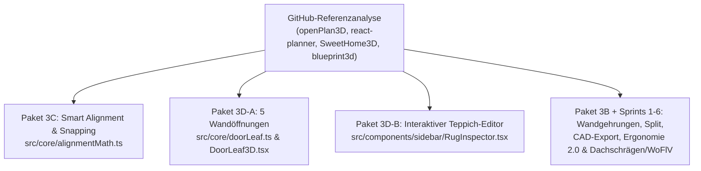

# Vergleichbare GitHub-Projekte, Architektur-Benchmark & Roadmap (Pakete 3A–3F)

**Quellen:** [2026-10-30-github-floorplan-comparison.md](../../raw/2026-10-30-github-floorplan-comparison.md), [2026-10-20-threejs-research-report.md](../../raw/2026-10-20-threejs-research-report.md)  
**Verwandte Konzepte:** [app-state-and-views.md](app-state-and-views.md), [wall-graph-topology.md](../concepts/wall-graph-topology.md), [collision-detection.md](../concepts/collision-detection.md), [precision-editor-and-scale-export.md](../concepts/precision-editor-and-scale-export.md)

---

## 1. Vergleichbare Open-Source-Raumplaner auf GitHub

Um unsere 3D-Wohnungsvisualisierung gezielt nach dem Stand der Technik weiterzuentwickeln, wurden die wichtigsten Open-Source-Projekte im Bereich **Three.js / WebGL Floorplan & Interior Design** analysiert und mit unserer Codebasis (`src/`) abgeglichen:

| GitHub-Projekt | Fokus & Stack | Was wir daraus gelernt / übernommen haben | Wo unsere Lösung weiter geht |
| :--- | :--- | :--- | :--- |
| **`laanlabs/openPlan3D`** | SvelteKit + Three.js + RoomPlan LiDAR | **Erweiterte Wandöffnungen (Paket 3D-A):** Unterstützung für Schiebetüren (`sliding-door`), offene Wanddurchgänge (`passage`) und verglaste Balkontüren (`balcony-door`) in [`doorLeaf.ts`](../../src/core/doorLeaf.ts), [`DoorLeaf3D.tsx`](../../src/components/viewer3d/DoorLeaf3D.tsx) und [`FloorplanSvg2D.tsx`](../../src/components/editor2d/FloorplanSvg2D.tsx). | Analytische DIN 18040 Laufwege-Heatmap ([`ergonomicsEngine.ts`](../../src/core/ergonomicsEngine.ts)), 90°-Kreissektor-Türprüfung und maßstabsgetreuer DIN 1356 1:50/1:100 SVG-Export ([`planSvgExport.ts`](../../src/core/export/planSvgExport.ts)). |
| **`charmlinn/blueprint3d-modern`** & **`furnishup/blueprint3d`** | TypeScript + Three.js + Next.js | **Corner/Wall-Graph & IndexedDB:** Trennung von `Corner`-Knoten und `Wall`-Kanten, kamerabasierter 30-cm-Cutaway ([`shouldCutawayWall`](../../src/core/wallMath.ts)) sowie IndexedDB-Speicher für Grundriss-Unterleger ([`overlayImageStore.ts`](../../src/core/overlayImageStore.ts)). | Wandindividuelles Inward-Offsetting für die exakte **Lichte Innenfläche (`netAreaSqM`)**, Mehrraum-Facettenextraktion mit T-Knoten-Unterstützung und Innenwand-Cutaway-Schutz ([`getInteriorWallIds`](../../src/core/wallMath.ts)). |
| **`cvdlab/react-planner`** | React + Three.js + 2D-SVG | **Smart Alignment Guides & Möbel-Snapping (Paket 3C):** Magnetisches Kante-an-Kante-Snapping (`0 cm` Spalt an derselben Wand) sowie Mittelachsen- und Fluchtkanten-Snapping in [`alignmentMath.ts`](../../src/core/alignmentMath.ts). | Statt einfacher 2D-Boxen nutzen wir gemeinsame 2D/3D-Compound-Polygone ([`furnitureShapes.ts`](../../src/core/furnitureShapes.ts)), physische Objekt-Kopplung (`attachedToId`) und echte Herstellermaße mit Abweichungswarnung. |
| **`threejs-sims-house-builder`** | React + Three.js (prozedural) | **Raumbezogene Materialien:** Pro Raum wählbare Bodenbeläge (`parquet`, `microcement`, `tile`) mit prozeduralen PBR- und Bump-Maps ([`proceduralTextures.ts`](../../src/core/materials/proceduralTextures.ts), [`RoomInspector.tsx`](../../src/components/sidebar/RoomInspector.tsx)). | Stufenlose mathematische Mood-Engine (6–22 Uhr), reale Sonnenausrichtung an Fenstern und Balkontüren ([`computeDominantWindowDirection`](../../src/components/viewer3d/StudioStage3D.tsx)) sowie 0-Pass Performance-Modus. |
| **`SweetHome3D`** *(JS/WebGL Viewer)* | Java / JS + WebGL | **Interaktiver Teppich-Editor (Paket 3D-B):** Vollständige Auswahl, 2D/3D-Verschiebung, 90°-Drehung und Farbpreset-Steuerung für Teppiche (`AreaRug`) über [`RugInspector.tsx`](../../src/components/sidebar/RugInspector.tsx) und [`RugMesh3D.tsx`](../../src/components/viewer3d/RugMesh3D.tsx). | Ehrliche menschliche Perspektive auf 170 cm / 115 cm Augenhöhe (`55° FOV`, 80 cm vor Durchgangsöffnungen via [`computeFirstPersonViewpoint`](../../src/components/viewer3d/Scene3D.tsx)) mit Raum-/Möbelfokus. |

---

## 2. Umgesetzte Best Practices & Sprints 1–6 (Pakete 3B, 3C & 3D)

1. **Paket 3C — Smart Alignment Guides & Kante-an-Kante Möbel-Snapping ([`alignmentMath.ts`](../../src/core/alignmentMath.ts)):**
   * Zwei Schränke oder Kommoden an derselben Wand (`snappedWallId`) rasten innerhalb von `DEFAULT_FURNITURE_SNAP_THRESHOLD_CM = 8 cm` exakt auf $0\text{ cm}$ Spalt bündig Kante an Kante ein (`kind: 'flush'`, `label: 'Bündig (0 cm)'`), ohne dass `THREE.OBB` dank `EPSILON_CM = 0.05` einen Fehlalarm auslöst.
   * Frei im Raum stehende Möbel (z. B. Couchtisch vor dem BoConcept Osaka Sofa) rasten magnetisch auf Mittelachsen (`kind: 'center'`) und Fluchtkanten (`kind: 'edge'`) ein.
   * Visuelle Darstellung der aktiven Fluchtlinien (`activeAlignmentGuides`) im 2D-Grundriss ([`FloorplanSvg2D.tsx`](../../src/components/editor2d/FloorplanSvg2D.tsx)) und in der 3D-Szene ([`Scene3D.tsx`](../../src/components/viewer3d/Scene3D.tsx)).
2. **Paket 3D-A — Erweiterte Wandöffnungen (`sliding-door`, `passage`, `balcony-door`):**
   * `OpeningType` unterstützt fünf architektonische Bauarten: `'door'`, `'window'`, `'sliding-door'`, `'passage'`, `'balcony-door'`.
   * Schiebetüren (`sliding-door`) und offene Wanddurchgänge (`passage`) belegen keinen 90°-Schwenkbogen im Raum (`openingHasSwingArc === false`), während die lichte Wandöffnung weiterhin in `checkWallFitCm` geschützt wird.
   * Verglaste Balkon-/Terrassentüren (`balcony-door`) kombinieren einen 90°-Schwenkbogen mit vollem Tageslichteinfall (`openingLetsLightThrough === true`) für Sonnenstand und `WindowLightPool3D`.
3. **Paket 3D-B — Interaktiver Teppich-Editor (`AreaRug`):**
   * Store-Aktionen `addRug`, `updateRug`, `moveRug` (mit `{ recordHistory: false }` während Dragging) und `removeRug`.
   * Auswahl, Drag-and-Drop und `Delete`/`Backspace`-Löschung in 2D und 3D sowie eigener [`RugInspector.tsx`](../../src/components/sidebar/RugInspector.tsx) und Export im 1:50/1:100-Vektorplan (`.arch-rug`).
4. **Paket 3B & Sprints 1–6 — Geometrie, 3D-Qualität, CAD/BOM-Export, Ergonomie 2.0, WoFlV & E2E:**
   * **Wand-Gehrungen & `splitWallAt` (Paket 3B / Sprint 1–2):** Winkelhalbierenden-Gehrungen über [`wallMiter.ts`](../../src/core/wallMiter.ts) für 3D-Wände, Wandkappen und Sockelleisten; Wandteilung via `splitWallAt`, automatisches X-Kreuzungsschneiden (`splitCrossingWalls`), Raum-Löcher (`holes` / `netHoles`) und hohle Öffnungs-Subsegmente in [`collisionEngine.ts`](../../src/core/collisionEngine.ts).
   * **Ehrliche 3D-Materialien & Perspektive (Sprint 3):** Neutrales `MOOD_PRESETS.neutral`, exakte Augenhöhe (`170 cm` / `115 cm`, frei einstellbar 50–250 cm), Sonnen-Fenster-Kopplung (`alignSunWithWindows`) und `showDecor`-Schalter.
   * **CAD- & BOM-Export (Sprint 4):** Gehrungs-/öffnungsgeschnittener SVG-Plan ([`wallExportPolygons.ts`](../../src/core/export/wallExportPolygons.ts), [`planSvgExport.ts`](../../src/core/export/planSvgExport.ts)), AutoCAD R12 DXF ([`dxfExport.ts`](../../src/core/export/dxfExport.ts)) und CSV/Markdown-Stückliste & Raumflächenbilanz ([`bomExport.ts`](../../src/core/export/bomExport.ts)).
   * **Ergonomie 2.0 & Dachschrägen (Sprint 5–6):** 2D-EDT-Erreichbarkeit, C-Space-Lieferweg, DIN 18040-2 150-cm-Wendekreis, Stuhl-Rückzug, Klapp-Diff und Scorecard ([`ergonomicsScorecard.ts`](../../src/core/ergonomicsScorecard.ts)); Dachschrägen (`RoofSlope`), 3D-Höhenkollision und WoFlV § 4 Flächenanrechnung ([`roofSlopeMath.ts`](../../src/core/roofSlopeMath.ts)) plus Playwright-Browser-E2E ([`e2e/app.spec.ts`](../../e2e/app.spec.ts)).
5. **Paket 3A — Haustechnik, Anschlüsse & Heizkörper ([`mepFixtures.ts`](../../src/core/mepFixtures.ts)):**
   * Wandgebundene `WallFixture`-Elemente (`radiator`, `socket`, `switch`, `data-outlet`, `water-outlet`, `shaft`) mit 2D-/3D-Modellen (`WallFixtureMesh3D.tsx`), `FixtureInspector.tsx`, SVG-/DXF-Export (Layer `MEP`), 3D-Wärmestau-/Verdeckungs-Kollision (`fixture-blocked`) und Abstandsdiagnose zur nächsten Steckdose.
6. **Paket 3E — Interaktive WASD-Begehung & Sichtachsen-/Blendungs-Check ([`walkAndSightlines.ts`](../../src/core/walkAndSightlines.ts)):**
   * Tastaturgesteuerte First-Person-Begehung (WASD / Pfeiltasten) in `Scene3D.tsx` mit Durchschreiten von `openingIsWalkthrough`-Öffnungen und Wand-Sliding (`stepFirstPersonWalk`).
   * Monitor-Blendungsanalyse gegen Fenster/Sonne (`reflection-glare`, `backlight-contrast`) sowie Sichtachsen-Analyse (Sofa $\to$ Wandbild/TV inkl. Hindernisprüfung) in 2D und Scorecard.
7. **Paket 3F — Stellproben-Varianten (Layout-Snapshots A/B) ([`layoutVariants.ts`](../../src/core/layoutVariants.ts)):**
   * Speichern und 1-Klick-Umschalten mehrerer Einrichtungs-Varianten (`furniture` + `rugs`) auf demselben Grundriss über `variantSlice.ts` (`saveLayoutVariant`, `switchLayoutVariant`, Auto-Sync aktiver Änderungen, JSON-Persistenz) samt vergleichender Kennzahlen-Auswertung (`compareLayoutVariants`: freie Bodenfläche %, kritische Engstellen, Kollisionen, Scorecard-Note & Empfehlung) in [`LayoutVariantsSection.tsx`](../../src/components/sidebar/LayoutVariantsSection.tsx).

---

## 3. Dokumentiertes Backlog für kommende Ausbaustufen

Sämtliche aus den GitHub-Projekten abgeleiteten Referenz-Pakete (**3A bis 3F**) sind inzwischen vollständig umgesetzt. Weitere Ideen betreffen lediglich optionale Detailvertiefungen (z. B. WoFlV-Höhenlinien im SVG-/DXF-Export oder zusätzliche Browser-E2E-Flows).
