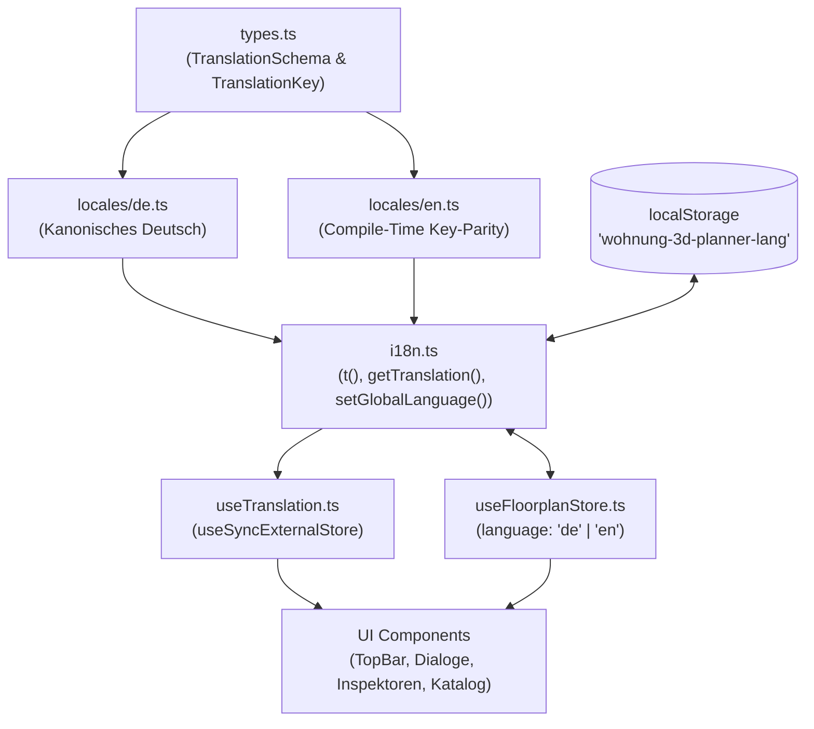

# Internationalisierung (i18n) & Mehrsprachigkeit (DE / EN)

Architektur- und Konzeptdokumentation des typsicheren, zero-dependency Mehrsprachigkeitssystems zur Adressierung von **GitHub Issue #1** (`dksHyrion/wohnung-3d-planner#1`).

---

## 1. Übersicht & Zielsetzung

Der **wohnung-3d-planner** ist als centimeter-genauer 2D/3D-Architektur- und Einrichtungsplaner konzipiert. Um internationalen Architekten, Innenarchitekten und CAD-Nutzern ein nahtloses Arbeiten zu ermöglichen, wurde ein vollwertiges Internationalisierungs-Subsystem eingeführt, das:
1. **100 % Offline-First** bleibt (keine externen Cloud-Translate-APIs, keine runtime CDN-Fetches, keine schweren externen Framework-Abhängigkeiten wie `i18next` oder `react-intl`).
2. **Compile-Time Typsicherheit und 100 % Key-Parität** zwischen allen Sprachen garantiert (`de.ts` und `en.ts`).
3. **Invariante 3B (`AGENTS.md`) strikt wahrt:** Die 3D-Geometrie, OBB/SAT-Kollision und Fangberechnungen hängen **ausschließlich** vom typisierten Identifikator `item.visual` (`FurnitureVisualType`) ab, niemals von lokalisierten Benennungen.

---

## 2. Architektur & Datenfluss

### Kernkomponenten im Verzeichnis `src/i18n/`

1. **`src/i18n/types.ts`:**
   - Definiert `Language = 'de' | 'en'`.
   - Definiert `TranslationSchema` als tief verschachteltes Objektinterface mit strikten Strings.
   - Bildet via TypeScript Mapped Type `NestedKeyOf<TranslationSchema>` den Hilfstyp `TranslationKey` (z. B. `'topbar.views.mode2d'`).

2. **`src/i18n/locales/de.ts` & `src/i18n/locales/en.ts`:**
   - Beide Dictionaries implementieren `TranslationSchema`. Fehlt in einer Sprache auch nur ein einziger Key oder weicht ein Typ ab, schlägt der TypeScript-Compiler (`tsc -b`) fehl.
   - `tests/i18n.test.ts` führt zudem automatisierte bidirektionale Key-Paritätsprüfungen zur Laufzeit aus.

3. **`src/i18n/i18n.ts`:**
   - Hält den synchronen In-Memory-Status (`currentLanguage`).
   - Behandelt Persistenz in `localStorage` unter dem Key `'wohnung-3d-planner-lang'` mit automatischem Fallback auf `'de'` im Fehler- oder SSR-Fall.
   - Stellt `getTranslation(lang, keyPath, params)` mit robuster Parameter-Interpolation (`{count}`, `{cm}`) und automatischem Fallback auf die kanonische deutsche Übersetzung zur Verfügung.
   - Bietet Listener-Subscription (`subscribeLanguage`) für reaktive Synchronisation außerhalb von React.

4. **`src/i18n/useTranslation.ts`:**
   - React-Hook basierend auf `React.useSyncExternalStore`.
   - Liefert `{ t, language, setLanguage }` ohne Flackern oder unnötige Re-Renders.

---

## 3. Zustand-Store Integration

In `src/store/`:
- `src/store/state.ts`: Ergänzt um `language: Language` und `setLanguage: (lang: Language) => void`.
- `src/store/view.ts`: Delegiert das Umschalten an `setGlobalLanguage(lang)`.
- `src/store/useFloorplanStore.ts`: Synchronisiert sich über `subscribeLanguage` bidirektional mit dem globalen Sprachstatus, sodass UI-Komponenten entweder `useTranslation()` oder `useFloorplanStore((s) => s.language)` nutzen können.

---

## 4. UI-Umschaltung: Der `<LanguageSwitch />`

In der oberen Navigationsleiste (`TopBar.tsx`) wurde ein kompakter Schalter (`src/components/layout/LanguageSwitch.tsx`) integriert:
- Segmentierter Toggle `DE | EN` mit nativem Styling (`.topbar-group`, `.btn`, `.active`).
- Volle Barrierefreiheit: `role="group"`, `aria-label="Sprache wechseln"` / `"Switch Language"`, `aria-pressed="true|false"` auf den aktiven Buttons.
- Schneller Zugriff direkt neben den Tastaturkürzeln.

---

## 5. Lokalisierungsbereiche

| Bereich | Lokalisierte Elemente |
|---|---|
| **TopBar** | Werkzeuge (Auswählen, Wand, Tür, Fenster, Messen), Ansichten (2D, Split, 3D), Kamera-Presets, Cutaway-Toggle, Wandsnapping, 3D-Maße, Deko-Modus, Laufwege-Badge, Render-Export, Reset-Aktion, Konfliktstatus |
| **Atmosphäre & Licht** | Tageszeit-Schieberegler, 6 Lichtstimmungen (Morgen, Mittag, Goldene Stunde, Blaue Stunde, Nacht, Neutral), Raumlicht, Fenster-Licht, Grafikqualität (Schön / Performance) |
| **Dialoge** | Tastaturkürzel-Hilfe (`KeyboardShortcutsDialog`), Vektor-Planexport SVG (`PlanExportDialog`), JSON-Plan Import/Export (`JsonPlanDialog`), Desktop-Hinweis (`MobileNoticeBanner`) |
| **Inspektoren** | Wandinspektor, Rauminspektor (mit lokalisierter Flächen- und Umfangsberechnung `de-DE`/`en-US`), Öffnungsinspektor (5 Bauarten), Möbelinspektor (inkl. Posen, Zubehör, Katalog-Reset, 3D-Modellauswahl), Teppichinspektor |
| **Katalog & Ergonomie** | 8 Möbelkategorien (`getCatalogCategoryLabel`), 33 3D-Modellbezeichnungen (`getFurnitureVisualLabel`), DIN 18040 Durchgangsbreiten & Engstellenwarnungen (`getPassageSeverityLabel`, `formatPassageDescription`, `formatClearanceWarning`) |

---

## 6. Erweiterungsanleitung (Neue Sprache hinzufügen)

Um in Zukunft eine weitere Sprache (z. B. Französisch `'fr'`) hinzuzufügen:
1. In `src/i18n/types.ts`: `Language = 'de' | 'en' | 'fr'`.
2. Datei `src/i18n/locales/fr.ts` erstellen und `TranslationSchema` implementieren (TypeScript erzwingt 100 % aller Keys).
3. In `src/i18n/i18n.ts`: `dictionaries: Record<Language, TranslationSchema> = { de, en, fr }`.
4. In `src/components/layout/LanguageSwitch.tsx`: Button für `'fr'` ergänzen.
5. `npm test` ausführen — alle Tests prüfen automatisch die Vollständigkeit.
