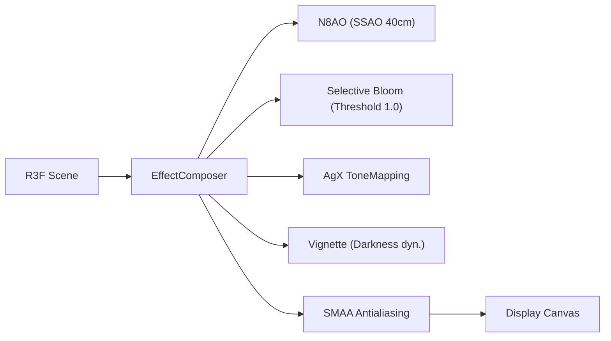

# Cinematische Archviz-Beleuchtung & Atmosphäre

Dokumentation der mathematischen Beleuchtungs-Engine, des autarken IBL-Studiosystems und der Post-Processing-Pipeline für High-End-Architekturvisualisierung in der 3D-Wohnung (`src/core/lighting/moodPresets.ts`, `src/components/viewer3d/StudioStage3D.tsx`, `src/components/viewer3d/PostFX3D.tsx`).

---

## 1. Mathematische Mood-Engine (`moodPresets.ts`)

Die Lichtstimmung wird nicht über starre Schalter, sondern über eine kontinuierliche mathematische Interpolationsfunktion gesteuert. Jeder Zeitpunkt $t \in [6.0, 22.0]$ (Stunden als Dezimalwert) erzeugt deterministisch ein vollständiges Set von Beleuchtungs- und Atmosphären-Parametern (`MoodPreset`).

### A. Architektur-Lichtstimmungen (Keyframe-Presets)

| Preset-Key | Name | Uhrzeit | Sonnenstand (Elev. / Azimut) | Sonnenfarbe (Intensität) | Hemi-Sky / Hemi-Ground (Intensität) | Besonderheiten |
| :--- | :--- | :--- | :--- | :--- | :--- | :--- |
| `morning` | 🌅 Morgen | 08:00 Uhr | 18° / 110° | Sanftes Goldgelb (`#ffe2c0`, 2.8) | Morgenblau (`#e0f0fe`) / Warmer Sand (`#eae0d2`, 0.45) | Frische, belebende Lichtstimmung, weicher Schattenwurf |
| `noon` | ☀️ Mittag | 12:30 Uhr | 58° / 180° | Reines Sonnenweiß (`#fff8ee`, 3.6) | Himmelblau (`#d4eafe`) / Neutraler Boden (`#ddd7ce`, 0.55) | Hoher Sonnenstand, intensive Raumausleuchtung, kurze Schatten |
| `golden_hour` | 🌇 Golden Hour | 18:00 Uhr | 14° / 245° | Sattes Bernstein (`#ffb070`, 4.2) | Zartrosa/Dämmerung (`#bfd4ea`) / Terrakotta (`#c8b8a2`, 0.40) | Flacher Lichteinfall, dramatisch lange Schatten durch Fensterfronten |
| `blue_hour` | 🌆 Blaue Stunde | 20:30 Uhr | -2° / 285° | Dämmerungsorange (`#fdba74`, 0.0) | Tiefes Dämmerungsblau (`#2c4375`) / Schieferblau (`#1f2433`, 0.28) | Kunstlicht aktiv (Tolomeo & Küchen-LEDs), selektives Leuchten |
| `night` | 🌙 Nacht | 22:00 Uhr | -20° / 310° | Nachtglut (`#f97316`, 0.0) | Mondlicht (`#111827`) / Nachtschwarz (`#0f172a`, 0.15) | Reine Interieur-Beleuchtung, stimmungsvolle Akzentlichter |

### B. Kontinuierliche Interpolation & $C^0$-Stetigkeit

Die Funktion `interpolateMood(hour: number): MoodPreset` interpoliert stetig zwischen benachbarten Presets:
- Skalare Werte (Intensitäten, Sonnenwinkel, Vignette, N8AO-Stärke) werden linear interpoliert (`lerp(a, b, t)`).
- Hex-Farbwerte werden über Three.js `THREE.Color.lerp` im linearen Farbraum gemischt.
- **$C^0$-stetige Kunstlicht-Aktivierung:** Die Leuchtmittel-Emissionsstärke (`lampEmissiveIntensity`) wird ab 16:00 Uhr kontinuierlich hochgefahren, `lampsActive = true` schaltet ab 17:30 Uhr zu und erreicht während der blauen Stunde und Nacht die volle Leuchtkraft.

---

## 2. Autarkes Image-Based Lighting (IBL) mit parametrischen Lightformern

Um vollständige Offline-Fähigkeit ohne externe CDN-Aufrufe (Poly Haven, UNPKG) zu garantieren, generiert `<StudioStage3D>` eine prozedurale IBL-Umgebung via `@react-three/drei` `<Environment>`:

- **Auflösung:** `resolution={256}`, `frames={1}` für minimale VRAM- und Rechenlast.
- **3 Parametrische Lightformer:**
  1. **Zenit-Himmelslicht:** Rechteckiger Flächenstrahler `1200 × 1200 cm` über der Wohnung (`[0, 600, 0]`, Rotation $90^\circ$ X) mit `hemiSkyColor`.
  2. **Fensterseitiges Streiflicht:** Flächenstrahler `800 × 400 cm` (`[-700, 300, 0]`, Rotation $90^\circ$ Y) mit `sunColor` zur Simulation des natürlichen Raumlichts.
  3. **Gegenlicht-Aufhellung:** Rechter Seiten-Flächenstrahler `600 × 300 cm` (`[700, 200, 0]`, Rotation $-90^\circ$ Y) mit `hemiGroundColor` gegen zu dunkle Schattenrisse.

---

## 3. Post-Processing Pipeline (`PostFX3D.tsx`)

Für High-End-Architekturfotografie kommt eine optimierte Post-Processing-Kette auf Basis von `@react-three/postprocessing` zum Einsatz:

1. **N8AO (Screen Space Ambient Occlusion):**
   - Radius: `40 cm` (`N8AO_RADIUS_CM = 40`), exakt abgestimmt auf den Zentimetermaßstab des Projekts.
   - Farbe: `#3a2f28` (warmer architektonischer Erdschatten statt reinem Schwarz).
   - Halb-Auflösung (`halfRes`, `quality="low"`) für schnelle Frametimes im `✨ Schön`-Modus.
2. **Selektives Bloom:**
   - Schwellenwert `luminanceThreshold: 1.0`. Dadurch leuchten normale Raumoberflächen nicht versehentlich auf; nur Materialien mit `emissiveIntensity > 1.0` und `toneMapped={false}` (wie der Pergamentschirm der Artemide Tolomeo oder die Küchen-LED-Leiste) erzeugen einen weichen, stimmungsvollen Lichtschein (`mipmapBlur`).
3. **AgX Tone Mapping:**
   - Ersetzt herkömmliches ACES-Filmic durch modernes AgX-Tonemapping. Verhindert Farbsättigungs-Artefakte und Clipping bei hellen Sonnenreflexionen und bewahrt die feinen Nuancen des Parketts und der Textilien.
4. **Subtile Vignette & SMAA:**
   - Dämpft die Ränder sanft ab und schärft geometrische Kanten ohne rechenintensives Multisampling (`multisampling={0}`).

---

## 4. Dualer Qualitätsmodus (`⚡ Performance` vs `✨ Schön`)

Über den Toggle in der TopBar kann der Benutzer jederzeit zwischen zwei Rendermodi wählen:
- **`⚡ Performance` (0-Pass Post-Processing):** `PostFX3D` gibt `null` zurück und unmountet den `EffectComposer` vollständig (0 FBO-Pässe). Stattdessen übernimmt der WebGL-Renderer direkt natives `THREE.AgXToneMapping`, Hardware-MSAA, `dpr={1}`, `shadow-mapSize={[1024, 1024]}` und `clearcoat={0}`. Ideal für verzögerungsfreie 60 FPS beim Wandzeichnen und Möbelverschieben.
- **`✨ Schön` (Studio-PostFX):** Aktiviert `EffectComposer` mit `N8AO` (`halfRes`, `quality="low"`), selektivem `Bloom`, `ToneMappingMode.AGX`, `Vignette` und `SMAA` sowie `shadow-mapSize={[2048, 2048]}` und Parkett-Clearcoat.

---

## 5. Z-Fighting-Freie Architektur-Plinthe & Single-Pass Fensterglas

- **Höhenstaffelung gegen Schattenflackern (`PLINTH_TOP_OFFSET_CM = -0.5`):**
  - Raum-Bodenpolygone liegen bei $Y = 0.0\text{ cm}$ (`polygonOffsetFactor={-1}`), Teppiche bei $Y = +0.4\text{ cm}$.
  - Die 20 cm starke Architektur-Plinthe (`computePlinthBounds`) schließt bei $Y = -0.5\text{ cm}$ ab (`centerYCm = -10.5\text{ cm}`), sodass Plinthe und Zimmerböden niemals koplanar sind.
  - Darunter liegen gestaffelt `ContactShadows` ($Y = -20.6\text{ cm}$, `frames={1}`), das Studio-Grid ($Y = -20.8\text{ cm}$) und die Bodenebene ($Y = -21.0\text{ cm}$).
- **Präzisions-Tiefenpuffer & Schatten-Bias:**
  - Die `OrthographicCamera` nutzt einen engen Tiefenbereich `near={10}`, `far={5000}` (24-Bit-Präzision $\approx 0{,}0003\text{ cm}$).
  - Das gerichtete Sonnenlicht arbeitet mit stabilisiertem Hardware-PCFSoftShadowMap (`SUN_SHADOW_BIAS = -0.0004`, `SUN_SHADOW_NORMAL_BIAS_CM = 1.2`) ohne verrauschte PCSS-Shader-Injektion.
- **Single-Pass Architektur-Fensterglas:** Eine Lage, im Ton der Wand (`#f1ece4`), matt (`roughness={0.82}`, `metalness={0}`), Deckkraft 0,28, `depthWrite={false}`. Kein blaues Spiegelglas und kein mehrstufiger `transmission`-Pass.
- **Ruhige Architektur-Schnittkappen:** Schnittwände bleiben anthrazit (`#2e2a26`). Das Bild öffnet im Morgenlicht, siehe Abschnitt 7.

---

## 6. Spülbecken-Entflackerung (Anti-Z-Fighting) & 3D-Performance-Tuning

### A. Ursache & Beseitigung des Spülen-Flackerns (Z-Fighting)
In `KitchenIslandModel.tsx` und `KitchenUnitModel.tsx` lag die Oberkante der Spülen-Kavität exakt koplanar auf der Höhe der Küchenarbeitsplatte ($Y = \text{height}/2$). Dadurch stritten die weiße Marmor-Arbeitsplatte (`#f8fafc`) und die dunkle Spülen-Geometrie (`#334155`) um dieselben Tiefenwerte im Z-Buffer, was bei kleinsten Kameradrehungen zu extremem Flimmern führte.

**Architektur der Lösung:**
1. **Erhabener Metallkragen (Rim):** Ein `0.5 cm` hoher Edelstahlkragen (`#475569`, `metalness: 0.85`, `roughness: 0.2`) ist mit `position={[0, 0.25, 0]}` leicht über die Arbeitsplatte angehoben und nutzt `polygonOffsetFactor: -2`.
2. **Echte Beckenkavität:** Das Becken ist $14\text{ cm}$ tief in den Korpus versenkt (`position={[0, -7, 0]}`) und besteht aus vier Innenwänden sowie einem Boden mit Abflusssieb-Ring (`cylinderGeometry`), anstatt einer flachen, koplanares Box.
3. **Induktionskochfeld-Staffelung:** Die Glaskeramikplatte ist um `0.5 cm` angehoben (`polygonOffsetFactor: -2`), die Kochzonenringe um weitere `+0.28 cm` mit `polygonOffsetFactor: -4`.

### B. GPU-Pipeline & Three.js-Deduplizierung
- **Three.js-Deduplizierung (`vite.config.ts`):** Durch `resolve: { dedupe: ['three'] }` wurde die mehrfache Einbindung von Three.js durch Drittpakete unterbunden. Dadurch entfällt der Shader-Kompilierungs-Overhead und die Initialisierungszeit sinkt signifikant.
- **Raycasting-Hitbox-Isolation (`FurnitureMesh3D.tsx`):** `onPointerDown` lag zuvor auf der übergeordneten `<group>` jedes Möbelstücks. R3F durchsuchte daher bei jeder Mausbewegung alle hunderte Kind-Meshes (Bücherseiten, Blätter, Kissenfalten). Die Interaktion wurde auf eine dedizierte, unsichtbare 12-Dreieck-Hitbox (`<meshBasicMaterial transparent opacity={0} depthWrite={false} />`) isoliert.
- **Shadow-Caster-Pruning:** Mikrodeko wie Buchseiten in Regalen (`Vitsoe606Model`), Stuhlbeine (`DiningTableModel`), Kissen und Pflanzenzweige wurden von `castShadow={true}` befreit. Dies reduzierte die Anzahl der Schatten-Draw-Calls von über 250 auf ca. 35.
- **Deaktivierung von `preserveDrawingBuffer`:** `preserveDrawingBuffer: false` in `Scene3D.tsx` verhindert GPU-ReadPixels-Pipeline-Stalls im Browser. Snapshots werden über einen synchronen Render-Hook-Listener (`wohnung-capture-snapshot`) erfasst.
- **Meshes & Geometrie-Optimierung:** Die `smoothness` von `RoundedBox` auf Sofas und Polstern wurde von 4 auf 2 reduziert, wodurch die Polygonanzahl komplexer Möbel um bis zu 75% sank.

---

## 7. Ehrliches Licht & Neutraler Startmodus (Befund 4.2)

Das externe Review kritisierte die unaufgeforderte Romantisierung der Planung durch goldene Abend- und Nachtstimmungen („Immobilienmakler-Kitsch“).
- **Preset `neutral` (`MOOD_PRESETS.neutral`):**
  - Reine 6500K-Tageslichtausleuchtung (`#ffffff`), Sonnenintensität 2.2, Himmelslicht 0.70.
  - 0 Bloom, 0 Vignette, Standard-Belichtung (`exposure: 1.0`).
  - Der Knopf bleibt. Das Bild öffnet seit dem 28.10.2026 im vorhandenen Morgenlicht (08:00), nicht in diesem Weiß.
- **Was ohne neuen Knopf immer da ist:** unter den Möbeln ein Kontakt-Schatten, auch im schnellen Modus (dort etwas weicher und heller). Vor jedem Fenster ein Lichtfleck auf dem Boden, in der Farbe der Sonne, hell an der Wand und zu den Seiten wie in den Raum weich auslaufend. Ist die Sonne aus, liegt kein Fleck da.

---

## 8. Menschliche Perspektive, Fokus & Gedämpfte Kamerafahrten (Entscheidung 6.2 & Paket 3)

Planer beurteilen Raumgrößen oft verzerrt, wenn Kameras in die Vogelperspektive oder unnatürliche Weitwinkel gezwungen werden:
- **Kamera-Preset `first-person` („👤 Augenhöhe“):**
  - Standard-Augenhöhe: `170 cm` (Erwachsener im Stehen) mit Schnellwahltaste `115 cm` (Kind).
  - Standpunkt-Berechnung (`computeFirstPersonViewpoint`): Platziert den Betrachter automatisch **80 cm hinter der Zimmertür** mit freiem Blick in den Raum. Ist ein spezifischer Raum oder ein Möbelstück ausgewählt (`focusPoint`), wählt die Kamera den zugehörigen Raum bzw. dessen Zugangstür und richtet die Blickachse direkt auf den ausgewählten Fokus.
  - **Menschliches Sichtfeld:** 55° Field of View (`fov={55}`), entsprechend einem klassischen 35mm-Kleinbildobjektiv. Verhindert Weitwinkel-Raumverzerrungen, die Räume künstlich riesig erscheinen lassen.
- **Sanfte Kameradämpfung (`CameraController`):**
  - Beim Wechsel zwischen Kamera-Presets (`orbit-65`, `iso-45`, `top`, `first-person`) interpoliert `useFrame` Position und `OrbitControls.target` exponentiell gedämpft (`1 - exp(-8 * dt)`). Sobald der Nutzer mit Maus oder Touch in die Steuerung eingreift (`controls.addEventListener('start')`), wird die automatische Interpolation sofort freigegeben.
- **Prozedurale Boden-Bump-Maps (`proceduralTextures.ts`):**
  - Graustufen-Höhenkarten (`getMicrocementBumpTexture`, `getParquetBumpTexture`, `getStoneTileBumpTexture`) sind in `getFloorMaterialProps` (`Scene3D.tsx`) als `bumpMap` + `bumpScale` hinterlegt, sodass Parkettfugen, Fliesenraster und Mikrozement im flachen Sonnen-Streiflicht feine Mikrostruktur zeigen.

---

## 9. Reale Fenster-Licht-Ausrichtung & Deko-Clean-Toggle (Befunde 4.4 & 4.5)

- **Dynamischer Sonnenvektor (`alignSunWithWindows`):**
  - Die Funktion [`computeDominantWindowDirection`](../../src/components/viewer3d/StudioStage3D.tsx) analysiert alle real existierenden Fensteröffnungen des Grundrisses und richtet den Azimut des Sonnenlichts so aus, dass die Sonnenstrahlen exakt durch die echten Fenster in den Raum fallen.
- **Deko-Toggle (`showDecor: false`):**
  - Schalter `📐 Clean` vs. `✨ Deko` in der TopBar.
  - Im Clean-Modus werden Obstschalen, Äpfel, Schreibtisch-Monitore, Tastaturen, Kaffeetisch-Bücher, Nachttischlampen und Wellengardinen ausgeblendet.
  - Raumleuchten (`ArtemideTolomeoModel`) sind separat über den Schalter `roomLightsActive` steuerbar.

